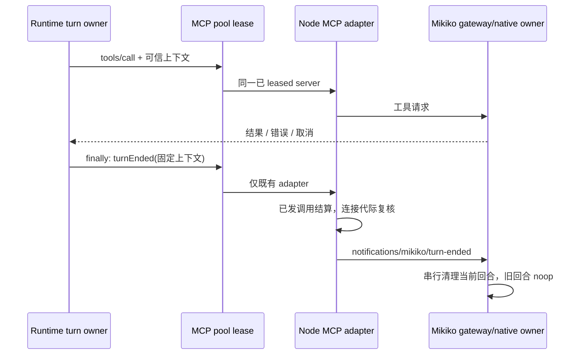

# MCP Minimal Integration

## Goal

Add a minimal Model Context Protocol integration that lets configured MCP servers expose tools to the agent loop. The first version is intentionally narrow:

- Transports: `stdio`, `http`, and `sse`.
- Model-facing tool names: `mcp__<server>__<tool>`.
- Runtime entry: tools are discovered before the first context build in a session.
- UI entry: `/mcp` shows server status and can connect or disconnect a configured server.

Prompts, resources, OAuth, server tool-list change notifications, and MCP server hosting are out of scope for this first version.

## Layering

MCP crosses process and network boundaries, so it is an adapter concern.

- `contracts`: defines MCP config, status, tool descriptors, call results, and the `McpPort` interface.
- `adapters`: owns the MCP SDK clients and transport implementations.
- `core`: converts `McpToolDescriptor` values into normal `ToolEntry` registrations. Core never imports the MCP SDK.
- `bootstrap`: wires config to the adapter and passes the `McpPort` to runtime.
- `cli`: exposes `/mcp` as a command-center command.
- `contextbuilder`: does not call MCP directly. It sees MCP tools only through the normal `ToolRegistry` and context usage accounting.

## Mikiko Computer Use Turn Lifecycle

Runtime 的唯一 turn finally 在成功、失败与取消后调用可选 `McpPort.turnEnded`，与 Browser
清理分别捕获错误，不以清理失败覆盖原 turn。输入来自本轮接纳时固定的可信 trace/session/
turn、workspace identity/path/key、runtimeScope、remoteSessionId、clientMode、deliveryKind；
默认交付字段与 tools/call 一样为 desktop-continuous。通知不继承已经取消的工具 AbortSignal。

Pool 只向当前 lease 已有 entries 转发，不等待/创建新连接。Node MCP adapter 只选择：
serverName=`plugin:computer-use:computer-use`、stdio、source.kind=builtin，以及 Host 在匹配
`computer-use@zcode-plugins-official` 后注入的
`MIKIKO_COMPUTER_USE_BACKEND=open-computer-use`、`MIKIKO_COMPUTER_USE_MODE=production`。
不借用官方账号 auth provenance 作为普通插件的归属声明，不向其他 MCP 发私有方法。

通知 method 为 `notifications/mikiko/turn-ended`，params 为 `{ _meta: mcpRequestMeta(context) }`，
复用 tools/call 的可信 metadata 构造，含 `_meta['com.zcode/request-context']`。adapter 等待
所选 client 已有工具调用 Promise 完成或取消，然后再次核对同 record/client 及 connected
状态，才发送通知；旧连接关闭/替换即跳过，不重连、不重试。Gateway 的单一串行队列负责
在此前工具之后释放当前 turn；迟到旧 turn 不得打断新 turn。模型不能调用或改写此生命周期。

SDK notification 的发送异常不保证自动关闭 transport。若 turn-end 发送失败，仅当 record、
client 与 connection generation 仍匹配发送时快照，adapter 同步发布 disconnected tombstone、
推进既有 App 连接失效代际并通知工具目录变化，再关闭捕获的旧 client/transport。关闭后的
await 不再写 records，不能覆盖期间新建的连接；成功通知不主动断开 gateway。原通知异常
原样交回 Runtime finally，关闭异常另记日志；不重试/重连，后续显式工具调用沿既有连接恢复。



验收：生产选择器和第三方隔离、既有调用与通知顺序、取消后仍清理、连接换代不误投、
lease 已释放/未建连不新建连接，以及真实 Runtime 成功/失败/取消 finally 与清理错误隔离。

## Configuration

Config file shape:

```json
{
  "features": {
    "mcp": true
  },
  "mcp": {
    "servers": {
      "filesystem": {
        "type": "stdio",
        "command": "node",
        "args": ["server.js"],
        "cwd": ".",
        "env": {
          "EXAMPLE": "value"
        },
        "timeoutMs": 30000
      },
      "remote": {
        "type": "http",
        "url": "https://example.com/mcp",
        "headers": {
          "Authorization": "Bearer token"
        },
        "timeoutMs": 30000
      }
    }
  }
}
```

Plugin-provided MCP servers are specified by
[`plugin-compat.md`](plugin-compat.md). They are normalized into the same
`mcp.servers` config shape before runtime startup. Manual user/project MCP
servers win on server-name collisions. Plugin server configs may use Claude
Code's `.mcp.json` wrapper shape and may omit `type` when a `command` is
present; ZCode infers `stdio` in that case.

`features.mcp` defaults to `true`, but no server is connected unless `mcp.servers` is configured. Individual servers may set `enabled: false`.

MCP client initialize 的 `clientInfo.version` 必须使用和 CLI 相同的 app version 来源，即仓库根 `package.json` 注入的版本值。源码测试或未注入 bundle 的直接运行环境可以回退到 `0.0.0`，但不能读取 `packages/adapters/package.json` 之类的 workspace 子包版本。

MCP 协议版本协商必须服从 server 的连接预算：

- `auto` 模式允许 modern probe 失败后回退 legacy，因此 probe 继续使用 `min(5000ms, timeoutMs / 2)`，必须给 legacy initialize 留出预算。
- 显式 modern pin 没有 legacy 回退；probe 就是唯一可用的 initialize 路径，必须使用完整的 `timeoutMs`，不能再套通用 5 秒上限。否则冷启动超过 5 秒的合法 server 会被静默移出工具池，即使它已声明更长的连接预算。
- 外层 connect timeout 仍是总预算与取消边界；pin probe 使用完整预算不代表允许越过 connect timeout。

## Project-Level MCP Config Plan

### Config Model

配置模型的基本形态：

- 配置文件支持 global config 和 project config 合并；project config 会从当前目录向上查找到最近 Git worktree。
- `mcp` 是普通 config section，server name 是 map key，后加载的 config 覆盖同名 server。
- 本地 MCP 用 command array，不通过 shell 字符串；远程 MCP 用 URL / headers / OAuth。
- MCP 工具最终以 server name 为前缀进入 tool pool，并可通过 tool allow/deny pattern 控制。

ZCode 采用“config 先合并，MCP 后连接”的大方向，但 project MCP 有额外安全边界：project config 可能是仓库内容，不能让进入目录本身就静默启动本地进程或发起网络连接。

### Desired Behavior

ZCode CLI/TUI/headless prompt 应自动读取 project-level config，使仓库可以声明自己的 MCP servers。典型形态：

```json
{
  "$schema": "https://zcode.dev/config.json",
  "mcp": {
    "servers": {
      "repo-docs": {
        "type": "stdio",
        "command": "node",
        "args": ["scripts/mcp-docs.js"],
        "cwd": ".",
        "timeoutMs": 30000
      },
      "issue-tracker": {
        "type": "http",
        "url": "https://example.com/mcp",
        "enabled": false
      }
    }
  }
}
```

The first shipped slice should keep the existing global config path unchanged:

- user config: `~/.zcode/cli/config.json`
- explicit project config path: existing `projectConfigPath` option, mostly for tests/embedding

Add automatic project discovery for local CLI/TUI/headless sessions:

1. Starting at `workingDirectory`, find the nearest worktree root by walking upward until a `.git` marker.
2. If no worktree root exists, only inspect `workingDirectory`.
3. Load project config files root-to-cwd, so deeper directory configs override ancestor configs.
4. Do not scan above the worktree root.

Candidate project files, per directory, in increasing precedence:

1. `<dir>/zcode.json`
2. `<dir>/.zcode/config.json`

JSONC support is desirable because users expect comments in config files, but ZCode's current config adapter is JSON-only. Treat `zcode.jsonc` / `.zcode/config.jsonc` as Phase 2 unless the same implementation slice adds a JSONC parser and schema diagnostics.

### Merge Precedence

Effective config order should be:

1. system defaults
2. user config `~/.zcode/cli/config.json`
3. discovered project config files, root-to-cwd
4. explicit project config path, if provided by embedding/tests
5. `ZCODE_*` environment config
6. CLI/session/runtime overrides

This preserves the current rule that env and CLI/session overrides win. It also means project config can override user config for normal preference fields.

Security-sensitive project MCP behavior needs stricter handling than a plain deep merge:

- If `features.mcp` is disabled by env or CLI/session override, project config cannot re-enable it.
- Project-origin MCP servers must carry source metadata internally: config path, scope, and config base directory.
- Relative `cwd` for project-origin MCP servers resolves relative to the project config base directory, not the shell's current directory. For `<dir>/zcode.json`, base is `<dir>`; for `<dir>/.zcode/config.json`, base is `<dir>`.
- Same-name `mcp.servers` entries deep-merge by source order. A project can disable an inherited server with `enabled: false` when the full server type is known. A later slice may add tombstones such as `"server": false` or `{ "enabled": false }` without repeating `type`.

### Trust And Side Effects

Connecting an MCP server is itself a side effect: `stdio` starts a process, and `http` / `sse` can make network requests during connect and tool listing. Project config therefore needs a trust gate before auto-connect.

P0 policy:

- User-configured MCP servers may keep current behavior and auto-connect when MCP is enabled.
- Project-configured MCP servers are discovered and visible in `/mcp list`, but are marked `untrusted` and excluded from startup auto-connect.
- Headless non-interactive runs should fail closed for untrusted project MCP servers: list them as configured but do not connect; model-visible tools should not include them.
- An explicit `/mcp connect <server>` user command may connect a configured project server for the current process.
- A later slice should add a TUI trust prompt and store project MCP trust in local settings keyed by project id plus config file digest, so changing the checked-in config requires re-approval.
- Approval UI must show source path, server names, transport type, command/url, and whether env/header keys are present. It must not print secret values.

This trust gate is separate from normal MCP tool-call permission. Tool calls still go through `mcp` permission even after a server is connected.

### ZCode App-Server Boundary

ZCode app-server sessions are protocol-controlled and already accept `mcpServers` during session setup. Keep the current ZCode app-server rule:

- ZCode app-server `mcpServers` is the complete server set for that ZCode app-server session.
- ZCode app-server should not implicitly merge local user/project MCP config unless a future ZCode app-server option explicitly requests it.
- Empty ZCode app-server `mcpServers` means no MCP servers for that session.

This prevents a generic ZCode protocol client from accidentally enabling repository-local MCP servers.

### Implementation Plan

1. Config discovery
   - Add project config discovery to the config adapter or a small project-config resolver.
   - Reuse Node `path` APIs and worktree-root detection; no shell command is required for P0.
   - Preserve `projectConfigPath` as an explicit override/test hook.

2. Config provenance
   - Extend internal config loading results with source metadata.
   - Normalize project MCP server `cwd` relative to the project config base directory.
   - Keep public `RuntimeConfig` shape stable unless source metadata must cross module boundaries.

3. MCP trust gate
   - Add an internal effective MCP server state that can represent `trusted`, `untrusted`, `disabled`, and `configured`.
   - `/mcp list` should show configured-but-untrusted project servers.
   - P0 permits explicit `/mcp connect <server>` as the user action; a later slice should add persistent trust decisions before connecting.

4. Runtime wiring
   - Pass only trusted/enabled servers into `connectConfiguredServers`.
   - Keep untrusted project servers out of model tool schemas.
   - Log skipped project MCP servers with trace/project/source metadata.

5. CLI/TUI/ZCode app-server surfaces
   - TUI permission prompt for project MCP trust.
   - Headless output should explain why project MCP servers were skipped.
   - ZCode app-server keeps session-supplied MCP behavior unchanged.

### Tests

Minimum coverage for the first implementation slice:

- Config discovery loads `zcode.json` and `.zcode/config.json` from cwd upward to worktree root, root-to-cwd.
- Project config does not scan above the worktree root.
- Project `mcp.servers` merges with user config by server key and later project config wins.
- Relative MCP `cwd` in project config resolves against the config base directory.
- Env/CLI/session `features.mcp: false` prevents project config from enabling MCP.
- Untrusted project MCP servers are listed but not connected or exposed to the model.
- Later trust slice: trusted project MCP servers connect and register tools normally.
- ZCode app-server session `mcpServers` remains a complete override and does not merge project config.
- Later diagnostics slice: invalid project config reports diagnostics with source path and does not silently drop unrelated config.

## Tool Contract

Each MCP tool is projected as a normal tool:

- `name`: `mcp__<normalized-server>__<normalized-tool>`.
- `inputSchema`: MCP `inputSchema`, forced to an object schema if absent.
- `outputSchema`: a stable wrapper containing `content`, optional `structuredContent`, optional `_meta`, and optional `isError`.
- `sideEffectScope`: defaults to `network`.
- `needsApproval`: defaults to `true`.
- `readOnly`: follows MCP `annotations.readOnlyHint`.
- `destructive`: follows MCP `annotations.destructiveHint`.
- `timeout`: defaults to the server config `timeoutMs` when present, otherwise the MCP default. Long-running
  local MCP servers such as simulator/build automation must not be forced into a generic short tool timeout.

This keeps unknown remote behavior visible to permission review. A later version may support project-level allowlists for specific MCP tools.

MCP result content uses the same provider-neutral model content path as built-in tools:

- `text` blocks stay model-visible text.
- `image` blocks with base64 `data` and `mimeType` are projected as model-visible image content blocks, so screenshots from MCP servers can be inspected by vision-capable models.
- unsupported binary blocks such as audio remain short textual placeholders unless a dedicated media pipeline is added.
- `structuredContent` is appended as bounded text after content blocks.

## Command Surface

`/mcp` and `/mcp list` return configured server status:

```text
MCP servers:
- filesystem: connected (2 tools)
- remote: failed (Connection timed out)
- repo-docs: untrusted (Project MCP server requires explicit connection before use.)
```

`/mcp connect <server>` reconnects one configured server. For project-origin MCP servers in P0, this explicit user command is the connection approval for the current process; persistent project trust is a later slice.

`/mcp disconnect <server>` closes one connected server and removes its current tool registrations from future sessions. Dynamic unregistering from the already-built context is not required in the first version.

## TUI Sidebar Projection

The TUI right sidebar shows the same configured MCP server status as `/mcp list`
through the app-level `listMcpServers()` interface:

- The TUI layer treats MCP status as read-only display data. It does not import
  the MCP SDK or adapter implementation and does not connect, disconnect, or
  trust servers from sidebar rendering.
- The sidebar includes configured, disabled, disconnected, connecting,
  connected, failed, and untrusted servers so users can see why MCP tools are or
  are not available.
- The status projection must include server name, transport, status, tool count,
  and a short sanitized error when present. It must not expose header values,
  environment values, tokens, or other secrets.
- Refresh is best-effort and bounded. A refresh failure should not clear the last
  successful server snapshot.
- `/mcp connect <server>` and `/mcp disconnect <server>` remain the command
  surface for state changes; the sidebar only reflects the resulting status.

## Error Handling

- A failed server connection marks only that server as `failed`; other servers may still connect.
- Tool calls against disconnected or failed servers return structured tool errors.
- Adapter errors preserve the original error message for logs and status, but do not expose secrets from configured headers or environment values.
- Timeouts apply to connect, tool listing, and tool calls.

## Tests

Minimum coverage:

- Config parser accepts `stdio`, `http`, and `sse` server shapes.
- Core bridge registers MCP tools with `mcp__server__tool` names and executes through `McpPort`.
- `/mcp list` formats status without submitting a model prompt.
- TUI sidebar renders configured MCP servers and their status through the
  app-level status interface.
