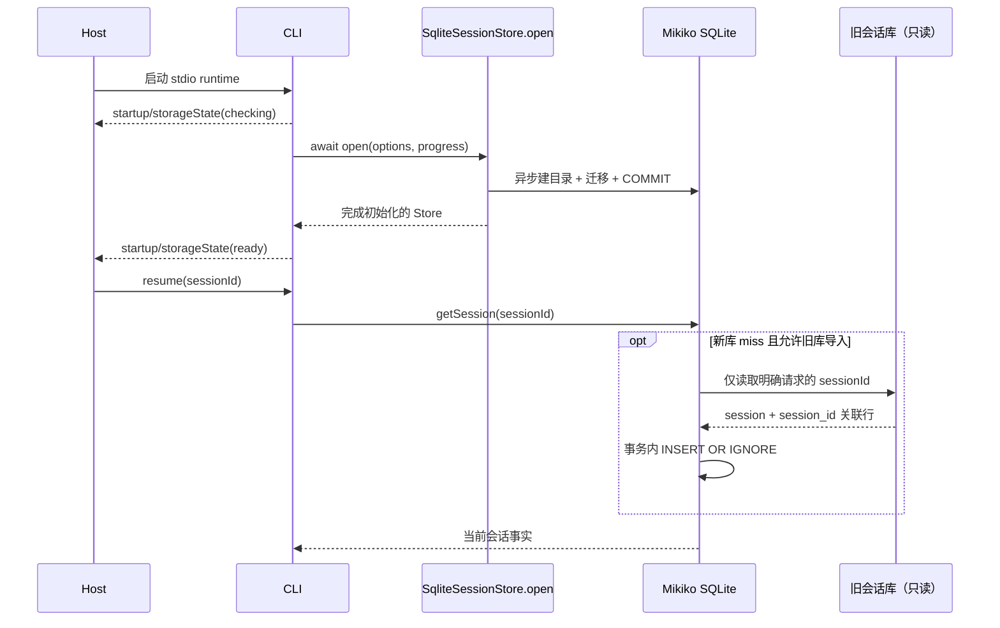
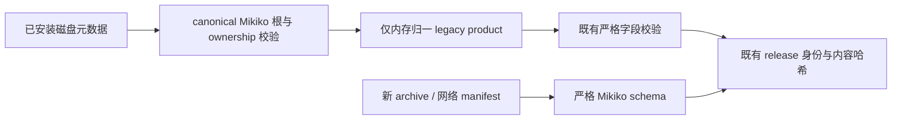

# Mikiko CLI 与 Source Server 的 v3.16 上游集成

## 产品与状态边界

### v3.16.2 修复批次

- Bash 输出沿用上游新的 prepare → 唯一路径发布 → spawn / 后台交接 → close / cancel 清理顺序；独立 tmp 根使用 `mikiko-bash-` 前缀。临时目录不可用时复用原存储根，不改历史输出或已有二开资源隔离。
- Workflow 并发治理器对 Stop 类配额/鉴权失败只结算本次尝试，不把跨小时的 Retry-After 写成桶冷却；继续复用 driver 的同一模型失败策略。停止与子会话只读判定采用上游统一 session-kind 函数。
- 插件 describe/list/overview 不再等待安装下载；仅懒加载写 known/manifest 的分支取得现有 storage lock。保留 Mikiko manifest 优先级与品牌目录，协议字段仍严格校验。
- 远端/Server 发行的 Agent 组件独立包含 `packages/bundled-skills`，不挂靠插件组件，也不让插件刷新覆盖技能包；内容哈希、复用与开发态上传必须覆盖该资产。
- 接纳 Linux glibc 前置检测、service manager 真实 Version 响应探测与有界管道清理、POSIX launcher 的物理路径归一；新的错误文案与文件路径仍使用 Mikiko。

- 合入上游异步 SQLite 打开与迁移、模型异常诊断和 Source Server 生命周期协议；保留 Mikiko 空回最多 5 次重试、单次流重复退化护栏、按需只读导入旧会话和启动存储守门器语义。
- `SqliteSessionStore.open` / `createSqliteSessionStore` 是建库与迁移的异步唯一入口；构造器只接收完成迁移的连接，不对外暴露半初始化实例。旧会话库路径解析必须在私有构造器中初始化，不能因改用异步工厂而丢失。
- 旧库只在明确请求的 sessionId 在新库缺失时读取；按列交集、事务与幂等插入迁入新库，后续写入只发生在 `.mikiko`。不扫描或整库迁移官方数据。
- Source Server 的 supervisor 拥有进程与升级事务；core 拥有运行中的服务；desktop attachment 通过现有 Source Server 传输连接，不另起手机 runtime。手机维持 Mikiko 自建远控，不采用 Relay V2。
- 所有新产品默认 env、数据路径、可执行文件、release 文件和后台服务名使用 Mikiko。内部 `@zcode` 包作用域与 TypeScript 协议符号不做无关重命名；官方 CodingPlan 接口保留账号与业务兼容性。
- Server 产品标识为 `mikiko-server`，默认目录 `~/.mikiko/server`，命令 `bin/mikiko`，归档 `mikiko-server-<target>.tar.gz`，环境变量前缀 `MIKIKO_SERVER_`。旧产品路径不得成为新写入或新安装目标；如兼容旧安装，只能显式发现与迁移。
- 更新与资产源必须由自建服务或显式配置提供；不能静默回退官方 ZCode 云端。插件元数据的历史兼容读取必须与新产品写入路径区分。
- 内置插件展示作者使用 Mikiko；图标与 icon-sources 默认从 `https://agent-dl.mikiko.ai/mikiko/official-plugin/assets` 获取。发布必须上传对应静态资产，客户端不以官方 CDN 兜底。第三方插件显式声明的来源不重写。
- Office 等新内置插件向 stdio 进程注入 `MIKIKO_PLUGIN_ROOT`、`MIKIKO_PLUGIN_DATA`、`MIKIKO_PROJECT_DIR`；历史 ZCode/Claude 模板仍可解析，用于旧插件兼容。新插件声明与 runtime 使用 Mikiko 键，staging 必须同时校验 Mikiko 和旧模板引用，禁止因品牌替换漏验 MCP 入口。
- 四个新 Office 插件的自有 manifest 目录为 `.mikiko-plugin`。插件发现、市场元数据、技能归属、zip 根识别、seed 与 runtime 重写、SEA 与远端发布均优先该目录，再只读兼容 `.zcode-plugin` / `.claude-plugin` / `.codex-plugin`。保持历史 marketplace ID 与安装开关，不能因目录更名生成第二个安装身份；新 Office 发布包只包含 Mikiko manifest，不双写历史目录。
- 插件目录发现与 manifest 读取/校验归入既有 `adapters/plugins/helpers.ts`；官方缓存目录读取归入持有 bundled/CDN 分片合同的 `official-marketplace.ts`，`index.ts` 只负责发现结果装配。沿用原有诊断、取消与分片优先级，不改变同步发现接口或新增存储写入路径。

## 事件顺序



## 验收

### 自建 Source Server 发行与恢复发布

`stage:remote-assets` 是四个 POSIX target（linux-x64、linux-arm64、darwin-x64、darwin-arm64）
的归档及 descriptor 唯一构建 owner。正式发布 job 在同一 tag/commit 构建一次，保留完整归档、
组件包、descriptor 与 `source-server-build.json`（sourceRunId/commit/tag/version）；恢复从原 run
下载该 artifact 并验证身份，不重编译、不混用其他 run 的四平台产物。

Publisher 先按 shared 的严格 descriptor schema、Server CLI 的严格 runtime/catalog schema 校验
完整四 target、版本、文件名、SHA/大小及归档内 manifest。每个 runtime manifest 的组件包必须存在，
组件传输 SHA 现场计算并与原有组件内容身份分开；新包不走 installed legacy decoder。
所有预检成功后才经既有 update Worker `/admin/files` 或 multipart 接口上传，令牌沿用
`UPDATE_PUBLISH_TOKEN`，重试/分片与 desktop feed 共用一份传输模块。

| 消费者 | 默认 URL | R2 key |
| --- | --- | --- |
| Desktop 版本索引 | `https://agent-dl.mikiko.ai/mikiko/electron/releases/<version>/source-server-release.json` | `mikiko/electron/releases/<version>/source-server-release.json` |
| CLI 默认更新目录 | `https://agent-dl.mikiko.ai/mikiko/server/catalog.json` | `mikiko/server/catalog.json` |
| 归档/组件/manifest | 上述版本根下按 SHA 寻址 | `mikiko/electron/releases/<version>/objects/<sha>/<filename>` |

两个索引只投影同一已验证的四 target 集合，不另建版本事实。所有对象上传后经下载域读回校验，
再发布版本 descriptor，最后单次 PUT 原子替换 CLI catalog；中途失败不推进索引。
SHA 对象不可变；两个可变索引不能用 immutable 年缓存。同版本恢复/重建不覆盖旧 SHA 对象。
CLI 未设置 `MIKIKO_SERVER_RELEASE_MANIFEST_URL` 时使用默认目录；显式空字符串继续表示离线 pending 模式。
本机 HTTP fixture 覆盖鉴权、真实分片、重试、读回、失败不发布索引、版本/来源混用拒绝与原 run 恢复。

### 既有 Mikiko Server 安装的品牌元数据兼容

旧 custom 版本在 `.mikiko/server/install.json` 与已安装 release 的 `manifest.json` 中写过
`product: "zcode-server"`。兼容只发生在已安装磁盘元数据读取边界：实际 canonical 路径必须属于
`.mikiko/server`，ownership 的 installationId、schemaVersion、canonicalServerRoot 等继续严格验证；
release 必须位于其 `releases/` 内并通过既有内容/身份哈希验证。只在内存把旧 product 归一为
`mikiko-server`，不改写旧磁盘字节、installationId 或时间，不扫描/导入 `.zcode/server`。
其他产品、未知字段、坏 ownership 或越界/symlink 路径仍拒绝。

新版 ownership 与发行 manifest 只写 Mikiko。新 archive、网络下载 manifest 与组件准入仍用
严格 `serverRuntimeManifestSchema`，不能调用 installed legacy 读取器。



1. 当前 schema 新建、历史 schema 升级、锁等待/迁移失败、启动进度保持上游测试；未迁移连接不可被 Repo 获得。
2. 惰性回迁覆盖行完整、只读旧库、幂等、显式禁用、环境路径与当前库同路径禁用；测试必须使用异步工厂。
3. 空回最后一次预算恢复、compact 流例外、重复退化不重试及 core 裁剪告警仍通过。
4. Source Server 安装、连接、busy 阻止升级、空闲升级交接、代理 stdio、服务注册、归档校验使用 Mikiko 产品路径与名字。
5. 兼容测试同时保留上游新协议行为与二开品牌断言，不恢复上游已被新生命周期替代的废弃部署路径。
6. 类型、Lint、架构检查和受影响测试实际运行；跨包仍在合并或运行环境不足时明确记录阻塞，不宣称通过。

### CLI 环境与 Office 网络资源品牌边界

环境解析默认接受 MIKIKO_*；只为已有安装保留 ZCODE_* 读取，新值始终优先，与 env 枚举顺序无关。显式自定义 prefix 只读取指定命名空间。Message 开关和 debug 网络捕获的手写读取遵守相同优先级，不增加新的配置 owner。新生成的诊断 env 只输出 Mikiko。
Office 字体统一从自建 agent-dl.mikiko.ai/mikiko/office-skill/fonts 获取，不回退官方 CDN。历史 font_list 的系统绝对路径只在构造下载 URL 时去掉 /usr/share/fonts/truetype/ 前缀，本地存在检查保持原语义。WebFetch User-Agent 联系地址为 mikiko.ai。验收覆盖新旧 env 优先级、实际 HTTP 请求头、绝对/相对/括号字体路径的实际 shell URL 构造。自建字体对象尚未发布时属于发行准备限制，不以官方回退掩盖。

### 字体发行准备（本轮不向生产上传）

代码已统一自建 CDN，但仓库不含字体源包或字体发布产物；本轮对新地址的只读探测为 HTTP 404，
不能宣称字体安装下载已在线可用。发行负责人需先收集许可允许分发且与 font_list.txt 一致的字体，
按去掉 `/usr/share/fonts/truetype/` 后的目录布局上传至现有 Update Worker，目标 R2 前缀为
`mikiko/office-skill/fonts/`。单个字体可以使用已有 `/admin/files/<key>` 传输契约：

```bash
curl --fail-with-body --request PUT \
  --header "x-publish-token: $UPDATE_PUBLISH_TOKEN" \
  --header 'content-type: application/octet-stream' \
  --data-binary '@NotoSansSC[wght].ttf' \
  'https://agent-update.mikiko.ai/admin/files/mikiko/office-skill/fonts/chinese/NotoSansSC%5Bwght%5D.ttf'
```

上传后逐项从下载域读回验证字体字节与 SHA256，Windows/macOS 安装脚本在干净机器复验。
本地回归真实执行 Bash URL 构造（绝对/相对/空格/括号路径），并从脚本抽取原 curl 命令对本地 HTTP 字体服务实际下载、核对文件字节；Windows 分支验证相同契约文本；
本机未运行 PowerShell 或全局字体安装，不等同 Windows 实机安装通过。

CLI 测试准入：browser-use-plugin 的 Vitest 入口明确筛选 `test/`，避免字符串 test 同时命中 `tests/` 下 Node 原生测试；后者继续通过 `test:external-cdp` / `test:external-cdp-cache` 运行。全量验收同时覆盖两种引擎，CLI/TUI 使用原参数并限制 Node test-concurrency，Office 独立 Vitest 不遗漏。

官方 CodingPlan CLI OAuth 是账号体系例外：`loginZCodeCli` 的 init/poll 使用 shared `resolveCodingPlanEndpointOrigin`，自建产品默认不得进入自建云 API；显式调用 baseUrl 和既有环境测试覆盖继续生效。既有默认 OAuth init 回归必须保持官方 zcode.z.ai 断言，不能为通过测试改成自建地址。

附加 workspace 的 subagent 扫描与主 workspace 同用 `.mikiko/agents`，保留原目录限定名、去重和项目级权限过滤，不能由新 additionalDirectories 分支恢复 `.zcode` 产品目录。

本轮测试入口盘点同时纳入10个既有源码旁 Vitest 文件（adapters/bootstrap/core 的 src/），不能仅因不在 test/tests 目录而漏跑；CLI mode-menu 用 Vitest，SEA Office 资产用 Node，默认test均串入。测试 wrapper 为嵌套工作区补外层 .bin，并将 Turbo 默认跨包并发限制为1、Vitest 默认1worker、Node runner并发2（显式调度参数优先）；最终默认命令执行 pretest模型映射构建、依赖build及全部runner；定向预验用--only复用已验证fresh build。

CLI 首屏品牌：空会话六行终端字标必须显示 MIKIKO，与 Starting Mikiko 文案一致；保留原居中、shimmer、短终端布局及空/非空会话切换。历史内部常量名不构成产品展示，不借此调整协议或业务状态。

SEA 发行版本：Browser Use 的 package、plugin manifest、official definition 与 SEA plugin table 必须同为0.5.2；版本不一致会让发行后的runtime seed精确匹配失败，不能只修测试期望。Office manifest读取验收Mic新路径，保留其他已安装插件兼容ID。

真实IO整组资源准入：同包2worker仍会让插件市场完整布局、expert workflow三项触及原5s时限；plugins完整79项及adapters完整158文件在1worker下通过。wrapper因此默认Vitest1worker、Turbo逐包，保留调用者显式worker覆盖；没有改产品等待、用例断言或原5s时限。Bootstrap整组及最终默认链的实际结果记录在验收报告。
