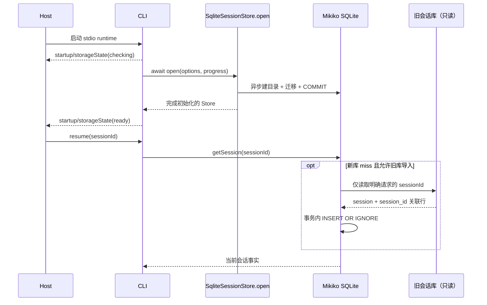
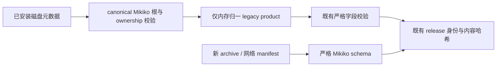

# Mikiko CLI 与 Source Server 的 v3.16 上游集成

## 产品与状态边界

- 合入上游异步 SQLite 打开与迁移、模型异常诊断和 Source Server 生命周期协议；保留 Mikiko 空回最多 5 次重试、单次流重复退化护栏、按需只读导入旧会话和启动存储守门器语义。
- `SqliteSessionStore.open` / `createSqliteSessionStore` 是建库与迁移的异步唯一入口；构造器只接收完成迁移的连接，不对外暴露半初始化实例。旧会话库路径解析必须在私有构造器中初始化，不能因改用异步工厂而丢失。
- 旧库只在明确请求的 sessionId 在新库缺失时读取；按列交集、事务与幂等插入迁入新库，后续写入只发生在 `.mikiko`。不扫描或整库迁移官方数据。
- Source Server 的 supervisor 拥有进程与升级事务；core 拥有运行中的服务；desktop attachment 通过现有 Source Server 传输连接，不另起手机 runtime。手机维持 Mikiko 自建远控，不采用 Relay V2。
- 所有新产品默认 env、数据路径、可执行文件、release 文件和后台服务名使用 Mikiko。内部 `@zcode` 包作用域与 TypeScript 协议符号不做无关重命名；官方 CodingPlan 接口保留账号与业务兼容性。
- Server 产品标识为 `mikiko-server`，默认目录 `~/.mikiko/server`，命令 `bin/mikiko`，归档 `mikiko-server-<target>.tar.gz`，环境变量前缀 `MIKIKO_SERVER_`。旧产品路径不得成为新写入或新安装目标；如兼容旧安装，只能显式发现与迁移。
- 更新与资产源必须由自建服务或显式配置提供；不能静默回退官方 ZCode 云端。插件元数据的历史兼容读取必须与新产品写入路径区分。
- 内置插件展示作者使用 Mikiko；图标与 icon-sources 默认从 `https://agent-dl.mikiko.ai/mikiko/official-plugin/assets` 获取。发布必须上传对应静态资产，客户端不以官方 CDN 兜底。第三方插件显式声明的来源不重写。
- Office 等新内置插件向 stdio 进程注入 `MIKIKO_PLUGIN_ROOT`、`MIKIKO_PLUGIN_DATA`、`MIKIKO_PROJECT_DIR`；历史 ZCode/Claude 模板仍可解析，用于旧插件兼容。新插件声明与 runtime 使用 Mikiko 键，staging 必须同时校验 Mikiko 和旧模板引用，禁止因品牌替换漏验 MCP 入口。
- 四个新 Office 插件的自有 manifest 目录为 `.mikiko-plugin`。插件发现、市场元数据、技能归属、zip 根识别、seed 与 runtime 重写、SEA 与远端发布均优先该目录，再只读兼容 `.zcode-plugin` / `.claude-plugin` / `.codex-plugin`。保持历史 marketplace ID 与安装开关，不能因目录更名生成第二个安装身份；新 Office 发布包只包含 Mikiko manifest，不双写历史目录。
- 插件目录发现与 manifest 读取/校验归入既有 `adapters/plugins/helpers.ts`；官方缓存目录读取归入持有 bundled/CDN 分片合同的 `official-marketplace.ts`，`index.ts` 只负责发现结果装配。沿用原有诊断、取消与分片优先级，不改变同步发现接口或新增存储写入路径。

## 事件顺序

## 验收

### 既有 Mikiko Server 安装的品牌元数据兼容

旧 custom 版本在 `.mikiko/server/install.json` 与已安装 release 的 `manifest.json` 中写过
`product: "zcode-server"`。兼容只发生在已安装磁盘元数据读取边界：实际 canonical 路径必须属于
`.mikiko/server`，ownership 的 installationId、schemaVersion、canonicalServerRoot 等继续严格验证；
release 必须位于其 `releases/` 内并通过既有内容/身份哈希验证。只在内存把旧 product 归一为
`mikiko-server`，不改写旧磁盘字节、installationId 或时间，不扫描/导入 `.zcode/server`。
其他产品、未知字段、坏 ownership 或越界/symlink 路径仍拒绝。

新版 ownership 与发行 manifest 只写 Mikiko。新 archive、网络下载 manifest 与组件准入仍用
严格 `serverRuntimeManifestSchema`，不能调用 installed legacy 读取器。

1. 当前 schema 新建、历史 schema 升级、锁等待/迁移失败、启动进度保持上游测试；未迁移连接不可被 Repo 获得。
2. 惰性回迁覆盖行完整、只读旧库、幂等、显式禁用、环境路径与当前库同路径禁用；测试必须使用异步工厂。
3. 空回最后一次预算恢复、compact 流例外、重复退化不重试及 core 裁剪告警仍通过。
4. Source Server 安装、连接、busy 阻止升级、空闲升级交接、代理 stdio、服务注册、归档校验使用 Mikiko 产品路径与名字。
5. 兼容测试同时保留上游新协议行为与二开品牌断言，不恢复上游已被新生命周期替代的废弃部署路径。
6. 类型、Lint、架构检查和受影响测试实际运行；跨包仍在合并或运行环境不足时明确记录阻塞，不宣称通过。
