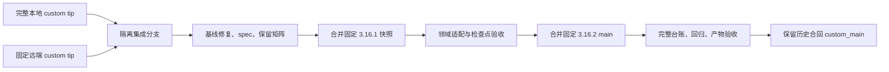
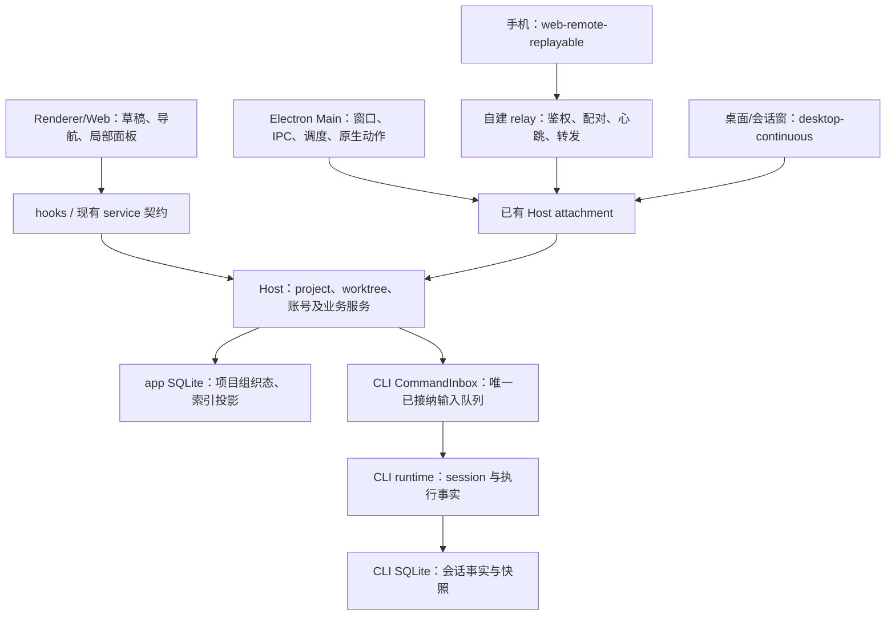
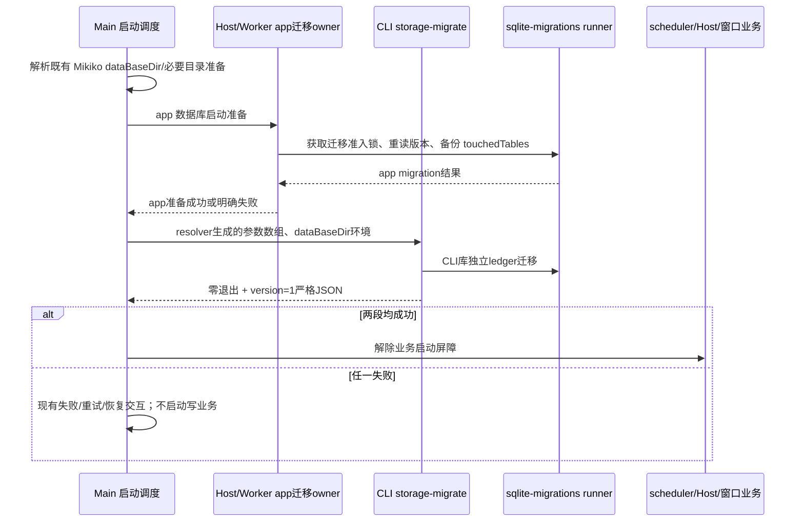

# 上游 v3.16.2 合入 custom_main 完整技术方案

日期：2026-10-20。状态：方案完成，尚未实施功能合入。

**目标：** 将 main 的 3.15.1 → 3.16.2 累计需求和修复应用到 Mikiko custom_main，保留全部已确认的二开功能、品牌约定和历史行为修复，通过可追踪台账及实际测试证明交付范围。

**架构：** 从完整 custom_main 建立隔离集成分支，收齐远端定制提交，采用保留祖先关系的三方合并，按 3.16.1 / 3.16.2 两个检查点推进。以新项目/远程/存储的唯一 owner 承接二开能力，保持自建账号、远控、更新与云端服务合同，不并存重复权威状态。

**技术栈：** 当前仓库 TypeScript、Electron、React、Zustand、Node SQLite、现有 RPC/CLI 协议、Vitest、Node Test、WebdriverIO；Node 24.14.0、pnpm 10.33.2（mise.toml）。不为本次合入引入另一套运行框架。

配套执行计划：[integration-plan.md](./2026-10-20-upstream-v3.16.2-integration-plan.md)。场景与覆盖要求：[integration-cases.md](./2026-10-20-upstream-v3.16.2-integration-cases.md)。既有评估文档只作调查参考，本方案中的保留规则、路径分类和验证门槛更具体，实际实现前按本方案回写对应 spec。

## 1. 把握、范围与交付口径

### 1.1 可执行性判断

有把握完成这次工程集成。主要风险已明确到模块、冲突路径、持久化规则和服务合同；当前没有证据表明需要重做整个二开产品。无法在实现和回归之前保证零缺陷，也不把 Git 无冲突、类型通过或截图正常等同于功能完整。

本任务的可信交付条件是：上游变更有去向、二开行为有保留落点、数据迁移可恢复、关键交互有非 UI 证据、受影响运行模式有真实执行记录。遇到设计冲突时缩小为具体决策，不通过不断增加 fallback、轮询或第二套状态维持表面可用。

### 1.2 输入与已核实基线

| 输入         | 固定提交                                 | 事实                                                  |
| ------------ | ---------------------------------------- | ----------------------------------------------------- |
| 上游共同基线 | a443dc3984908f22d123891b04de9b73137982f4 | 产品 3.15.1                                           |
| 上游检查点 1 | 0a1fc56d                                 | 产品 3.16.1，源码同步快照                             |
| 上游检查点 2 | 075fde8429f15bc5baa018f4605ea776770dbf8d | main / origin/main，产品 3.16.2；含 3c5b2276 同步提交 |
| 本地二开     | 6c8f13930b3912096a071913cbc787dc7c21d674 | Mikiko 1.1.3；相对上游 ahead 177 / behind 3           |
| 远端二开     | 6fd01b00f42ce35e9335109e31a138f733f2242c | 本地相对它 ahead 30 / behind 4                        |

上轮无工作区合并演算确认：本地二开与 main 有 162 个冲突路径，138 条内容冲突、24 条修改/删除冲突；本地与远端 custom 的演算无文本冲突。正式实施先重新 fetch 和固定 SHA，之后报告不得混用移动分支与固定输入。

路径台账以共同基线、`git diff --no-renames --name-status` 为口径：上游 4,623 路径、二开 7,699 路径、交集 459、并集 11,863；二开其中 6,134 个是已跟踪 Web dist-pages 产物。数字不是功能数；最终冲突量需在收齐远端 custom 后重算。

### 1.3 授权范围与默认产品规则

- 本轮交付技术方案、执行计划、验收场景；不在撰写文档时开始正式合并、改生产数据或发版。
- 实施默认保留所有已确认二开能力和历史修复。移动入口可接受，删除能力须明确登记并获得对应产品决定。
- main 新增和修复全部进入审查范围。不能因为自建服务不同而整域标记“无需处理”；逐项采用、适配、等效证明或登记未解决项。
- 不主动恢复开源快照中缺失的内部依赖。CUA 两侧实际包都是 fail-closed placeholder，不将迁移文档误读为完整 CUA 已可用。
- 保留当前未跟踪文档和其他工作树；不自动清理构建产物、调试文件或其他任务改动。

## 2. 技术路线与分支策略

### 2.1 方案比较

| 路线                            | 优点                                                 | 主要问题                                                     | 结论                   |
| ------------------------------- | ---------------------------------------------------- | ------------------------------------------------------------ | ---------------------- |
| custom 基础上正常三方 merge     | 保留历史与共同祖先，后续同步可追踪；二开完整输入不丢 | 需要一次系统性语义适配                                       | 推荐                   |
| main 基础上重放/rebase 二开历史 | 表面线性                                             | 相同组件被多次修改、修复互相依赖，会重复解冲突并重做定制     | 不采用                 |
| cherry-pick/复制少数修复        | 可处理独立紧急补丁                                   | 上游是源码快照，没有需求级提交粒度，易漏依赖和未显式冲突变化 | 只用于后续明确的小补丁 |

Git 官方 merge 文档说明正常 merge 记录共同历史；merge-tree 可不改 index/worktree 做演算；worktree 用于独立检出。官方源码文档已核对：[merge](https://github.com/git/git/blob/master/Documentation/git-merge.adoc)、[merge-tree](https://github.com/git/git/blob/master/Documentation/git-merge-tree.adoc)、[worktree](https://github.com/git/git/blob/master/Documentation/git-worktree.adoc)。不采用 squash 集成，以免丢失本次上游祖先关系。

### 2.2 分支与隔离

从实施时固定的完整本地 custom tip 创建 `codex/integrate-upstream-v3.16.2`。先检查本聊天已附着 worktree，优先复用适合本任务的独立检出；不复用已有 notary-candidates 工作树。确需新建时使用 Codex 管理工作树，并显式指定 custom SHA，避免工具默认从 main 起步。

隔离工作树不携带未提交文件。原目录中的方案文档、local-mac-build.md 及其他未跟踪内容只复制明确属于本任务的部分，不使用 `git add .` 或自动 stash 全部文件。

在集成分支合并固定 origin/custom_main tip，保留两个父提交。基线检查失败的原因是已分叉，不能通过 reset、改 upstream 或禁用检查伪装为新鲜；收齐后在集成检出重新检查，并记录“无跟踪分支/特性分支”场景的真实检查范围。

每个合并期间先按领域解决冲突、补齐文档和测试，最后形成完整 merge commit；不能在 MERGE_HEAD 未结束时把分领域普通提交当作完整合并。若隔离分支已形成仅供本任务的合并候选，可在其后用小提交修复，未达门槛的候选不得进入 custom_main 或发布。

3.16.1 检查点用于缩小结构重构与最后一轮修复的定位范围。已明确由 3.16.2 解决的上游问题可登记为中间已知项，不能伪造通过或为让中间版本过关再发明重复补丁；数据丢失、越权、身份串用和破坏迁移的错误不得带入下一检查点。

## 3. 防遗漏的三张台账

| 台账         | 最小字段                                                                        | 关闭条件                                                                            |
| ------------ | ------------------------------------------------------------------------------- | ----------------------------------------------------------------------------------- |
| 上游变更去向 | 固定 SHA、路径/需求 ID、旧行为、新行为、依赖、处理分类、最终落点、测试/运行证据 | adopted / adapted / already-equivalent / intentionally-excluded；排除项须有明确决定 |
| 二开保留矩阵 | spec/历史提交、入口、行为、不变量、唯一 owner、迁移落点、场景 ID                | retained / relocated / intentionally-retired；默认不得 retired                      |
| 文件审查表   | base→main、base→custom、rename 对照、文本冲突、领域、语义结论、测试结果         | 并集每条都有结论；自动合并路径不能自动标完成                                        |

正文覆盖已确认的领域，文件台账用机器数据保证输入不漏；两者必须关联，不能用“每个文件都看过”替代业务用例。构建产物单列后仍保留记录；为每个上游删除/重命名入口登记二开语义的替代位置。

实施产物建议保存为 `docs/testing/upstream-v3.16.2-integration/` 下的来源 manifest、功能去向表、二开保留表、文件审查表和 validation-report.md。这些是将创建的本任务资产，不假定仓库已有生成命令；不得将运行结果、凭据或个人数据库提交进 Git。

“完成”需满足：输入覆盖率 100%，关键场景通过率 100%，P0/P1 遗留缺陷 0，所有未测/排除项有明确范围与理由。未运行的平台不算通过；P0 环境缺失时保留工程成果并报告交付限制，不宣布全平台验收完成。

## 4. 目标架构与状态所有者

| 状态/事实                                    | 唯一 owner                              | 其他层允许行为                                         |
| -------------------------------------------- | --------------------------------------- | ------------------------------------------------------ |
| 未提交正文/模型/权限/Plan/工作位置意图       | 各 scope Composer/store                 | 草稿恢复不能覆盖当前编辑；Recent 只在接纳后更新        |
| accepted 输入与 FIFO                         | CLI/runtime CommandInbox                | UI 只保留 pending optimistic overlay；Host 只路由      |
| title、created/updated、lastOutcome、deleted | CLI；Host task-facts 摄入投影           | 不用 Host 时钟覆盖 CLI 事实；每个 await 后核验代际     |
| project/roots、组织归属、pin/archive/read    | 持库 Host 的项目/索引服务               | UI 通过公开 hooks/服务发命令，不直接操作 Repo          |
| worktree 注册表与创建/删除                   | WorktreeService                         | project/sidebar 只消费投影；Git 分支真值按现有服务对账 |
| provider/站点配置与凭据                      | 现有账号、provider、credential 服务     | UI 不复制 token；刷新轮换落盘与配置串行写保持          |
| 窗口/原生应用检测/更新安装                   | Main 对应模块                           | IPlatformService/IPC 访问；不直调 window.zcode         |
| 远控 transport/配对                          | 现有自建 relay 与客户端 transport owner | 不复制 accepted queue、snapshot 或任务事实             |
| tabs/guest 生命周期                          | 窗口内 pane owner + 既有 guest lease    | 同 Host 两个窗口面板独立；不能把一次打开变两份 runtime |

### 4.1 领域上下文与依赖方向

每次产品代码修改前执行 architecture-governance：先 `pnpm architecture:check --changed`，再对实际 policy 中的模块生成 `architecture:context <module-id>`。当前 policy 已有 shared/services/session/storage/ui/desktop/server/relay-server/zcode-cli 等模块，main 新 managed 模块以合并后的 policy 为准，不猜 module-id。

依赖保持 UI → hooks/services → application/domain/adapters；跨包用公开入口。新 project-storage 的内部文件不得成为其他服务或 UI 的快捷依赖。不能通过修改架构 baseline、批量 lint 白名单或恢复移除依赖绕过合入失败。

## 5. 领域适配设计

### 5.1 项目侧栏、工作树与任务导航

采用上游 project-sidebar 和 Host 项目组织态，迁移旧侧栏中的二开行为，不保留两套组织树。重点源入口：WorkspaceSidebarItem、WorkspaceGroupedTasksSection、WorkspacePinnedTasksSection、useWorkspaceTaskLists；目标模块是 main 的 `packages/ui/src/project-sidebar/` 及 services project/project-storage。

工作树仍是独立执行 workspace。根项目展示聚合不能改写工作树 task 的真实 cwd、workspaceIdentity、会话 ID、CLI 数据归属或 lease。优先使用上游目录解析/归属契约；如果它不能表达现有“显示层并入根项目但执行不变”，先在 spec 定义投影扩展，再通过公开 contract 实现，不在 UI 猜路径或制造第二份 task。

保留项目完整路径/复制/打开、置顶项目→会话层级、右键菜单、分支徽标和当前会话高亮、工作树管理、新建分支搜索、归档总览及拖出开窗。上游 pin 功能存在不代表满足现有层级展示；逐项验证后才可标 already-equivalent。

普通“删除项目”按上游合同不删除会话；“删除工作树”继续按二开已确认规则确认受影响历史并执行原工作树清理。两种动作入口、确认内容和服务调用不可混淆。跨 Host 移动拒绝；移动项目归属不改已创建 session cwd。

项目主要目录失效时，禁止新建/文件树但可看历史；不能通过重建目录或回落另一目录制造新执行位置。旧远端没有 virtualProjects 能力时只用上游单 root 只读适配，不把读适配变成本机权威项目。

### 5.2 未读、蓝点与多窗口角标

采用上游 tasks-index `unreadAt` → ProjectTree 的单一事实投影，不继续维护旧 renderer unread map 作为第二权威。任务去重使用上游的 hostId + `(workspaceIdentity?.trim() || workspacePath)` + taskId，项目可见性与实际侧栏分区一致，不能让已删除项目或孤儿任务制造幽灵角标。

二开历史合同中的后台终态、归档清除、远控断连、双窗口去重都必须重新映射。Main 聚合不能因主窗口/独立窗口共享同一树而把同一任务累计两遍；保留现有 workspace 集合去重的有效语义，必要的聚合合同调整先更新 unread-badge spec 和 IPC schema，再实现。禁止用 max(所有窗口) 粗暴代替集合并集。

离线远端的未读展示若与上游新缓存合同冲突，记录为产品决策；不得为了维持数字复制过期业务事实。场景 UNT-04 未确定前不能宣称旧断连语义已等效。

### 5.3 Composer、模型目录、语音、统计与工作位置

上游模型/Effort 合并菜单及响应式行为接入现有目录 owner。保留 MikikoCC、Sub2API、ChatGPT 分组、provider 级 contextWindow/maxOutputTokens 覆盖、当前密钥与模型请求鉴权；自动化记录、Subagent Markdown、会话模型仍写各自落点。

新项目草稿/Recent 与 worktreeDraftStore 明确分工：项目 scope 持有创建意图，执行位置在首条发送前由 WorktreeService/prepareSession 确定，Submission 冻结完整配置后进入唯一 admission。选择新建工作树时不能在根 checkout 提前预热一个真实执行 session。

语音按钮、设备/麦克风权限、转写/LLM 整理、会话统计仍在普通/窄屏/完整视图 Composer 可达。取消语音不发送；整理不能覆盖用户后续编辑；统计以原 CLI 投影为准，不因新渲染树重复计算。

### 5.4 独立会话窗口与 Side Pane 完整视图

最新合同：独立窗口优先附着来源窗口已有 Host，使用 desktop-continuous；面板在本窗口本地渲染，仅现行 spec 保留的 automations 主视图动作转发。不能照搬早期“独立 Host”或“全部转发主窗口”的旧段落。

完整视图是同窗口布局变化，与独立原生窗口共存。文件/审查/辅助对话/浏览器/终端继续按 workspace + ownerTaskId 隔离，主窗口切换任务不改变会话窗口面板。关闭独立窗口销毁它的 renderer/attachment，不关闭来源 Host、不在后续 Dock/通知唤起时复活。

现有“来源 Host 已不存在”的降级分支仅按当前有效合同处理；不借合入扩大到任意 attachment 失败就新建 Host。runtime 来源或 lease 失效时撤销 guest 请求，迟到连接不能给新 owner 签发页面。

### 5.5 自建远控与上游 Relay V2

保持当前自建后端与 Mikiko ID 账号设备能力作为默认生产主链。二开 `/api/rc/*` 与上游 `/api/v1/remote/*`、`ws2` 的字段、认证、token 生命周期不等价，不并发装配两个 transport，不把 URL 替换当协议适配。

上游变化逐项分解：设备展示、错误呈现、取消/重连/迟到结果防护、OAuth 完成事件、HTTP 响应扩展字段兼容等可迁移行为，映射到当前 transport；SID/一次性 token 专属变化标为需协议对照。已经等效必须有用例证据，无法等效而又需引入的功能列为未解决需求，不能把整套 V2 静默 excluded。

初始方案不新增 wire 路由或改变已部署服务 schema；如果审查发现上游用户需求必须依赖 V2 服务端能力，则提交独立 client/server 迁移子方案，定义设备/凭据迁移与兼容窗口。未经对应决定不取消现有 P2P、账号直连或扫码能力。

### 5.6 远端 Source Server、版本与发行包

采用上游 sourceServerId、Connection Profile、兼容 manifest、daemon/adapter 主链，保留已确认的身份隔离、owner 路由和 provisioning 方向。SSH/WSL/Docker 每种传输从探测→安装/更新→握手→workspace→恢复逐段验证。

Mikiko 产品版本暂保留 1.1.3 作为集成基线，不在合并时自动变成 3.16.2 或直接打 1.2.0；具体下次发行号在产物验收时确定。来源版本与提交写入集成 manifest。产品版本、minCompatibleVersion、Server archive 描述及客户端期望必须在同一版本体系内构建，不能将 1.x 控制端与官方 3.x 门槛混用。

远端历史 `.zcode/server`、服务名/管道/产物名是 surface-rebrand 明确保留的兼容边界；本次默认不更名。新发行包的路径、文件名、sha256、target 列表遵循现有 schema，不通过放宽校验接纳错误包。旧 server 缺兼容字段时按上游升级/只读能力合同呈现，不能强制返回 compatible=true。

### 5.7 文件打开、插件、Office 与浏览器

将上游 fileApplications 与二开 fileOpenApps/fileOpenAppConfig 融合到一个 Main 应用检测/打开链路，保留默认应用、格式规则、顺序/去重及 Cmd/Ctrl 行为。远端路径不交给本地格式阅读器；取消保存不报成功；SVG 等图片下载保留原始字节。

Office runtime、查看面板、插件项目覆盖/全局安装、后台 guest 保活与 MCP 连接屏障整体接入。生产插件构建和占位 CUA 分开验证，不能从文档推断缺失内部能力可用。项目暂停不等于卸载；卸载的内置插件重启不能自动复活；恢复只触及目标 scope。

外部 CDP 设置、连接失败不阻塞新会话、能力提示词和隔离规则保留。浏览器 guest 的后台执行由已有 page owner 管理，不增加全局保活历史 session 的扫描器。

### 5.8 品牌、设置、皮肤、桌宠与云端服务

品牌审查覆盖新增文件、自动合并文件、复制的构建脚本/测试夹具和 UI 资产。按当前 surface-rebrand、agent-prompt-naming、outbound-user-agent 等 spec 分类，禁止整份 i18n“custom 值全胜”：同 key 如包含新插值参数/语义变化，保留新契约再改产品名，双语结构/参数集合一致。

设置重组保留账号、用量、工作树、归档、语音、桌宠、皮肤入口；皮肤 token 在新壳、完整视图和独立窗口生效，主题/语言广播防回环。文件规则、宠物原生窗口与麦克风 API 保持跨平台守卫。

mikiko-cloud、relay-server、update-service、官网、反馈账户化和分享继续保留，并检查 accessor/node/platform/renderer 注入和构建脚本真的引用它们。磁盘上还存在文件不算服务仍可达。

上游营销/遥测入口按现有产品关闭规则评估，不能因 merge 重新激活自有产品不采用的请求。确有业务用途的上游第三方端点按各自供应商合同处理，不把所有 z.ai 请求代理到 Mikiko 而改变含义。

### 5.9 自动更新、依赖与 CI

上游更新生命周期修复接入现有 autoUpdater，保留自建 feed、per-arch manifest、release notes、下载域名和恢复发布流程。ready 包、最新目标包、锁定安装包分别按上游 owner 管理；preparing 后迟到检查不得改变锁定目标，失败恢复不能重复重启。

先解决 package.json/pnpm-workspace、overrides、patches 和二开 workspace importer，再在隔离环境用固定 pnpm 重建 lockfile；禁止只取 main lockfile 并寄望 install 自动还原所有二开版本/patch 意图。重新生成后 frozen-lockfile 安装必须通过。

合并 root typecheck、verify:pre-push、prepare/build:cua 等脚本时保留 main 新检查与二开云端/relay 检查的并集。新增 source-size/lint/架构规则冲突优先局部拆职责，不批量加豁免或刷新 baseline。macOS 签名、公证恢复、feed multipart 重试独立回归，不在普通 build 中触发生产发布。

## 6. 持久化、迁移顺序与数据恢复

### 6.1 数据路径分类

| 类型                                           | 本次规则                                                                         |
| ---------------------------------------------- | -------------------------------------------------------------------------------- |
| 本地 Host/CLI 业务数据库、配置、工作树、备份   | 继续使用当前 Mikiko 路径解析入口，修正上游新文件硬编码；不得打开另一品牌的用户库 |
| 新 SQL 中 `.zcode/workspace/*` 分类表达式      | 按真实 Mikiko 默认目录合同适配，覆盖 default/worktree/普通目录/历史异常数据      |
| 已部署远端 `.zcode/server`、进程服务名、产物名 | 按当前兼容白名单保留；不得与本地业务路径一刀切处理                               |
| CUA/第三方/测试内部标识                        | 按现行明确例外保留，不作为品牌漏改自动修复                                       |
| 新临时文件/插件导入文件                        | 复用现有 temp/path owner，按本品牌规则分类，异步文件 IO                          |

### 6.2 启动事件顺序

目录准备只解决当前品牌路径和已存在的兼容规则，不新增全量 `.zcode → .mikiko` 迁移器。两个库不是跨进程原子事务：app 已完成、CLI 失败时，重试依赖每库 ledger，不能把前段成功撤回成未执行。

### 6.3 数据模型与幂等规则

采用 main 已有 project-storage schema 的 hosts/projects/project*roots/remote_project_entries 和 tasks 组织/cli*\* 列，不自行复制另一份 schema。组织写入不改 CLI 时间/title/deleted，CLI 投影不改 pin/archive/read/project。

旧 settings 保留项目首次转换遵循上游合同：不从全部历史 tasks 或磁盘目录猜项目，不擅自归位未分类任务，不把远端入口缓存转成本机权威项目。工作树展示聚合在这一转换上显式加适配，不能让 SQL 按相同路径合并跨 Host 身份。

迁移 runner 使用现有锁、touchedTables、ledger、校验和与备份元数据。已发布 SQL/checksum 不修改，品牌路径相关差异在首次引入本品牌版本前明确定义；如历史数据库已经记账，只能追加 migration，不能改旧 SQL 然后忽略 checksum。未来未知 ID、校验和冲突和降级按原 fail-closed 合同处理。

生产/个人真实数据不作开发夹具。匿名化旧版数据副本、合成数据和临时目录分别验证迁移前后 session ID、正文哈希、cwd、归属、pin/archive/unread、provider 配置及工作树注册表。

### 6.4 回滚

Git 回退不等于数据回退。每个检查点记录代码 SHA、构建版本、运行环境、迁移 ledger 和可恢复备份。涉及备份的数据库先关闭所有写进程/连接，采用一致性 SQLite 备份或既有 runner 导出，不在 WAL 写入期间单独复制主 db 文件。

开发集成失败可在隔离检出 abort 未完成 merge 或退回仅属于本任务的检查点。对已升级测试数据按既有 restore 合同恢复并验证后再用旧程序打开。正式用户升级后的数据不盲目降级；既有备份可能只含 touchedTables，不能当作完整 profile 回滚包，发布前必须验证完整恢复范围。

## 7. 跨组件异常、接口及安全

本方案优先复用已有接口，不在技术文档中发明新的公开 DTO。新方法/字段如确需引入，先写到 shared/service contract、运行时 schema 和对应 spec，旧客户端读取策略及错误传播一并定义。

| 链路                      | 契约与关键身份                                                                          | 超时/取消/重试/幂等                                                           | 失败处理                                                                        |
| ------------------------- | --------------------------------------------------------------------------------------- | ----------------------------------------------------------------------------- | ------------------------------------------------------------------------------- |
| Composer → Host → CLI     | 现有 ConversationCommand；commandId、workspaceIdentity、remoteSessionId、revision/lease | 沿现有命令准入；非幂等命令不在 UI 静默重发；迟到 ACK 核对 scope               | 保留草稿/pending 反馈，不能制造已接纳事实                                       |
| Host project 服务         | 现有 readTree/prepareSession/move 等；host/project/cwd                                  | prepareSession 复检目录；重试不覆盖已决定归属；读投影不触发 Agent             | 错误到 UI，不改 cwd、不重建缺失目录                                             |
| Main/Worker/CLI migration | resolver 参数数组、指定数据根、version=1 JSON                                           | 沿既有锁/ledger，不加按数据库大小猜测的迁移截止时间或超时重启循环             | 屏障失败，不启动业务写者；保留备份/恢复入口                                     |
| 自建 relay HTTP/WS        | 当前 /api/rc 路由、OIDC 身份、device/session/token                                      | 使用既有 transport 预算/取消/退避；不叠加 UI 重试器；认领和连接按既有幂等边界 | 区分 401 登录失效、403 权限、404 设备未就绪、网络失败；不因普通网络错清所有账号 |
| Source Server             | manifest、sourceServerId、profile/remote identity                                       | 复用连接管理器取消/重连与兼容判断；await 后核对代际                           | 显式离线/需升级/身份冲突；不路由到同路径另一设备                                |
| Sub2API/OIDC              | 现有服务的 credential key 和站点身份                                                    | 保留服务现有请求预算、refresh轮换落盘及串行配置写；不能在外层复制刷新循环     | 登录/同步失败明确可见，余额刷新不得覆盖新配置                                   |
| 文件/guest/平台           | IPlatformService、文件scope、lease和连接身份                                            | 沿既有 cancellation、guest admission；同逻辑键共用一次初始化                  | 取消不提示成功；旧文件/owner结果不得写新面板                                    |
| feed/下载/安装            | 当前自建更新端点、版本、sha256、target                                                  | 不并发下载，锁定ready后不等待后台manifest；发布沿恢复产物验证                 | 网络错与安装错分开；保留可恢复状态并防止重复重启                                |

本轮不新增生产超时常量。实施核对每个被改写调用点的真实常量和值，将差异写入功能台账；不凭文档给现有系统另套默认预算。

日志复用 UI logger 和 createServiceLogger。生命周期/迁移结果用 info，高频帧/chunk 用 debug，恢复性错误 warn，不可恢复鉴权/握手错误 error。记录 scope/代际/错误码等必要诊断，不记录 token、票据、授权头、完整个人正文或真实内部地址。

账号、设备、workspace 隔离测试必须包含异账号设备及相同 path 不同 identity 的拒绝场景。源码清单和备份不包含生产凭据；已有凭据通过 credentialService 原加密途径访问，不为测试导出明文。

## 8. 兼容性矩阵

| 场景                   | 设计与证明要求                                                                                            |
| ---------------------- | --------------------------------------------------------------------------------------------------------- |
| 新老服务端并存         | 默认自建 relay API 不变；Source Server 按 profile、能力与 manifest 判断，不能因为一个设备升级改变其他设备 |
| 数据库升级             | 匿名化旧版本副本迁移，保留CLI事实/组织态、校验和、备份与幂等；未知未来库拒绝写                            |
| 新服务端 + 老客户端    | 不以此次客户端集成偷偷改变已部署自建 API；需新 server 能力时单独约定旧协议兼容与升级入口                  |
| 新客户端 + 老服务端    | 旧 remote virtualProjects 单root只读/升级合同；缺失新字段不伪造可写能力，不绕过兼容检查                   |
| 新旧客户端共用本地数据 | 不宣称旧程序可安全打开升级库；先停旧写者，按降级合同验证；回退恢复备份后再启动旧版                        |
| 策略/配置前向兼容      | 沿已有 schema 的 strict/扩展字段政策逐接口审查；不能从某HTTP响应宽松解析推导所有wire字段可宽松            |
| 定制化与平台兼容       | Mikiko品牌/数据/账号/更新/工作树/窗口/皮肤等保留；macOS/Windows/Linux与Web/手机模式分别覆盖               |

## 9. 验证、性能与交付门禁

### 9.1 已有基线记录

上轮已实际执行，尚无产品代码改动：typecheck 在 mikiko-cloud/src/worker.ts:205 TS2345 失败；lint exit 0、137 warnings、0 errors；architecture changed 检查 0 violations。当前 freshness 再次执行仍因 custom 分叉失败。

实施先在收齐 custom 后重跑并保存完整日志。基线问题单独修复并给回归依据，不把现有失败写成合入引入，也不带着失败报告“检查全绿”。已知 worker 故障需定位真实控制流后修复，不能只用 `!` 压掉类型错误。

### 9.2 测试层次

1. 静态/来源：固定SHA、全量台账、rename、品牌分类、service接线、schema与架构。
2. 单元：新adapter/选择/去重/迁移过滤/owner guard，先观察有意义的失败，再适配实现；原测试不可仅因文件被删就删除产品断言。
3. 集成：真实SQLite迁移、真实CLI协议与service装配、测试relay/OIDC合同和guest lease；测试依赖失败与用户动作并发。
4. E2E：按附录场景更新case catalog/coverage matrix后落地，遵循现有pending→manual review→fixture→promotion。UI必须同时断言runtime/protocol/files/network至少一层。
5. 产物：二开Desktop/Web/Server构建，分别验证身份/域名/架构/包元数据/签名流程；构建成功不等同已签名、已公证或已发布。

命令和入口详见执行计划。root test:unit 不代表 CLI、relay、cloud 所有套件已覆盖；CLI沿其 turbo脚本运行，二开包沿各自当前 package.json 补跑。CLI/远程/真机权限/生产账号缺环境时分类为 not-run/blocked，不用 mock 冒称真实链路。

### 9.3 性能预算（拟定验收门槛，不是现测结果）

对同机器、同匿名夹具、同构建类型，在基线和候选各做至少5次采样，比较中位数和P95；公开记录样本量，不把5个样本声称成稳定统计分布。首启迁移与正常冷启分开，禁用自动归档/网络等非受控变化或同等配置。

- 非迁移冷启、首次侧栏可交互、切任务、打开独立窗口的中位数相对基线回退超过20%必须解释/修复；不得用延时掩盖准备不足。
- 10,000任务合成夹具检查侧栏虚拟化与历史查询；任何卡死、任务丢失、O(n)全量磁盘扫描进入频繁render都阻断交付。
- 连续20次开关独立窗口/插件面板后，活动Host/Agent/attachment/guest数量须回到合法基线；RSS与句柄残留单独观察，不能只凭GC前后单点下泄漏结论。
- 迁移耗时、峰值内存、备份字节、SQL锁等待实测后填入验证报告，不虚构TB级或万用户容量数据。本次不新增云端部署容量，180天SaaS存储成本模型不适用；新Office依赖体积及Web产物大小与基线比较并报告。

### 9.4 最终门禁

固定上游tip是集成HEAD祖先；完整custom输入亦为祖先；无未解决冲突；台账无pending；P0/P1缺陷0；typecheck/lint/架构/合后schema检查及真实受影响单元/集成/E2E通过；未测环境清单明确；二开服务与构建/发布恢复能力可达；数据恢复演练成功。

上游已知P2问题或产品允许的排除不能自动放行，必须在报告说明受影响用户、原因、处理方案及对应决定。报告本轮覆盖与限制，不承诺“所有历史功能绝不受影响”。

## 10. 分阶段验证与发布恢复

| 阶段          | 范围                                 | 进入下一阶段条件                                  | 失败动作                                                        |
| ------------- | ------------------------------------ | ------------------------------------------------- | --------------------------------------------------------------- |
| S0 方案/基线  | 文档、隔离检出、收齐custom、基线修复 | 固定输入、已知失败可解释、恢复点齐全              | 留在隔离分支，不碰原检出                                        |
| S1 结构集成   | 3.16.1与最高风险owner/迁移           | 不存在数据/身份P0，领域测试完成，中间已知项有归属 | abort未完成merge或回任务检查点；恢复夹具                        |
| S2 完整集成   | 3.16.2最终修复及全部二开             | 完整静态/单元/集成、核心E2E、台账收口             | 隔离修复，不发布                                                |
| S3 安装包验证 | 测试profile、测试设备、受控账号      | 核心交互/迁移/恢复/跨平台证据完整                 | 保留旧产物，恢复测试数据；不用生产用户做迁移试验                |
| S4 正式发版   | 按现有release流程                    | 发行号、manifest、产物、签名/公证和发布记录明确   | 撤回/停止新feed目标并按已有恢复流程处理；代码回退与数据恢复分开 |

不假设已有百分比灰度或生产feature flag服务。默认通过测试profile和独立候选产物验证，不能为“灰度”临时引入双栈业务状态。正式发布是单独动作，技术方案和本轮文档不触发部署。

## 11. 风险、决策与工作拆分

| 风险                             | 概率/影响判断     | 应对                                                            | 执行责任           |
| -------------------------------- | ----------------- | --------------------------------------------------------------- | ------------------ |
| 自动合并吞掉品牌/路径/二开接线   | 高/高             | 全量并集台账+新增路径审查+可达性/E2E                            | 实施者负责逐项证据 |
| 项目迁移误归属或丢历史           | 中/极高           | 新旧快照对账、只用副本、checksum/ledger与恢复演练               | 存储适配任务       |
| 多窗口/手机产生双owner或重复未读 | 中/高             | 单Host/队列不变量、双模式/双窗口并发测试                        | 协议与UI任务       |
| Relay V2与自建服务不兼容         | 已确认合同不同/高 | 固定现有生产合同、逐项功能适配；需要新后端则独立设计            | 远控任务           |
| 新检查脚本漏掉二开或靠豁免过关   | 中/高             | scripts/deps/patches并集、补跑CLI/relay/cloud、禁止批量弱化门禁 | 工具链任务         |

可直接按授权推进：隔离/备份/基线修复、保留历史merge、现有合同的适配与回归、保留品牌和二开。

需要发现具体冲突后再定、但不阻塞本技术文档的事项：离线远端未读语义若与新目录模型冲突；上游不可在现有relay上等效的用户能力；新Source Server实际发行包与最低兼容版本；下一次对外发行号。记录候选、影响、推荐值与验收，不能在代码里默认删掉能力。没有取消决定时继续采用保留原则。

实现由当前任务按执行计划逐项完成；文档不假定额外人员或并行agent资源。工作量主要在语义移植和回归，不能根据162个冲突给出固定完成承诺；每个检查点以完成证据报告进展，运行时长/平台资源需求实测后更新。

## 12. 交付自检

- [x] 固定版本、源码输入与现有失败已列明。
- [x] 方案选择、Git历史、隔离和未跟踪文件规则已定义。
- [x] UI/Host/CLI/Main/relay所有者与事件顺序已画图。
- [x] 每个主要领域的二开保留与上游适配方向已定义。
- [x] 本地数据路径和远端兼容白名单已区分。
- [x] 迁移、重试、幂等、错误传播、备份及恢复边界已定义。
- [x] 测试层次、具体执行任务、场景矩阵与验收证据已配套。
- [x] 未确认产品冲突、未测环境及性能拟定门槛明确标注。
- [ ] 尚未进行正式源码合并、迁移测试或安装包验收；这些属于后续实施交付。
