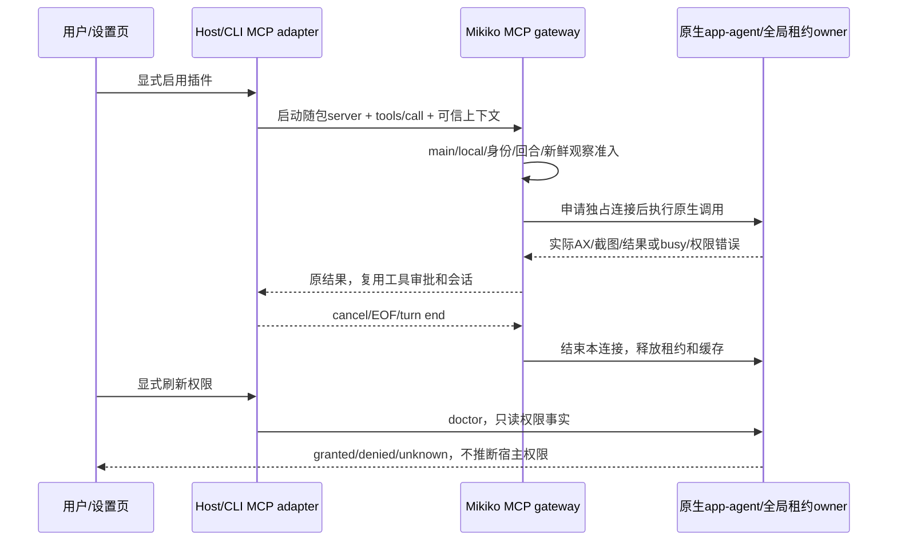

# Mikiko Computer Use 正式集成实施计划

**Goal:** 用户已批准将正式随包集成及真实测试纳入 v1.1.4，版本未创建 tag 前完成集成与验收。
**Architecture:** 复用独立 Mikiko MCP gateway 和固定 OCU 原生源码，采用原生 App-agent 的单一控制租约；MCP adapter 注入可信 session/workspace/turn 上下文，复用现有工具审批。内置插件和权限页接入新后端，保留官方占位包的 unavailable 事实。
**Tech Stack:** TypeScript、现有 MCP SDK、Swift 6.2、macOS 14+、Electron builder/GitHub Actions。

## 方案选择

1. 推荐：原生 Mikiko 后端 + 独立 MCP tools + 现有插件启用态/权限 UI。最少协议翻译，原生结果和截图直接返回，模型通过技能使用新工具。
2. 仿制官方 NodeRepl producer：需要完整重做帧 authority/PiP/窗口协议，容易出现虚假兼容，放弃。
3. 继续仅独立预览：不能满足本次随包交付要求，放弃。

## 产品规则与所有者

- macOS 14+ arm64/x64 随包构建、签名、公证；Windows/Linux 本次不提供该后端，保留明确不可用状态，不影响普通功能。
- `Mikiko Computer Use.app`/`mikiko-computer-use` 独立稳定品牌身份。开发和正式身份隔离；不复用原预览授权冒充正式权限。
- Host/CLI 是会话和可信调用上下文所有者，原生 app-agent 是全局控制租约唯一所有者。不同窗口/Host/会话不得同时控制；竞争立即返回 busy，无超时偷取租约。结束回合/stop/EOF/取消释放连接；动作绝不重试。
- 插件默认关闭，用户显式开启后发现工具。生产版可发现本机应用；工具仍经过既有 MCP 审批。目标动作必须有本回合完整观察，不允许 global/sky/virtual-display 模式。
- 仅本机主会话 desktop-continuous；子代理、远程 workspace、手机 replayable 调用明确拒绝。不新增 Agent/Host，保留所有远控链路边界。
- 权限状态只采集此后端的 doctor/app-agent 真值；设置页通过 service/hook 显示。用户点击授权时可打开对应系统设置并展示准确 app 路径；不改 TCC，不伪造授权或截图。
- `~/.mikiko` 数据根和 `.mikikoignore` 不变。新配置放 `~/.mikiko/computer-use`，日志不记窗口/屏幕内容。

## 任务与验证

1. 回滚锚点：已创建 `33a8ccde`，包含此前全部已验证源码和独立预览；不重打 tag。
2. 原生与打包：builder 增加正式模式、稳定身份、架构验证；electron-builder 和 release workflow 唯一构建链带入签名原包。先写 builder/资源合同测试；原生租约必须有竞争/断开释放测试证据。
3. Gateway：补生产发现、上下文隔离、观察新鲜度、stop/取消等测试，再实现公开 API。独立预览默认规则不放宽。
4. Host/插件/权限：增加公开 adapter，复用 computer-use 插件 enabled 状态；新后端走新技能与 MCP，旧官方 SDK 文档不向新后端发送不支持的指令。缺包/低版本/权限缺失有明确 UI。
5. 真实验收：受控 Cocoa fixture 观察、真实 screenshot、AX set_value 后 fixture 读回、click/keyboard、busy/取消/关闭。新 Mikiko app 自身缺 OS 授权时立即请求用户手动授权，并继续其他独立任务；授权未到不得发布。
6. 验证：根 typecheck/lint/架构、相关包 tests、CLI caller tests、Electron 交互 E2E；全仓原有通过证据不覆盖本次新增行为。提交后 clean pre-push。
7. 发布：只在上述完成后推送 custom_main/v1.1.4；按既有发布恢复合同跟踪两架构公证、官网和五平台更新，保存最终验收报告。
