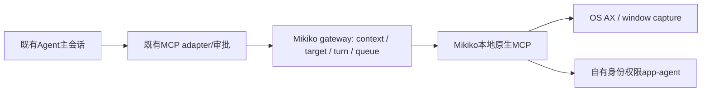

# Mikiko Open Computer Use 技术方案与实施计划

**Goal:** 用可重编译的本地开源后端验证电脑控制，替代对不可获取的官方 producer 的依赖。
**Architecture:** 第一阶段为独立、显式启用的 MCP 预览插件。既有 Host/CLI 负责会话和工具审批，Mikiko gateway 负责上下文、目标、串行准入与生命周期，OCU 负责原生 AX/截图/动作。
**Tech Stack:** TypeScript、现有 MCP SDK、Node 24、Swift 6.2、macOS 14+。

## 1. 已确认事实与目标

回滚锚点 `c41c6ba7f9cde785276c329f2394bbdfa3c9de05` 已在实践前创建，工作区当时干净。需求来源为用户指定的 https://github.com/iFurySt/open-computer-use 。研究固定提交 `43eb4b53de7a15b3f99ec2c9922bedeb95602266`，MIT，Copyright 2026 Leo；Swift 依赖 libwebp-Xcode 1.6.0，revision `2b5256c29ff4e20f2a0d5ee863b62b1a22144434`。

源码/原生探测确认 macOS 11 个工具：list_apps、get_app_state、click、perform_secondary_action、scroll、drag、type_text、press_key、set_value、select_text、query。Windows/Linux 各9个，处于实验阶段。原生 MCP 使用2025-03-26，构建前文档所称“9+query”不能作为实际工具数依据。

本机 Swift debug/release 已真实构建，help/doctor JSON/initialize/tools/list 通过。诊断曾返回 allGranted=true，但这是禁 app-agent 代理时的运行环境快照，不能证明 Mikiko 新身份获授权。完整原生操作必须单独核验。

验收目标：可复现构建自有身份；MCP发现与真实工具链路；受控窗口观察/输入/读回；缺权限、取消、跨上下文和危险模式明确拒绝；可回滚，不改变项目数据根目录。

## 2. 技术选择

| 方案                              | 收益                                                              | 缺口                                                                                                                      | 结论                 |
| --------------------------------- | ----------------------------------------------------------------- | ------------------------------------------------------------------------------------------------------------------------- | -------------------- |
| 独立本地 MCP 插件                 | 复用已存在的MCP传输、图片和审批；上游原生接口可直接验证；影响最小 | 初期独立配置；原内置按钮不代表此插件；完整全局lease仍需Host扩展                                                           | 先实施受控预览       |
| 仿制官方@zcode/zcode-cua producer | 原UI/NodeREPL表面兼容                                             | state_id、截图authority、possibly_sent、防重放、动态app授权、controller lease、PiP、kill switch等并不兼容；不能只改工具名 | 不作为首轮实践       |
| 独立Host原生backend port          | 可统一权限、控制权、回合cleanup并保留旧后端                       | 涉及shared/services/Main/CLI/UI边界与旧签名producer双栈                                                                   | 正式产品阶段推荐方向 |

原始MCP离散工具是上游提供的标准接入方式。复用它，避免新增第二个任意JS执行器。当前node_repl已有自己的generation/scope合同，不能让OCU JS facade绕进旧官方bridge。

## 3. 首轮边界与架构

新包 `packages/computer-use-open`，自有插件ID `mikiko-computer-use`。默认不加入官方内置种子，不自动修改用户MCP设置或其他Agent配置。构建后提供本地插件清单和可导入MCP配置，isolation=session。

MCP gateway验证既有adapter注入的 `com.zcode/request-context`：main、session_id、workspace identity/path、turn_id、desktop-continuous；子代理和remote/replayable失败。参数里的同名字段不能改变身份。每实例只绑定一个session/workspace；所有原生请求串行。同回合有观察后才允许动作，新turn先结束旧native状态，重新观察；EOF/取消/超时关闭原生连接，副作用不重试。

预览只操作显式目标allowlist，默认不允许任何目标；不暴露无约束应用枚举。拒绝global/sky输入和agent_display，不启用视觉cursor、LockedUse、Guardian、授权插件或root服务。预览不宣称具备生产级跨进程独占控制；首轮实际验证限定自有测试应用。正式允许多个会话控制普通应用之前，必须新增Host单一控制owner及跨进程lease，不能把MCP session isolation当作物理桌面独占。

## 4. 权限、身份与打包

macOS权限归LaunchServices启动的原生app-agent。App display为Mikiko Computer Use Dev，bundle ID `dev.mikiko.computer-use.development`，可执行文件 `mikiko-computer-use`。PermissionSupport中的认可ID/显示名/发现规则与Info.plist一致，不能只重命名外壳。进程socket使用独立Mikiko namespace，避免连接/结束用户独立安装的OCU。

配置通过映射指向 `~/.mikiko/computer-use/config.json`。业务 `~/.mikiko/v2` / `~/.mikiko/cli` 不改。原SDK占位标记和内置构建可用性检测保持真实；MCP预览与原内置“电脑控制”按钮分别描述。

构建脚本固定远端与commit，使用忽略的本地cache，校验来源，生成明确provenance。自行编译应用，保留MIT与实际依赖声明。上游存在提取自其他产品的cursor参考图，本预览不复制/分发这些图，不使用其cursor资源。正式发行需Developer ID签名/公证和升级权限回归；预览ad-hoc身份只代表本地开发。

permission-required、binary-missing、protocol-error、scope-denied、target-denied、stale-turn、cancelled/disposed分别明确传播。doctor退出0仍必须检查权限字段。真实系统授权由用户完成；不修改TCC数据库、不借用官方签名。

## 5. 生命周期和异常

| 触发                        | 处理                                   | 重试                  |
| --------------------------- | -------------------------------------- | --------------------- |
| 未观察直接动作/新turn旧元素 | 本地拒绝，要求新观察                   | 不自动重放            |
| session/workspace变化       | 拒绝复用本实例                         | 使用新session隔离连接 |
| scope/目标/危险模式不符     | 本地拒绝，原生调用为零                 | 不重试                |
| native工具错误              | 原始MCP错误/结果透传                   | 不重试动作            |
| timeout/cancel/断链         | 关闭本实例原生连接并使controller失效   | 新连接需重新观察      |
| 正常EOF                     | 结束native session，回收本进程拥有资源 | 不启动新Host/Agent    |

MCP没有现成的Mikiko turn-complete外发钩子。预览通过turn_id切换强制新观察，关闭虚拟显示/视觉cursor来排除回合残留；不能据此声称即时turn-end已完整实现。正式阶段将runtime turn-complete/cancel/session-close向backend通知，并在native cleanup确认后归还Host lease。崩溃和强杀下的收尾需单独验证。

## 6. 正式接入阶段

1. Host新增ComputerUseBackendOwner，统一global lease、目标app授权、取消和stale-generation；协议继承workspaceIdentity/remoteSessionId，不按路径冒认远端。
2. 独立backend状态 binary-missing/runtime-unavailable/permission-required/ready/error，Main调度与权限桥；UI经hooks和IPlatformService访问，不直接启动进程。
3. 真实可用后再接NodeRepl port；官方方法映射逐项设计，缺少的list_windows/paste/request_access/stop及帧、防重放合同不得伪装成功。
4. macOS版本地板14，不复用原官方12；Windows签名/UIA、LinuxAT-SPI/GUI session/Wayland分别验证。手机仅附着原Host，仍分continuous/replayable；首轮预览不放开手机控制。

无新数据库或云端服务。没有新模型费用，截图和AX随既有模型请求使用；推理成本由用户原模型选择决定，本轮不调用付费模型。构建耗时、运行延迟以实测记录，未验证指标不编造。主要风险：OS权限/签名归属、私有截图SPI兼容、控制权与清理、上游实验性平台；分别以独立身份probe、版本测试、Host lease和平台分阶段验收处理。

## 7. 实施计划与测试

1. 已完成：锚点commit、固定源码、license/架构/Swift构建和协议研究。
2. `scripts/build-mikiko-computer-use.mjs`：固定源码/品牌overlay/构建/自有app/NOTICE/provenance；失败不写用户设置。命令 `mise exec -- node scripts/build-mikiko-computer-use.mjs`。
3. `packages/computer-use-open`：先写context/target/turn/cancel/serialization测试，再实现controller与MCP stdio adapter；managed module五件套；SDK真实client→gateway→假native及原生集成。
4. 本地插件/配置示例与可复现smoke脚本：initialize、tools/list、受控应用AX/screenshot与set_value读回；测试数据不落入会话/用户配置；权限阻塞如实记录。
5. 根typecheck/lint/architecture、原占位契约回归；本地实验无默认启用。交付完整技术方案、源码、构建产物定位、真实验收/未覆盖项。

回滚：停预览连接，移除其MCP配置或插件，删除本地生成cache/app；代码退回c41c6ba7。系统授权如用户已手动授予，可在系统设置移除相应Mikiko app；不批量回滚用户其他设置。

## 8. 本轮实施结果

已交付原生品牌 patch/可复现 builder、自有签名开发应用、MCP gateway、默认空目标配置、受控 Cocoa fixture 与 smoke runner。预览只接受绝对本地 workspace_path，提供 identity/key 时必须与路径相等；不自行解析或构造远程身份。已退役回合被拒绝。动作必须有本回合成功的 get_app_state；query 不替代完整观察，AX 动作需 AX，drag 需真正返回的截图。任何原生工具错误会撤销该目标的动作准入。

自动化共38项通过，根类型检查通过，Lint为0错误/174条现有警告。真实工具链路发现10个预览工具成功，首次窗口观察被新 Mikiko 应用的辅助功能权限阻塞，真实截图和输入尚不能记为通过。最终原生构建标识 `7ff118070543ba2998ddc91c66d227e0f05a5d905c987b7cf6e367a8aa64cb49`，源码、补丁、可执行hash及签名已校验。完整结果和重放入口见 [实践验收](../testing/mikiko-open-computer-use-2026-10-21.md)；配置与操作见 [预览README](../../packages/computer-use-open/README.md)。
