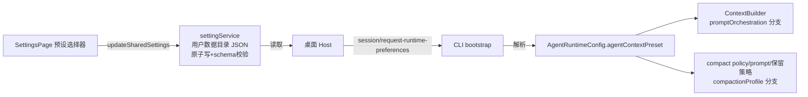

# 会话缓存命中率与会话压缩：Mikiko × DeepSeek Harness × Codex 三方对比与预设方案

- 日期：2026-10-21
- 状态：调研结论 + 方案设计；**已实施**（见 `docs/specs/agent-context-preset.md`），真实模型实测结论见 `docs/analysis/2026-10-21-agent-context-preset-bench-results.md`
- 证据版本：
  - Mikiko/ZCode：`custom_main @ 9602416f`
  - DeepSeek Harness（dsh）：`v0.2.1-rc.2 @ 687f282e86`（本地路径 `~/Documents/Projects/ClientProjects/deepseek-harness`）
  - OpenAI Codex：`27065a91cc`（本地路径 `~/Documents/Projects/RustProjects/Public/codex`）
- 所有三方结论均来自本地源码阅读，关键断言附 `file:line`；外部仓库引用带仓库名前缀。

---

## 0. 结论先行（TL;DR）

**命中率 85% vs 95% 的差距不是单一 bug，而是「全量缓存失效事件」的发生频率问题。** 按影响排序，Mikiko 的结构性原因：

1. **压缩事件的全量重写 + 阈值 100% 触发导致的连环压缩**。每次压缩 `replaceMessages` 重建历史，下一主轮请求只有 tools+system 前缀能命中；且压缩在窗口几乎写满（100%）时才触发，压缩后摘要+保留轮经常仍超阈值，`willRetriggerNextTurn` 连环再压（`compact-active.ts:624-627`），一次任务里可能连续多次全量重写。
2. **缓存 TTL 过期**。Anthropic 风格断点 TTL 约 5 分钟（GLM 端点行为待实测），交互式使用中用户两次输入间隔常超 5 分钟，过期轮 cacheRead≈0。竞品同样有 TTL，但 DSH 把「变化频率」压到了最低，单轮 miss 后的恢复成本低；更关键的是 Codex 的请求级 `prompt_cache_key` + 会话亲和路由。
3. **会话内模型切换**。模型名写在 dynamic system block 内（`env-info.ts:92-95`），切换即改写 system → 从 system 起全部失效；切到异构 provider 还会触发 reasoning 历史归一化改写（`reasoning-history-normalization.ts:31-48`）。多数 provider 缓存按模型隔离，切模型本身必然 miss，此项主要伤害「切回」场景。
4. **tools 数组中途变化**（MCP `tools/list_changed` 每回合检查、ToolSearch native 发现即扩容）。Anthropic 语义下 tools 位于请求最前，任何变化全量失效。
5. **口径因素**：短会话拉低聚合值（首请求 0% 命中）；压缩 sidecar 请求（高命中）不计入统计而压缩后首轮（大额 write）计入。

**压缩后失忆是四个收敛设计叠加的直接结果，与摘要模板质量无关**（Mikiko 的摘要模板实际上比 Codex 的更详细）：

1. 原文保留窗口极小：Auto 压缩只保留最后 1 个 assistant 轮组（一条 assistant 消息 + 其工具结果 + 当前用户输入，`compact-selection.ts:36`），手动 `/compact` 保留 0 组；
2. 恢复材料封顶且仅限 Read：5 个文件 × 5000 tokens（`compact-post-reminders.ts:20-22`），Grep/Glob/终端输出零恢复，且压缩后 `readFileState.clear()`（`compact-active.ts:681`）；
3. 摘要输出 20k token 上限（`policy.ts:11`），长会话必然泛化；
4. **`transcriptPath` 断线**：`buildCompactSummaryMessage` 支持告知模型回读全文的路径（`prompt.ts:146-148`），但主压缩路径没传（`compact-active.ts:579-581` 只传 `suppressFollowup`）——模型既没有原文也没有回读入口，只能重新 Read/Grep。

**竞品的共同答案**：历史 append-only、变化只以尾部追加消息表达、压缩时「canonical 前缀 + 结构化 checkpoint + 尾部原文预算」三件套保留。本文第 3 节给出四套预设方案（默认 / 融合优化 / DeepSeek 仿照 / Codex 仿照），第 4 节给出系统设置落地设计。

---

## 1. 问题、口径与证据范围

### 1.1 客户反馈

- 主会话缓存命中率约 85%，竞品（DeepSeek Harness、Codex CLI）约 95%。
- 主动压缩（自动压缩）完成后，Agent 表现如失忆：压缩后第一轮重新收集项目情况、重新分析会话；竞品压缩后可立即继续。

### 1.2 命中率口径

三方公式数学上等价，均为「cache 命中读 / 计费 prompt 总量」：

| 产品 | 公式 | 备注 |
| --- | --- | --- |
| Mikiko | `sum(cacheReadTokens) / sum(inputTokens)`，仅 `querySource === "main_turn"` | AI SDK v6 Anthropic 路径 `inputTokens` 已含 cache read+write（`docs/context-cache-hit-rate.md:11-18`，`turn-model-step-usage.ts:114-165`）。compact/标题生成/subagent 等 sidecar 请求排除 |
| DSH | `cacheRead / (input + cacheRead + cacheWrite)` | 三桶不相交（`llm/src/types.ts:168-187`），分母即计费 prompt；TUI footer 展示。Web 端对 >99% 增加小数位，说明其实际运行在高命中区 |
| Codex | `cached_tokens / prompt_tokens`（OpenAI usage） | OpenAI 服务端自动前缀缓存，无显式断点；配合 `prompt_cache_key` 会话亲和路由 |

口径差异不解释 10 个点的差距；差距来自下文的实现差异。但需注意：**短会话天然拉低聚合命中率**（首请求 0%），横向对比时应控制会话长度分布。

### 1.3 三方基础设施前提（不可公平比较的部分）

- Mikiko 主链路：GLM(bigmodel) Coding Plan 走 **Anthropic messages wire**（`config/provider/zcode-builtin.json` 的 `bigmodel-api` 模板；官方套餐网关改写为 `/api/v1/ultra/anthropic/v1/messages`，`official-coding-plan-gateway.ts:8-11`），显式 `cache_control` 断点。
- Codex：OpenAI Responses API，**服务端自动缓存** + `prompt_cache_key`/`session_id` 亲和 + WebSocket `previous_response_id` 增量续传。
- DSH：DeepSeek **Anthropic 兼容端点** + 服务端硬盘自动前缀缓存，另有两条 wire 级扩展（in-history system 更新、in-history 工具增量，见 2.2.3）。

结论：竞品 95% 有相当部分来自自家模型+自家基础设施的协同（Codex 的增量续传、DSH 的缓存扩展），Mikiko 无法 1:1 获得；但下文列出的大多数手段与 provider 无关，是纯客户端编排问题。

---

## 2. 三方实现深读

### 2.1 系统提示词编排

#### 2.1.1 Mikiko：ContextBuilder 分节 + 会话首帧快照

组装核心 `apps/zcode-cli/packages/core/src/context/builder.ts:83-233`，最终消息序：

```text
[tools]
[system: cli_prefix（"You are Mikiko…"，无 cache 标记）]
[system: stable body ●断点1]        ← identity、desktop context 等静态文本
[system: dynamic block ●断点2]      ← env-info（cwd/platform/shell/git快照/模型名）、
                                      memory、output style、context management
[user: context_prefix 附件]         ← AGENTS.md + MEMORY.md index，<system-reminder> 包裹
[user: skills_listing 附件]         ← skills 名录
[...对话历史...]
[user: 最新消息 ●断点3（每请求重定位）]  ← 见 provider-request-messages.ts:326-348
```

要点：

- 环境信息是**会话首帧快照**（`runtime/methods/context.ts:39-91`），git 状态明确声明「不会随会话更新」（`env-info.ts:22-23`）→ 会话内字节稳定。
- 每轮变化的 reminder（todo、runtime_mode、agent listing、memory recall 等）在每次模型请求前 **append 到历史尾部**，投影时只把「当前尾部」的附件冒泡到最后一条真实内容之后（`provider-request-messages.ts:113-146`）；已进入历史中部的附件位置不再移动（本次已逐行核实，不构成逐轮前缀漂移）。
- **模型名行 `- You are powered by the model named ${providerId}/${modelId}` 位于 dynamic system block 内**（`env-info.ts:92-95`），每个 model step 重投影（`turn.ts:402-405`）。
- 工具顺序：内置名单 alphabetical 在前、其余按注册序（`tool/provider-visible-order.ts`）→ 跨轮稳定；但 MCP 每回合 `initializeMcp + refreshMcpToolsIfChanged`（`turn-loop.ts:123-127`），`list_changed` 会中途改变 tools 集合；ToolSearch native 模式发现即扩容（`tool/search/exposure.ts:106-142`，默认 off）。

#### 2.1.2 Codex：WorldState 分节 + diff-only 追加

HEAD 版本（`27065a91cc`）已没有旧开源版的 `prompt_manager.rs`，取而代之：

- **`WorldState` 分节上下文**（`codex-rs/core/src/session/world_state.rs:142-411`）：约 17 个带稳定 ID 的 section（base_instructions、AGENTS.md、permissions、environments、tools、model_catalog…），每个 section 有 `render_diff(previous)`。
- **核心不变量：写入历史的内容永不改写，变化只能以「尾部追加的新消息」表达**（`session/mod.rs:4776-4807`）。例：
  - AGENTS.md 变化 → 追加一条 user 消息 + 固定声明 `"These AGENTS.md instructions replace all previously provided AGENTS.md instructions."`（`world_state/agents_md.rs:11-13`）；
  - 环境上下文（cwd/shell/时区/日期/网络）完整版只在窗口首轮出现，之后只发 diff（`world_state/environment.rs:109-217`）；
  - 当前时间不进 system，按间隔/边界节流为尾部 `<current_time_reminder>` developer 消息（`session/time_reminder.rs:63-96`）。
- 指令模板不在代码硬编码，从模型 catalog 按模型加载 17k–22k 字符/份（`models-manager/models.json`），可热更新。
- developer 角色分节合并为一条 developer 消息、user 角色（AGENTS.md/env）合并为一条 contextual user 消息，顺序固定（`session/mod.rs:4498-4623`）。

#### 2.1.3 DeepSeek Harness：极简 system + 三层拆分

- system prompt 本体是**会话历史 node 0**，不是请求字段（`packages/core/agent-loop/src/runtime-context.ts:57-103`）。中央序表 `SECTION_ORDERS`/`CONTEXT_ORDERS`（`packages/core/system-prompt/src/index.ts:131-179`），源码注释明说设计意图：**"Process-specific paths and endpoints stay out of the cached system prompt."**
- 三层拆分：
  1. **稳定 section**（system prompt 内）：一句话 persona（`You are an AI agent powered by DeepSeek Harness.`）+ 每工具一句使用守则；
  2. **PromptContext 运行时快照**（user 角色 durable 消息）：cwd、sandbox、审批策略等可变事实，**仅当文本变化才 append** 一条，开头固定 `Current runtime context. This snapshot supersedes earlier runtime-context snapshots.`（`runtime-context.ts:152-163`）；
  3. **按需加载**：skill 目录一条 user 消息（SHA-256 digest 判定是否需要重发 replacement catalog，`packages/skill/tool-skill/src/index.ts:256-311`）；AGENTS.md 一条 durable user 消息，变化时 append 替换/移除声明（`packages/context/agent-instructions/src/index.ts:334-378`），README 明言 **"Append-only after the existing reusable prefix... does not invalidate existing KV Cache entries."**
- 时间默认 10 分钟才注入一条（`packages/context/time-context/src/index.ts:59`），不是每轮。

#### 2.1.4 编排对比表

| 维度 | Mikiko | Codex | DSH |
| --- | --- | --- | --- |
| system 内容 | 较大（identity+desktop+env+memory+style） | catalog 大模板（developer 消息） | 极简（persona+工具守则） |
| 环境事实 | 首帧快照进 system（稳定） | 窗口首轮 user 消息，之后 diff | PromptContext 快照 user 消息，变化才 append |
| AGENTS.md 变化 | 重建前缀（`context-refresh.ts:45` replaceMessages） | 尾部追加替换声明 | 尾部追加替换声明 |
| 时间/日期 | currentDate 快照 + date_change reminder | 节流的尾部 reminder | 10 分钟间隔 durable 消息 |
| 工具定义变化 | MCP list_changed → tools 数组变化（全失效） | Responses Lite：in-history 工具目录 + schema 哈希 diff 追加 | wire 扩展：defer_loading + tool_addition/removal 追加 |
| 历史改写 | compact / rewind / 切模型归一化 | 仅 compact/回滚（显式新窗口） | 仅受控替换（compact/spill/图像 offload），推进 replaceGeneration |

### 2.2 缓存命中率机制

#### 2.2.1 Mikiko 断点布局（已核实）

- 断点 1：system stable body 末尾（`builder.ts:267`）
- 断点 2：system dynamic block 末尾（`builder.ts:281`）
- 断点 3：最新非 system 消息（每请求清空旧标记后重定位，`provider-request-messages.ts:326-348`）
- compact 摘要请求特例 `skipCacheWrite: true` 使断点前移到 compact prompt 之前的真实上下文（`compact-active.ts:344-346`），避免在摘要 prompt 位置写入缓存——设计正确。
- tools 数组不带 cache_control（`tool-transform.ts`），工具前缀由断点 1 覆盖。

#### 2.2.2 Codex 的请求级手段

- `store: false` + 恒定 `prompt_cache_key = session_id`（thread id）+ `session_id` 头（`client.rs:641-663, 1049, 1074, 1444`），注释："ChatGPT derives cache affinity from the Responses session-id header."
- 每次请求重建的 prompt-only item（指令、工具目录）用**内容哈希确定性 ID**（`Uuid::new_v5(namespace, thread_id + 内容哈希)`），保证序列化字节跨请求/重试/resume 一致（`client.rs:968-1001`）。
- 同 turn 后续请求走 WebSocket 增量：只发 input 增量 + `previous_response_id`（`client.rs:1468-1533`）。
- `include: ["reasoning.encrypted_content"]`：store:false 下重放加密 reasoning，保证历史前缀字节稳定（`client.rs:1029-1031`）。
- 压缩请求超限时**从最旧开始裁剪**，注释原文："Trim from the beginning to preserve cache (prefix-based) and keep recent messages intact."（`compact.rs:338-350`）
- auto-compact 计量 `AutoCompactTokenLimitScope::BodyAfterPrefix`：阈值按「prefill 基线之后的增量」算，另有全窗口 95% 硬顶兜底（`session/context_window.rs:61-81, 97-117`）。

#### 2.2.3 DSH 的 wire 级扩展（模型能力协商）

`packages/llm/llm/src/types.ts:408-425` 定义两条能力，注释写明动机：

- `SystemPromptUpdate = 'in-history'`：模型把任意位置的「最后一条 system 消息」当完整 system prompt → prompt 变化时**append 到缓存历史之后**而不是重写消息 0（决策记录 `.agents/notes/implemented/feature/2026-09-02-in-history-system-prompt-replacement.md` 原话："Every system prompt change costs the whole provider prefix cache"）。
- `ToolUpdate = 'addition-only' | 'in-history'`：工具 schema 带 `defer_loading: true`，后续 developer 消息里的 `tool_addition/tool_removal` 块激活 → 工具增删不重写 tools 数组（beta 头 `mid-conversation-tool-changes-2026-07-01`）。

这两条依赖 DeepSeek 服务端支持，GLM 端点不可用；但其**思想**（变化走追加消息）可部分迁移（见方案 C）。

#### 2.2.4 Mikiko 失效源清单（按影响排序，标注证据强度）

| # | 失效源 | 影响范围 | 证据强度 |
| --- | --- | --- | --- |
| 1 | 压缩 `replaceMessages` 后首主轮全量重写 + 阈值 100% 触发过晚 + `willRetriggerNextTurn` 连环压缩 | 该轮全部 input（会话已近满窗，单轮即 100k+ token 级 write） | 已确认（代码路径完整核实） |
| 2 | TTL 过期（GLM 端点行为待实测） | 过期轮全部 input | 机制已确认、频率待实测（开发者面板 per-request hitRate 可观测） |
| 3 | 会话内切模型：system dynamic 块内模型名改写 + reasoning 历史归一化改写历史 | 从 system 起全部 | 已确认代码路径；发生频率取决于 highspeed fallback/off-peak 使用率 |
| 4 | tools 数组中途变化（MCP list_changed、ToolSearch native） | 全部 | 已确认；取决于用户 MCP 配置 |
| 5 | 每会话首轮 write、短会话占比 | 聚合口径 | 已确认（口径性质） |
| 6 | AGENTS.md/MEMORY.md 变化触发 `rebuildContextPrefix` 的 replaceMessages | 全部 | 已确认；频率低（memory 写入后 rebuild） |

量化直觉（示意估算，非实测）：设 60 个主轮请求、平均 input 120k，稳态轮命中率 ≈ 96–98%（每轮增量 3–5k）。若任务中发生 2 次压缩后首轮（各 ~80% miss）与 3 次 TTL 过期轮（100% miss），聚合命中率 ≈ 85–90%。**命中率差距 ≈ 全量 miss 事件的频率 × 单事件 input 体量**，优化必须盯着这两项。

### 2.3 会话压缩

#### 2.3.1 触发策略对比

| 维度 | Mikiko | Codex | DSH |
| --- | --- | --- | --- |
| 自动阈值 | `contextWindow − min(maxOutput, 21k) − 13k`，`DEFAULT_AUTOCOMPACT_THRESHOLD_PERCENT = 100`（`policy.ts:6-13, 67-88`） | `min(配置值, contextWindow×9/10)` + 全窗口 95% 硬顶（`openai_models.rs:529-540`） | `min(contextWindow×0.8, contextWindow − reservedCompletion − headroom 64k)`（`config.ts:20-23, 75, 105-108`） |
| 触发相位 | 回合首 PreRequest / MidTurn（`turn-loop.ts:83-108`）+ 上下文溢出反应式 | PreTurn / MidTurn / PostTurn 三相位 + **切模型前**用旧模型压缩（`turn.rs:609-654, 719-757, 1304-1341`） | `agent/pre-step`（step 间）+ 溢出错误强制压缩重试（`compaction-basic/src/index.ts:158-176, 190-234`） |
| 计量 | provider usage 锚定 + 本地增量估算（`compact.ts:317-344`）；cacheRead 仅作诊断字段 | BodyAfterPrefix：prefill 基线后的增量 + 95% 硬顶 | O(1) 折叠 + 4 chars/token 启发式 + provider usage 锚定 |

注意：`AutoCompactPolicyConfig.thresholdPercentOverride` 字段仍留在接口（`policy.ts:23`），但 `shouldAutoCompact` 的 `thresholdPercent` 直接取常量 100（`policy.ts:101`），且测试「旧 percent override 不再改变统一算法」锁定了这一行为（`tests/compact-policy.test.ts:200-209`）——该旋钮是被有意废弃的，不是预留；调整阈值比例需新增 ratio 配置路径。

#### 2.3.2 保留策略对比（失忆问题的核心）

| 保留项 | Mikiko | Codex | DSH |
| --- | --- | --- | --- |
| 前缀（指令/AGENTS.md/环境/skills） | 保留（`compact.ts:72-88`，prefix 原样截取） | **canonical 全量重渲染**并插在「最后一条真实用户消息」之前（`compact.rs:615-675`） | system head 永不压缩（`region.ts:117-155`）；AGENTS.md baseline 被吞后**自动重注入** |
| 近期原文 | Auto 仅最后 1 个 assistant 轮组；Manual 0 组（`compact-selection.ts:36, 225`） | **用户消息**（非工具结果）倒序保留至 20k token（`compact.rs:63, 567`） | 尾部 **16% 窗口预算**的原文（按 token 不按轮数），tool-call/result 配对绝不拆散（`region.ts:117-155` + `tool-pairing.ts`） |
| 工具结果/文件内容 | 全部丢弃；仅恢复最近 5 个 Read 文件（≤5k/文件、总 50k），Grep/Glob/Bash 零恢复；随后 `readFileState.clear()` | 遗留工具状态按 SUMMARY_PREFIX 声明可用（"You also have access to the state of the tools"） | 被裁剪 tool 结果**原文留在日志**，spill 文件可 `read` 回取；pruner 免模型裁剪（>8192 字符 → 4096 头 + 1024 尾） |
| 摘要回读入口 | `transcriptPath` 参数存在但**主路径未传**（`prompt.ts:146-148` vs `compact-active.ts:579-581`） | 无（靠保留消息） | 无（靠日志级工作记忆） |
| todo/计划 | todo 压缩后不立即重注入（10 轮阈值，`runtime-reminders.ts:81-84`）；plan 文件有专门重注入（`plan-file-continuity.ts:18-28`） | 用户 goal 更新跨压缩保留 | todo/goal/plan/deliverables 全是 log 级事件，压缩永远碰不到 |
| 二次压缩 | `willRetriggerNextTurn` 连环再压 | PostTurn 百分比阈值 + "shouldn't worry about infinite loop" 注释 | 模板强制 **PRIOR checkpoint 合并**（旧摘要不照抄、合并为单份） |

#### 2.3.3 摘要模板对比

一个重要且反直觉的事实：**Mikiko 的摘要模板是三者中最详细的**（9 段、要求列出全部用户消息、安全约束逐字保留、`<analysis>` 思考块），Codex 的反而是最短的 handoff 风格。失忆的根因不在模板，在 2.3.2 的保留策略与 20k 输出上限（`policy.ts:11`）。模板全文对照见附录 A。

#### 2.3.4 压缩请求自身的缓存

三方都做了（这一项 Mikiko 不落后）：

- Mikiko：摘要请求携带完整历史 + `skipCacheWrite` 前移断点（`compact-active.ts:344-346`）；
- Codex：复用同一 `ModelClientSession` 与旧历史（`compact.rs:279-283`）；
- DSH：原样重放 system+tools+被压缩区间，指令作为最后一条 user 消息（`summarizer.ts:145-151`），注释原话："makes the auxiliary call a genuine prefix of the last routed request, so the provider's KV cache is reused instead of invalidated."

但注意口径：Mikiko 的压缩 sidecar 请求被排除在命中率统计外——它省下的 cache read 不进分子，压缩后首轮主请求的大额 write 全进分母。

#### 2.3.5 压缩后消息结构（ASCII 对照）

```text
Mikiko（Auto）:
[tools][sys][sys●][sys●][context_prefix][skills]
[摘要 user 消息（"This session is being continued…"）]
[最后 1 个 assistant 轮组原文]                    ← 非常小
[reminders: agent listing / plan file / ≤5 Read 文件 / tool 公告]
[新用户输入…]

Codex:
[prefix items（指令+工具目录）]
[canonical 初始上下文（developer bundle + AGENTS.md/env user bundle 全量重渲染）]
                                    ← 插在最后一条真实用户消息之前
[保留的用户消息，倒序取至 20k token]
[CompactionSummary user 消息（SUMMARY_PREFIX + 摘要）]
[压缩后新产生的消息…]

DSH:
[system node 0（原样，缓存段）]
[checkpoint user 消息（preamble + <compacted-summary>，位于被压缩区间的原位置）]
[尾部 16% 预算的近期原文（tool-pair 完整）]
[（下一 step）AGENTS.md baseline 重注入（若被吞）/ runtime-context 快照 / 新输入]
```

#### 2.3.6 工作记忆（对话之外）

- Mikiko：todo 持久化在 session、plan 文件落盘 `.mikiko/plans/`（注意：`docs/plan-mode-plan-file-compact-continuity.md` 写的是 `.zcode/plans`，与实现不一致，建议顺手修正文档）；memory（MEMORY.md）体系独立。
- Codex：极端方案是 TokenBudget/Memento 模式——不摘要，窗口耗尽直接重置，模型事先用 `notes` 工具自管 checkpoint、用只读 `history` 工具回读（`compact_token_budget.rs:21-69`）；rollout 的 `CompactedItem` 携带完整 `replacement_history`，resume 从最新压缩点有界回放、逐字节一致（`rollout/src/model_context.rs:27-56`）。
- DSH：todo/goal/plan/deliverables/spill 全部 log 级，压缩只替换 surface 消息节点，**结构上不可能丢**。

### 2.4 根因归纳

#### 2.4.1 为什么 85%

按「频率 × 体量」排序：① 压缩事件（阈值 100% → 触发即近满窗 → 全量重写 + 连环压缩）；② TTL 过期轮（待实测频率）；③ 切模型（highspeed fallback/off-peak 场景）；④ tools 中途变化（MCP 重度用户）；⑤ 口径（短会话、sidecar 排除）。

#### 2.4.2 为什么失忆

保留 1 轮组（≈ 一次 assistant 步骤）+ 5 文件 Read 恢复 + 20k 摘要上限 + transcriptPath 未接线，四项叠加。摘要模板不背锅。

---

## 3. 四套预设方案

### 3.0 设计原则与维度拆分

用户要求一个「系统提示词 + 压缩算法」联合可选项。建议对外是**单一预设枚举**，对内拆成两个正交维度，避免未来无法混配：

```text
agentContextPreset ──┬─ promptOrchestration（section 布局 / 动态注入方式）
                     └─ compactionProfile（阈值 / 保留策略 / 摘要模板 / 重注入）
```

| 预设 | promptOrchestration | compactionProfile |
| --- | --- | --- |
| A default | 现状 ContextBuilder | 现状（1 轮组保留 / 100% 阈值 / 9 段模板） |
| B fused | 现状布局 + 断点重构 + 模型名移位 | token 预算尾部保留 + 85% 阈值 + 模板增强 + transcript 接线 |
| C deepseek-style | 极简 system + 运行时快照消息 + AGENTS.md 追加声明 | 80% 阈值 / 16% 尾部 / 8 段 checkpoint / spill |
| D codex-style | diff-only 追加（WorldState 式） | canonical 重注入 / 20k 用户消息保留 / 三相位触发 |

### 3.1 方案 A：默认（现状基线）

保持现有行为，作为对照组。价值：灰度对比与回归兜底。已知问题即 2.4 节清单。

### 3.2 方案 B：融合优化方案（推荐演进为将来的默认）

原则：不动整体架构，只修「全量 miss 事件」与「失忆」的单点，每项都可独立验证。

#### B-1 命中率侧

1. **断点布局重构**（利用 Anthropic 4 断点上限，当前只用 3）：
   - 合并 system stable + dynamic 为一个断点，把模型名行从 system 移到尾部 runtime reminder（或首轮 meta_user 附件）。收益：切回模型时 system 段不失效；语义上「模型身份」本来就不是稳定指令。
   - 新增**会话稳定附件断点**：`context_prefix + skills_listing` 结束处。压缩后首请求从「只命中 tools+system」提升为「命中 tools+system+AGENTS.md+skills 名录」（本仓库自身为例，skills 名录即上万 token）。
   - 压缩后在摘要消息上加**窗口锚断点**（窗口内稳定，避免窗口内后续轮次因尾部断点滑动而反复重写摘要段）。
   - 最终布局：`[tools+sys ●1][附件 ●2][摘要 ●3（如有）][最新消息 ●4]`。
2. **tools 定型**：会话首请求前冻结 tools 集合；MCP `list_changed` 不即时生效，统一在回合边界防抖合并；ToolSearch 保持 local 模式优先（历史内展开，不动 tools 数组）。
3. **压缩频率与连锁防护**（与 B-2 联动）：阈值 100% → 85%。旧 `thresholdPercentOverride` 已被有意废弃并被测试锁定（`tests/compact-policy.test.ts:200-209`），不复用，新增 `thresholdRatio` 计算路径；`willRetriggerNextTurn` 为真时强制把保留预算下调并合并旧摘要，杜绝连环压缩的全量重写。
4. **可观测**：开发者面板已有 per-request hitRate（`docs/context-cache-hit-rate.md`），补充「压缩事件标记」与相邻请求的前缀稳定率（见 4.5 验收）。

#### B-2 压缩侧

1. **尾部保留从「1 轮组」改为「token 预算」**：默认 `retainTokens = 16% × effectiveWindow`（DSH 同值），按 token 从尾部倒序保留、以 tool-call/result 配对为吸附边界（复用 `groupByAssistantStartedRounds` 的分组天然不拆对，跨组截断时需补配对吸附）。手动 `/compact` 同样保留尾部（对齐 Codex：手动也保留用户消息）。
2. **`readFileState` 不 clear + 恢复面扩大**：Read 恢复上限提升（如 10 文件 / 单文件 8k / 总 80k，可配）；引入 **spill 落盘**：超限内容写入会话目录文件，reminder 只留定位器（`(Omitted N tokens. Full result stored at: <path>)`），模型可 Read 回取——把「恢复材料封顶」从有损截断改为无损可回取。
3. **transcriptPath 接线**（近一行改动）：把会话 transcript 文件路径传入 `buildCompactSummaryMessage`（`compact-active.ts:579`），模型拿到回读入口。
4. **摘要模板增强**（保留 9 段结构，追加三段 + 一条规则）：
   - `Read/Examined Files`：已读文件清单（路径 + 行区间 + 一句话作用），与 readFileState 对齐；
   - `Environment & Workspace Facts`：git 状态快照、关键路径、已确认的环境事实；
   - `Current Todo & Plan`：当前 todo 全文 / plan 文件路径；
   - 多次压缩合并规则（DSH 同款）：旧 checkpoint 不照抄，合并为单份（当前实现旧摘要会被丢弃，加此规则是为尾部保留引入后旧摘要可能仍在保留区内）。
5. **压缩后立即重注入 todo**：压缩后首轮强制注入一次 todo reminder（现有 10 轮阈值逻辑旁路一次），plan 文件重注入已有、保持。
6. **摘要输出上限**：20k 维持，但模板显式要求「文件清单用路径+行号，代码片段只留签名级」，避免 20k 被大段代码吃满。

#### B-3 压缩事件时序（目标态）

```mermaid
sequenceDiagram
    participant U as 用户输入
    participant TL as turn-loop
    participant CP as compact 流程
    participant M as 模型侧(carrier)
    participant H as messageHistory

    U->>TL: 新回合
    TL->>TL: PreRequest 阈值检查(85%)
    TL->>M: 正常请求(断点: 附件● 摘要锚● 最新●)
    TL->>TL: MidTurn 检查(每 model step)
    TL->>CP: 触达阈值 → compact
    CP->>CP: 选区间: 前缀保留 + 尾部16%预算(tool-pair吸附)
    CP->>M: 摘要请求 = 完整历史重放 + 指令(断点前移 skipCacheWrite)
    M-->>CP: checkpoint 摘要
    CP->>CP: 摘要消息接 transcriptPath; 合并旧 checkpoint
    CP->>H: replaceMessages(prefix + 摘要 + 尾部预算)
    CP->>CP: 重注入: todo(强制一次)/plan/agent listing/spill 定位器
    CP->>TL: 断言 postCompact < 阈值, 否则下调保留预算重算(不二次全压)
    TL->>M: 下一请求(断点: 附件● 摘要锚● 最新●)
```

#### B-4 预期收益（定性 + 验收口径见 4.5）

- 命中率：压缩事件从「近满窗 + 连环」变为「85% 处一次 + 无连锁」，单次事件 write 量下降（尾部预算保留使被重写区间更小、附件断点使可命中段更大）；TTL/tools 两项不在本方案内另行处理（见开放问题）。
- 失忆：压缩后首轮具备「checkpoint + 尾部原文 + todo/plan + 文件清单 + transcript 回读」五重底座，预期首轮不再重新 Read/Grep 探索。

### 3.3 方案 C：DeepSeek 仿照方案（deepseek-style）

定位：最激进的前缀稳定优先。接受 system 极小化带来的指令密度下降。

提示词编排迁移：

1. system 压缩为「一句话 persona + 每工具一句守则」；identity/desktop/memory/output-style 等移出 system。
2. 引入 **PromptContext 运行时快照**：cwd/git 摘要/审批策略/模型身份等可变事实渲染为一条 user 消息，**仅文本变化才 append**，开头固定 `Current runtime context. This snapshot supersedes earlier runtime-context snapshots.`
3. AGENTS.md/MEMORY.md 作为 durable user 消息；内容变化时**追加替换声明**而不是 `rebuildContextPrefix` 重写前缀（对 Mikiko 是行为反转：`context-refresh.ts:45` 现在是 replaceMessages）。
4. skill 目录按 digest 判定重发 replacement catalog（现状 skills_listing 是重建前缀的一部分，两者可共存：目录 digest 稳定即字节稳定）。
5. 时间类信息 10 分钟间隔注入。
6. GLM 无 in-history system / 工具增量 wire 扩展：system 仍走消息 0，但**因为内容已极简且稳定，重写面趋近于零**；工具变化退化为「回合边界定型」（同 B-1）。

压缩迁移（对齐 `compaction-basic` 默认值）：

| 参数 | 取值 | 对应 dsh 证据 |
| --- | --- | --- |
| thresholdRatio | 0.8（`min(0.8×cw, cw − reservedCompletion − 65536)`） | `config.ts:20-23, 75` |
| 尾部保留 | retainRatio 0.16（token 预算，tool-pair 吸附） | `region.ts:117-155`、`tool-pairing.ts` |
| 摘要模板 | 8 段 checkpoint（见附录 A）+ PRIOR 合并规则 | `summarizer.ts:32-67` |
| 摘要请求 | 原样重放 system+tools+区间 + 尾部指令（Mikiko 已基本如此，保留 `skipCacheWrite`） | `summarizer.ts:145-151` |
| 三层防线 | spill（入史截断+落盘定位器）→ pruner（免模型裁剪大 tool 结果）→ 摘要 | `spill-policy`、`compaction-tool-result-pruner` |
| 摘要 framed 校验 | 摘要包裹后 tokens 必须 < 被压缩区间计价 tokens，否则失败 | `region.ts:417-422` |

### 3.4 方案 D：Codex 仿照方案（codex-style）

定位：把「历史 append-only + 变化=尾部声明」做成硬不变量，压缩用 canonical 重注入。

提示词编排迁移：

1. **分节快照 + diff-only**：为 context section 引入 `renderDiff(previous)` 语义；AGENTS.md 变化 → 追加 `"These AGENTS.md instructions replace all previously provided AGENTS.md instructions."`；环境事实变化 → 追加 diff 消息。这是对 Mikiko `rebuildContextPrefix` 的行为反转，与方案 C 第 3 条同向，可共享实现。
2. 时间 reminder 节流（间隔 + 用户消息/工具输出边界）。
3. 请求级稳定性：对每次重建的 prompt-only 内容使用**内容哈希确定性 ID**；OpenAI Responses 路径若 AI SDK 支持，透传 `promptCacheKey = sessionId` 与 `store: false`（待验证 `@ai-sdk/openai` 的 providerOptions 面）。

压缩迁移：

1. **canonical 重注入**：压缩后以「初始上下文全量重渲染（system + AGENTS.md + 环境 + skills）」开头，并**插在最后一条真实用户消息之前**——保证窗口内从一开始就是稳定前缀。
2. 保留**用户消息**（非工具结果）倒序取至 20k token（`COMPACT_USER_MESSAGE_MAX_TOKENS`），用户原话不丢。
3. 摘要用短 handoff 模板 + `SUMMARY_PREFIX`（"You also have access to the state of the tools…"，见附录 A）；摘要请求复用主模型与 effort。
4. **三相位触发**：PreTurn / MidTurn（工具续跑前）/ PostTurn（按百分比收尾），阈值 `min(配置, cw×90%)` + 95% 硬顶。
5. **切模型前压缩**：检测模型兼容哈希变化时，先用旧模型压缩再切换（对 Mikiko 的 highspeed fallback 场景直接适用）。
6. 压缩请求超限时从最旧开始裁剪（保近弃远）。
7. 持久化对齐：CompactBoundary 事件已存在，补齐「replacement history 原子落盘 + resume 从最新压缩点有界回放」的确定性（Mikiko 的 sessionStore 已持久化摘要与保留段，补窗口 ID/逐字节重建语义）。

不适配项：Memento/TokenBudget 模式依赖 `notes`/`history` 工具与 OpenAI 服务端配合，列为远期可选（Mikiko 的 memory 体系可演化出等价物）。

### 3.5 四方案对照总表

| 维度 | A default | B fused | C deepseek-style | D codex-style |
| --- | --- | --- | --- | --- |
| system 体积 | 大 | 大（断点重构） | 极简 | catalog 式（大但稳定） |
| 动态内容位置 | system dynamic 块 + 尾部 reminder | 模型名移出 + 尾部 | 全部尾部快照消息 | 全部尾部 diff 消息 |
| AGENTS.md 变化 | 重写前缀 | 重写前缀（维持） | 追加替换声明 | 追加替换声明 |
| 压缩阈值 | ~100% | 85% | 80% − headroom | 90% + 95% 硬顶 |
| 尾部原文保留 | 1 轮组 / 0 | 16% token 预算 | 16% token 预算 | 用户消息 20k |
| 摘要风格 | 9 段详尽 | 9+3 段增强 | 8 段 checkpoint | 短 handoff |
| 压缩后底座 | plan/agent listing/5 Read 文件 | +todo/transcript/spill/文件清单 | +log 级工作记忆/spill | +canonical 重注入/用户原话 |
| transcript 回读 | 断线 | 接线 | 无（spill 回取） | 无 |
| 实现成本 | 0 | 低（单点修补） | 中（编排反转） | 中高（diff 基建） |

---

## 4. 系统设置落地设计

### 4.1 配置模型

- 新增 AppSettings 字段：`agentContextPreset: "default" | "fused" | "deepseek-style" | "codex-style"`，默认 `"default"`。
- CLI 侧运行期偏好新增同名字段（zcode protocol），桌面 Host 从 AppSettings 解析下发。

### 4.2 数据流与所有者



所有权与生效语义（对齐现有 `toolSearchMode` 先例，`protocol.ts:370-373`）：

- 设置属于用户级配置，CLI 是唯一执行者；UI 不解释预设语义，只透传枚举。
- **冷会话生效**：新建或冷恢复的 Session 读取；已有 Runtime 保持原策略直到会话结束。避免会话中途切换导致前缀重建（那本身就是一次全量缓存失效）。
- 会话内展示当前生效预设（会话详情/开发者面板），排查口径用。

### 4.3 代码落点

| 层 | 文件 | 改动 |
| --- | --- | --- |
| Schema | `packages/shared/src/protocol.ts`（AppSettings 接口）、`packages/shared/src/validationAppSettings.ts`（object/patch schema） | 新增枚举字段（三处同名字段） |
| 协议 | `packages/shared/src/zcode-protocol/index.ts` `zcodeSessionRuntimePreferencesResultSchema` | 新增字段 + 冷读取语义注释 |
| Host 下发 | `apps/zcode-cli/packages/bootstrap/src/zcode-protocol/server-operations.ts` | 读取并回传 |
| Runtime 注入 | `apps/zcode-cli/packages/core/src/runtime/types.ts`（AgentRuntimeConfig） | `agentContextPreset` 字段 |
| 提示词分支 | `apps/zcode-cli/packages/core/src/context/builder.ts`、`context/dynamic-sections.ts`、`sections/env-info.ts` | B：断点布局/模型名移位；C：极简 system + 快照消息；D：diff-only |
| 压缩分支 | `core/src/compact/policy.ts`、`prompt.ts`、`runtime/helpers/compact-selection.ts`、`compact-post-reminders.ts`、`compact-active.ts`、`runtime/methods/compact.ts` | 阈值比例接线、保留预算、模板族、transcriptPath、重注入 |
| UI | `packages/ui/src/SettingsPage.tsx` | 预设选择器（先例：`toolSearchMode:802/1053`） |

实现顺序建议（每步独立可验收）：

1. 方案 B 的压缩侧（保留预算 + transcriptPath + 模板增强 + todo 重注入）——直接解决失忆；
2. 方案 B 的命中率侧（断点重构 + 阈值 85% + tools 定型）；
3. 设置链路与预设枚举（此时 default=B 融合前行为，fused=B）；
4. 方案 C/D 作为独立 profile 落地（编排反转的 diff 基建与 B/C/D 共享）。

### 4.4 兼容与迁移

- 缺省 `default` 保证存量用户行为不变；灰度验证 B 后可将出厂默认切至 `fused`。
- 旧会话 resume：预设随冷恢复读取，CompactBoundary 事件兼容（新增字段可选）。
- i18n：设置项文案四份（desktop 与手机 Web 布局兼顾）。

### 4.5 测试与验收

单测/E2E：

- policy 单测：各预设阈值计算、尾部预算选择、tool-pair 吸附、断点布局（含 `skipCacheWrite` 前移）。
- 压缩 E2E：构造长会话触发主动压缩，断言压缩后首轮**不出现探索性 Read/Glob/Grep 重新收集项目情况**（可基于 `apps/zcode-cli` 的 `test:e2e:memory` 与 prompt-trajectory 用例扩展）。
- 协议只读测试：runtime preferences 新字段的冷读取语义。

验收指标（用现有工具，不新造轮子）：

- **前缀稳定率**：用 `@zcode/prompt-trajectory` 的 model-io 记录，计算相邻主轮请求公共前缀 token / 上一轮 input token。稳态轮应 ≥ 99%。
- **聚合命中率**：开发者面板/`usage_update.cache.hitRate`，对照方案 A 会话与同长度分布。
- **压缩事件成本**：压缩后首个主轮的 `cacheWriteTokens` 与 `hitRate`（目标：附件断点生效后从「仅 tools+system 命中」提升）。
- **失忆行为**：压缩后首轮的探索性工具调用计数（目标 0–1 次）。

---

## 5. 风险与开放问题

1. **GLM Anthropic 端点缓存行为需实测**：TTL 时长、断点数量上限、按模型隔离粒度、cache write 计费。开发者面板 per-request hitRate 已可观测，先测再定 TTL 相关优化（本方案未把「空闲续热」列入，因续热请求本身计费且收益未证实）。
2. **Anthropic 语义下 tools 数组任何变化都是全量失效**：MCP 动态工具是硬伤，「回合边界定型 + 防抖」只能降低频率不能消除；长期看可评估 DSH 式 defer_loading 是否有 provider 侧支持。
3. **阈值提前会提高压缩频率**（每次压缩有一次窗口重写成本）：B 用「尾部预算 + checkpoint 合并 + 无连锁断言」压低单次成本，需在灰度里平衡；`thresholdPercentOverride` 接线后可调。
4. **竞品 95% 的基础设施成分**（Codex 增量续传/会话亲和、DSH wire 扩展）不可全量获得：对外沟通时建议区分「客户端编排差距」（可修）与「provider 差距」（部分不可修），验收以自身前后对照为准。
5. 文档债：`docs/plan-mode-plan-file-compact-continuity.md` 的 `.zcode/plans` 与实现 `.mikiko/plans` 不一致；`AutoCompactPolicyConfig.thresholdPercentOverride` 已被有意废弃（测试锁定）但仍留在接口中，建议清理或替换为新的 ratio 配置。
6. 方案 C/D 的「编排反转」（AGENTS.md 变化从重写前缀改为追加声明）会改变消息形状，需验证各 provider 投影（mid-conversation system、`<system-reminder>` 包裹）与 rewind/导出等下游消费者的兼容性。

---

## 附录 A：三方摘要模板原文对照

**Mikiko**（`core/src/compact/prompt.ts:14-109`，9 段）：Primary Request and Intent / Key Technical Concepts / Files and Code Sections（含 full code snippets 要求）/ Errors and fixes / Problem Solving / All user messages / Pending Tasks / Current Work / Optional Next Step（要求逐字引用最近对话）。摘要消息导语（`prompt.ts:142-162`）：`This session is being continued from a previous conversation that ran out of context…` + `Continue the conversation from where it left off… Resume directly — do not acknowledge the summary…`

**Codex**（`codex-rs/prompts/templates/compact/prompt.md`，全文）：`You are performing a CONTEXT CHECKPOINT COMPACTION. Create a handoff summary for another LLM that will resume the task. Include: Current progress and key decisions made / Important context, constraints, or user preferences / What remains to be done (clear next steps) / Any critical data, examples, or references needed to continue. Be concise, structured, and focused on helping the next LLM seamlessly continue the work.` 摘要前缀（`summary_prefix.md`）：`Another language model started to solve this problem and produced a summary of its thinking process. You also have access to the state of the tools that were used by that language model. Use this to build on the work that has already been done and avoid duplicating work…`

**DSH**（`compaction-basic/src/summarizer.ts:32-67`，8 段 + Rules）：Primary Request and Intent / Key Technical Concepts / Files and Code（exact path）/ Errors and Fixes / Pending Jobs / Current Work / Next Step / Critical Context；Rules 要求 `Preserve exact file paths, commands, error strings, identifiers, numeric values, function signatures, and syntax fragments`，且 `If the conversation already contains a <compacted-summary> block, it is a PRIOR checkpoint. Do not copy it forward verbatim… merge newer information into a single consolidated summary`。checkpoint 包裹导语：`This is an automatically generated checkpoint… Treat the captured context as established background and build on it without restating it.`

## 附录 B：关键源码索引

Mikiko（`apps/zcode-cli/packages/` 除注明外）：

- 提示词：`core/src/context/builder.ts:83-233, 240-286, 319-334`；`sections/env-info.ts:22-23, 92-95`；`runtime/methods/context.ts:39-91`；`context-refresh.ts:7-50`
- 请求/断点：`core/src/runtime/helpers/provider-request-messages.ts:113-146, 326-348`；`adapters/src/model/model-execution.ts:317-358`；`transform.ts:536-550`；根仓库 `config/provider/zcode-builtin.json`
- 压缩：`core/src/compact/policy.ts:6-13, 67-155`；`prompt.ts:14-165`；`rounds.ts`；`runtime/helpers/compact-selection.ts:30-57, 209-227`；`compact-post-reminders.ts:20-22`；`compact.ts:72-88`；`runtime/methods/compact-active.ts:344-346, 554-562, 579-581, 592-599, 624-627, 673-681`；`runtime/methods/compact.ts:317-344`；`plan-file-continuity.ts:18-28`
- 统计：`runtime/methods/turn-model-step-usage.ts:114-165`；根仓库 `docs/context-cache-hit-rate.md`
- 设置链路：根仓库 `packages/shared/src/protocol.ts:256`、`validationAppSettings.ts:615, 680`；`packages/services/src/setting/settingService.ts`；`packages/ui/src/SettingsPage.tsx:802, 1053`；`packages/shared/src/zcode-protocol/index.ts:2111-2126`；`bootstrap/src/zcode-protocol/server-operations.ts:3292-3327`；`core/src/runtime/types.ts:122, 140`

Codex（`codex-rs/`）：

- 编排：`core/src/session/mod.rs:4351-4625, 4157-4265, 4776-4807`；`core/src/session/world_state.rs:142-411`；`world_state/agents_md.rs:11-13`；`world_state/environment.rs:109-217`；`session/time_reminder.rs:63-96`
- 缓存：`core/src/client.rs:641-663, 968-1001, 1029-1031, 1049, 1074, 1444, 1468-1533`；`session/context_window.rs:53-130`
- 压缩：`core/src/compact.rs:63, 80-111, 259-368, 370-415, 567-603, 615-675`；`compact_remote_v2.rs:78-79, 548-597`；`session/turn.rs:609-654, 719-757, 1304-1341, 1435-1509`；`compact_token_budget.rs:21-69`；`protocol/src/openai_models.rs:393, 470-471, 523-540`；`prompts/templates/compact/{prompt,summary_prefix}.md`；`rollout/src/model_context.rs:27-56`

DSH（`packages/`）：

- 编排：`core/system-prompt/src/index.ts:131-179, 242-295`；`core/agent-loop/src/runtime-context.ts:57-103, 152-163`；`core/agent-loop/src/agent.ts:407-440, 652-665`；`context/agent-instructions/src/index.ts:48-65, 334-378`；`skill/tool-skill/src/index.ts:256-311`；`context/time-context/src/index.ts:59`
- 缓存：`llm/llm/src/types.ts:168-187, 408-425`；`llm/llm-deepseek/src/{models.ts:12, serialize.ts:91-101,160-166, messages-api.ts:8, README.md}`；`.agents/notes/implemented/feature/2026-09-02-in-history-system-prompt-replacement.md`；`.agents/notes/archived/feature/2026-07-21-tui-footer-cache-hit-rate.md`
- 压缩：`compaction/compaction-basic/src/{config.ts:20-23, 75, 105-108; index.ts:158-176, 190-234, 383-435; region.ts:117-155, 210-276, 417-422, 544-563; summarizer.ts:25-71, 145-151}`；`compaction/compaction/src/{tool-pairing.ts, checkpoint.ts:24-40}`；`compaction/compaction-tool-result-pruner/README.md`；`bundle/base/cordis.patch.yml:348-436, 414-417`
