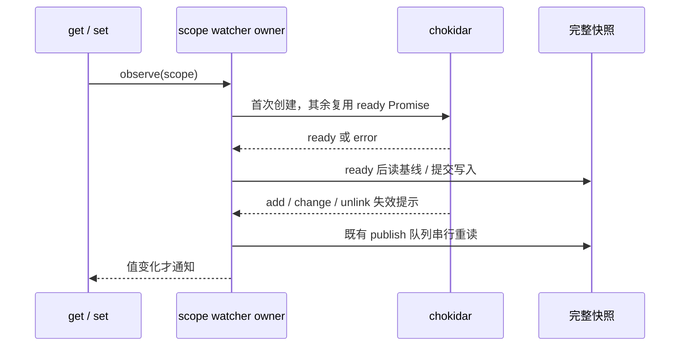

# Gen UI 状态监听初始化

Desktop Local Host 的 stateStorage 是持久 widget state、scope watcher 与通知队列的唯一所有者。
跨窗口/进程完整快照仍通过原子替换及既有文件锁提交；监听事件只是重新读取磁盘的失效提示，
不能直接生成另一份状态或触发 UI 写回。

Darwin 上同步返回的原生 fs.watch 曾在新建 scope 目录中完全漏掉首次写入：两个 watcher
均已创建，无 error，但 30 秒内没有任何原生事件。Node [#53111](https://github.com/nodejs/node/issues/53111)、
[#52601](https://github.com/nodejs/node/issues/52601) 与 libuv [#3866](https://github.com/libuv/libuv/issues/3866)
记录了同类启动缺口。chokidar ready 只代表初始扫描，实测仍不能弥补 Darwin 原生事件缺口。

每个 scope 只使用一个 chokidar 后端：Darwin 显式选 stat polling，文本与二进制间隔均为
500ms；Linux/Windows 保持 native。不是 native 与 polling 并行，也不是失败后切换兜底。
get/observe 等待 ready 后读取基线。程序内 set 的 ACK 通知仍即时；外部创建、覆盖、删除
最终快照在约 500ms 加文件 IO/调度耗时后传播，不承诺捕获两次采样间的每个瞬态值。
不引入 sleep、自动重试、新公开 API 或第二份状态事实。各 scope 仍最多保留 100 条记录。

平台观察策略由 storage 持有，不能被第三方通用 `CHOKIDAR_USEPOLLING` / `CHOKIDAR_INTERVAL`
环境变量静默覆盖。构造 watcher 后检查其最终 effective options：所有平台检查 usePolling，
Darwin 另检查文本与二进制间隔均为 500ms。冲突按初始化错误拒绝等待者并关闭 watcher，
报错指出平台策略与有效选项不一致；不修改全局 process.env，不启动另一后端或重试。
native 平台不使用 polling interval，因此不因无关的 interval 覆盖而拒绝初始化。

每个 storage 实例、scope 目录只有一个 watcher entry 和一个初始化 Promise。
并发 observe 复用该 Promise；初始化错误向等待调用方传播并释放 watcher。dispose 同步撤销
entry 并拒绝未完成初始化；迟到的 ready 不得继续读取或重新发布状态，关闭过程保持幂等。
runtime watcher 错误仍按既有日志边界报告，不改写磁盘快照。

验收包括：ready 前外部写入由首次读取获得；并发观察只创建一个 scope watcher；初始化
错误拒绝等待者；dispose 与迟到 ready 不泄漏 watcher；真实跨实例创建/覆盖/删除及重复
失效事件只传播最新快照；32 轮真实观察压力、100 条容量约束和多 scope 空闲开销实测。
