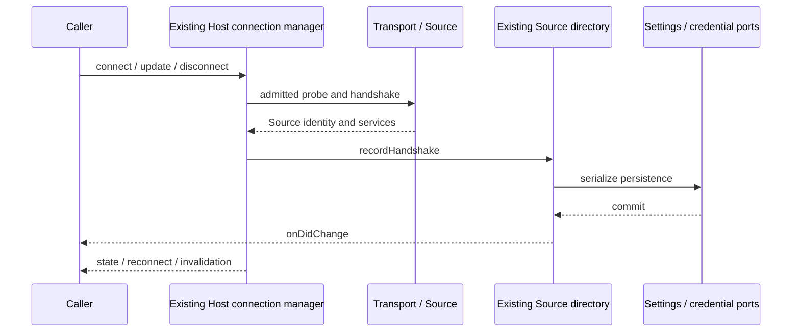

# Host Source Server boundary

Owner: `remote-workspace`; layer: `adapters`. 本边界归属既有 `sourceServerConnectionManager.ts`、`sourceServerDirectory.ts` 与本目录，公开契约直接 re-export 原实现及类型，既有文件入口继续兼容。没有第二份 registry、连接缓存或 accepted queue。

`SourceServerDirectory` 串行编排 Source/Profile/Workspace 目录和凭据引用，经已有 setting/credential 端口持久化；真实写入完成后才发布 `onDidChange`。调用方读 snapshot，不能以 UI 的路由偏好覆盖稳定 Source identity。路径用于文件操作，身份沿用已有 workspace identity 规则。

当前 Host 的 `SourceServerConnectionManager` 持有物理连接、single flight、代际、重试、更新和取消。Transport adapter 执行探测、安装与连接 IO；Source services 持有远端业务状态。Main 和 UI 读取公开状态并提交命令，不能创建镜像 owner。安装、升级、identity 变更的公开错误保持 `retryable=false`，须明确确认后重新提交。

文件传输能力绑定当前 connection generation，离线不能读取得到可用能力，旧能力不能在重连后隐式切换线路。Desktop continuous 与手机 replayable 仍复用既有 Host attachment 与业务 owner；本边界不新增 relay、会话运行时或跨端状态。

继承诊断（本次不改运行时文件）：connection manager 1460 行，directory 1486 行，两者各有一条 `eslint-disable max-lines`，均超过架构 800 行上限并触发 `disable-count`。后续治理应单独评审拆分，不以新增 facade 或删除 suppression 掩盖现有复杂度。
