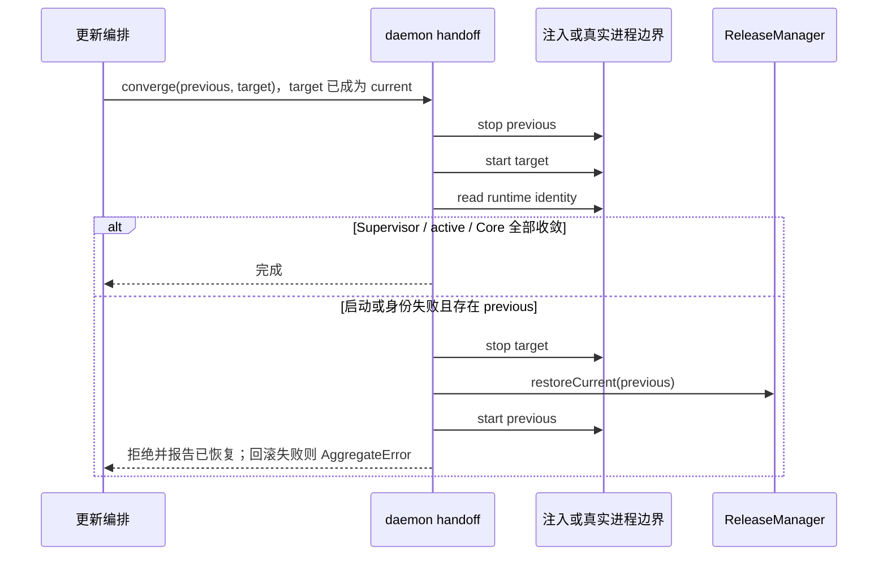

# Source Server 守护进程边界

remote-runtime 接管既有 updateHandoff.ts 与 proxyStdio.ts，契约直接转导出既有函数和类型，不建立第二份运行时或状态。ReleaseManager 继续独占磁盘 release 指针，进程边界只负责 stop、start 和读取实际身份。

身份同时检查三个版本及 target 提供的三个 releaseId。相同版本的不同构建不得视为收敛。缺少 previous 时明确失败，不能伪报回滚成功；首次 stop 失败直接拒绝。调用方沿用既有更新锁串行执行，本接口不新增队列或事务所有者。

proxy-stdio 只在有效 ready 状态与正端口下连接 127.0.0.1，保持任意二进制字节透明，不向 stdout 注入日志或 framing，不关闭调用方 output。状态缺失以 daemon-not-ready 拒绝；建立连接失败以 daemon-connect-failed 拒绝。该接口是到既有 daemon 的本地传输桥，不提供手机 Relay、attachment、会话所有权或重放语义。
