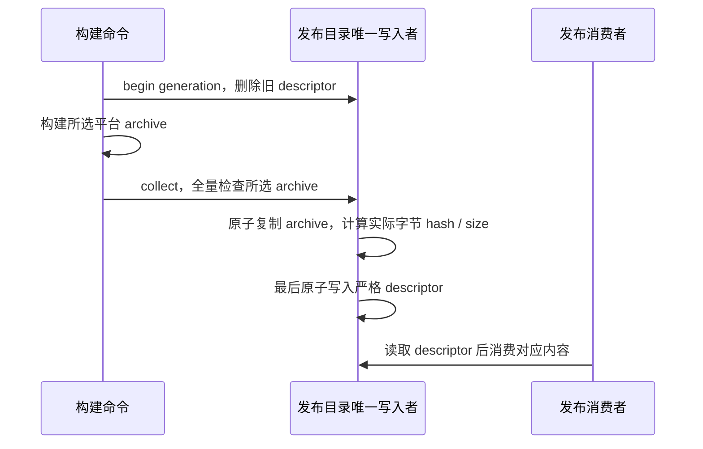

# Source Server 发布打包

distribution 拥有发布目录的一次 generation。此边界直接复用 remoteAssetRelease.ts、stageArchives.ts；stageRemoteAssetsCli.ts 只作为命令入口接管，因顶层执行 main，不得导入或转导出。

archive 文件使用 mikiko-server 品牌。缺少任一所选平台时失败且旧 descriptor 保持失效；不会把旧代际描述文件当作本轮成功。此接口验证归档存在与字节身份，不解析归档内部 manifest，也不负责发布上传或远端服务配置。

组件身份按排序后的相对文件名、NUL 分隔符与内容计算，sizeBytes 只累加内容字节；同内容改路径会改变身份。createComponentArchive 返回该内容身份，不是压缩包本身的哈希。Windows 组件为 zip，其他目标为 tar.gz，平台工具选择仍由既有 tarCommand 负责。调用方串行拥有同一输出目录，不保证多个 generation 并发隔离。
