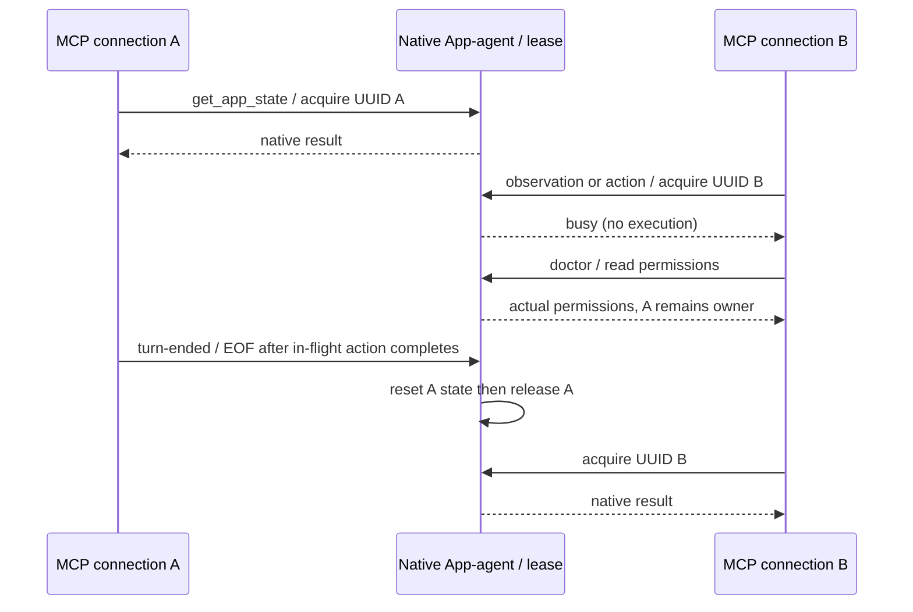

# Mikiko Computer Use native production contract

The reviewed upstream commit and preview patch stay pinned. Production adds a separate reviewed patch and `MikikoControlLease.swift`; the original signed preview output is never overwritten.

- Production builder: `node scripts/build-mikiko-computer-use.mjs --production --arch arm64|x64`. Release configuration only, Swift 6.2.x; macOS 14+.
- Output: `.cache/mikiko-computer-use/production/<arm64|x86_64>/release/Mikiko Computer Use.app`; executable `Contents/MacOS/mikiko-computer-use`, bundle `dev.mikiko.computer-use`. Development retains `dev.mikiko.computer-use.development`.
- Packaged resources: `computer-use/Mikiko Computer Use.app`, `computer-use/production-server.mjs`, and build provenance. `MIKIKO_COMPUTER_USE_BINARY` points to that executable; `MIKIKO_COMPUTER_USE_APP_PATH` to its App and `MIKIKO_COMPUTER_USE_SERVER` to standalone server.
- Production agent socket is fixed per uid at `/tmp/mikiko-computer-use-production-<uid>.sock`; namespace environment overrides and proxy bypass cannot create independent production control owners. A kernel-held exclusive listener lock prevents racing App instances from unlinking an active socket. No timed lease theft.
- Native app-agent is the single lease owner. Connection UUID acquires before any observation/action and before environment serialization; competitors get busy immediately. Protocol discovery/list_apps/doctor do not acquire or release control. Turn end/stop/cancellation release only their own state; EOF releases after in-flight synchronous native work finishes, never before. Cleanup completes before the next owner acquires.
- `doctor --json` runs through LaunchServices agent and includes existing permission fields plus `grantOwnerBundleId`, `appPath`, `buildIdentifier`, `appAgent:true`. No TCC edits. `restart-agent --json` verifies path/build identity, refuses busy, stops only the verified idle agent, then launches doctor; output `{restarted:true,permissions:<doctor>}`, failure exit 1. On upgrades, an existing stale helper is replaced only after socket peer uid/PID and running SecCode verify the same production bundle and Developer ID team as the new binary, then atomic idle shutdown; different identities and busy peers fail closed.
- Production builder never activates the App-agent before final signing. It verifies architecture/signature and records provenance; actual doctor and action acceptance run explicitly after Developer ID signing. `--sign-identity` signs before first activation; `--compile-only` leaves outputs untouched; `--candidate <slug>` places a separately signed acceptance App under production/candidates without replacing the current authorization baseline. Local ad-hoc is labelled as such; release CI requires Developer ID, hardened runtime and timestamp, then nested App is included in the existing top-level notarization archive. No missing-helper fallback.

Acceptance: pure Swift lease competition/cleanup/stale-owner tests; builder identity/layout/rejection tests; real production agent socket tests for discovery/doctor without acquisition, two-client busy, turn-ended/EOF release and busy restart refusal. Actual AX/screenshot/input acceptance belongs to the release fixture suite and must use this exact production build identity.

## Capture failure diagnostic

A requested screenshot that native capture cannot produce returns an explicit
`Screenshot unavailable: native window capture did not produce an image.` text
note alongside any valid AX result. It never returns a fabricated image and never
retries an action or changes window placement to hide the failure. Existing image
encoding/size omission notes stay intact. A real returned image remains the only
source of screenshot authority in the gateway. The controlled smoke fixture must
first display its own complete window on an active display; stage thumbnails and
off-display animation geometry are not valid full-window screenshot preconditions.

## AX mutation confirmation

Query traversal uses a short messaging budget. That budget must not leak into a
mutation on an element returned by query: reset the mutation's AX messaging timeout
to an explicit two-second acknowledgement budget before dispatch (the short
query default is scoped to the application and resetting an element to zero
would still inherit it). Once an advertised AX action is sent,
only confirmed success permits the next explicitly requested repeat. Any AX error
is an unconfirmed outcome: throw immediately without another action, nearby-target
heuristic or activation fallback. Unsupported actions can be skipped only before
any dispatch. A delayed synthetic button must receive exactly one activation for
one request, and a simulated `cannotComplete` after a side effect must never replay.

## Last connection shutdown

The App-agent tracks admitted connections within the same native owner. After the
last connection reaches EOF and completes native cleanup, it fences new admission
and exits. Read-only probes count as connections while open. This is an explicit
lifecycle transition, never a timed lease expiry. It prevents a detached idle
Helper from surviving its App and retaining an obsolete executable after update.
The listener constructs/registers a connection before handing it to its worker.
EOF while another connection exists must preserve that connection and its lease.
EOF-triggered shutdown and a competing registration are atomic under the owner.

## Literal keyboard input

Production `type_text` uses the existing public per-PID Unicode keyboard path,
which respects the target's actual focused caret/selection. It does not replace
that operation with an AXValue append/read-modify-write, and never switches to a
second write path after dispatch. Cmd+A followed by typing must replace exactly
the selected text in the controlled Cocoa fixture, with no extra copy appended.

## Visible production drag

Production drag uses HID events and moves the real pointer. It does not enable global
click/keyboard options. Native snapshot PID/window and exact current bounds fence
every point; AX hit testing must identify that exact window; click-through Dock/Stage Manager surfaces do not masquerade as occlusion. The exact observed AX
window is raised, never an arbitrary first app window. Endpoints stay inside that
window. An independent stdio EOF monitor shuts down only its owned native socket even during a synchronous request. Existing action scope checks owning connection EOF before each step. A
preallocated mouse-up is posted exactly once in cleanup at the last delivered point,
even after cancellation; lease release still follows synchronous cleanup.
