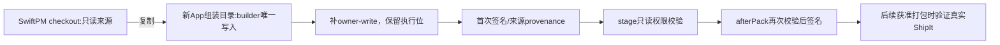

# macOS 自动更新包的文件权限

## 已确认的问题

1.1.2 在 `quitAndInstall()` 返回后清除安装标记，macOS 异步 before-quit 又触发安装，产生重入。当前源码已改为成功交接后保留 installing，首次旧版升级不能靠目标包中的修复改变旧进程，应采用 DMG 覆盖安装完成首次过渡。

1.1.4 新增 Computer Use Helper 的 libwebp LICENSE 来自 SwiftPM 只读 checkout。copyFile 保留0444，最终ZIP也保留；ShipIt 清除该文件的 quarantine 属性时报EACCES，三次失败后重新启动旧版。独立合成文件已复现0444失败、0644成功。

## 所有者、接口与顺序

- 原生 builder 是新组装 Helper App 文件权限的唯一写入者，在首次签名前补 owner-write。保留原执行位及其它权限，不增加 group/world-write，不改变文件内容。
- 仅处理本次组装的真实 `.app` 目录内普通文件和目录；不跟随符号链接、不修改依赖 checkout、用户正式应用、更新缓存或已发布包。
- 共享构建工具提供 normalize 与只读 assert 两个入口。桌面 stage 及 afterPack 在各自边界校验 Helper；发现只读输入直接失败，不修补已签名缓存或带病进入发布。
- 权限策略的源码摘要进入原生 build input/provenance，策略变化不得命中旧缓存。

## 验收

- 0444许可证、0555可执行文件/目录经处理后分别为0644/0755；内容摘要、源文件权限及执行位保持不变。
- 符号链接目标在App外时不能被修改，符号链接本身保持不变；根路径不能为符号链接。
- 真正给合成许可证设置quarantine，确认修复前移除属性失败、调用同一生产权限策略后成功；只操作测试夹具。
- stage/afterPack遇到只读缓存或资源，在签名前明确失败；有效输入保留原签名/身份/hash验证。
- 复核已有退出重入单测和进程级smoke。smoke不替换用户应用，不作为真实ShipIt完整升级证明。
- 本轮用户明确要求只修复并commit，不编译/生成正式App、DMG或ZIP，不发布、不改v1.1.4 tag及资产。真实签名整包ShipIt安装/重启留待后续获准打包时执行。
