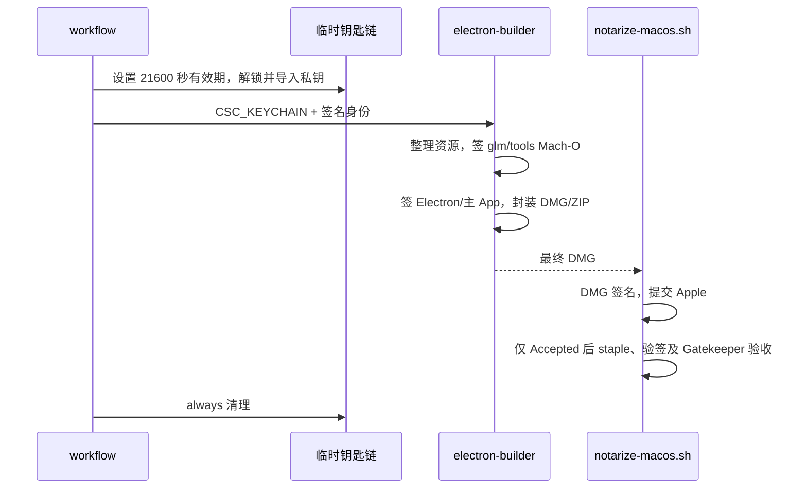
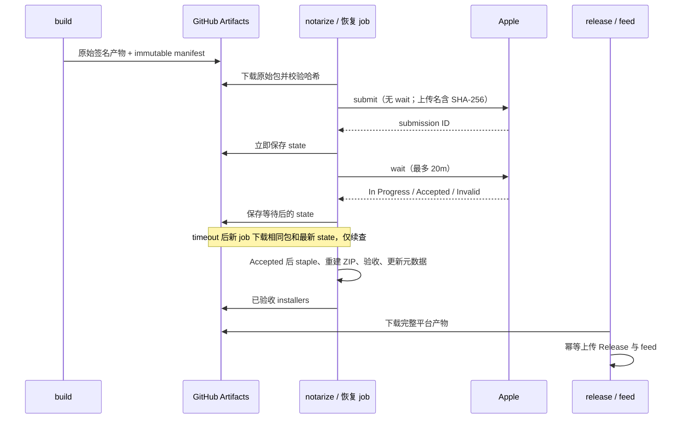

# macOS 构建、签名与公证

## 故障与目标

GitHub Actions 创建的临时钥匙链默认在 300 秒后锁定。2026-10-19 的运行
39233815411 在解锁约 341 秒后进入签名，39219865408 在约 504 秒后进入签名；
前者在 codesign 静默 80 多分钟后结束，后者的所有运行时二进制均签名超时。
本机创建空临时钥匙链复现了 `lock-on-sleep timeout=300s`。CI 必须显式延长
钥匙链有效期，并用新运行验证修复；不能把增加 job 超时当作签名修复。

## 所有者与顺序

- workflow 拥有临时钥匙链：设置 21600 秒超时（覆盖完整 job）、解锁、导入私钥、
  设置分区权限，并通过 CSC_KEYCHAIN 指定签名使用的钥匙链；始终清理。
- electron-builder 的 afterPack 拥有 glm/tools 内嵌 Mach-O 的预签名；在所有资源
  改写完成后执行，最外层 App 签名及 DMG/ZIP 封装之前完成。
- electron-builder 拥有 Electron、framework、helper、asar.unpacked 与主 App 的签名。
  macos-window-bounds 继续由 builder 签名。独立 CUA Helper 的既有签名边界保留。
- notarize-macos.sh 只负责最终 DMG 的签名、公证、staple 和验收，不修改已封装 App
  或重建 DMG，避免 App、DMG、ZIP 和更新元数据对应不同字节。

## 签名约束

- 每个内嵌 Mach-O 必须有 Developer ID、安全时间戳和 hardened runtime。
  Apple 既有公证日志已明确拒绝缺少这些属性的二进制。
- Mach-O 通过文件头识别，不依赖执行权限；不遍历符号链接和非目标资源树。
- 原生签名使用异步子进程，最多 4 个并发，每次 120 秒上限；记录当前文件和耗时。
  失败时保留原始错误并终止打包；禁止去掉 runtime/entitlements 后降级或接受旧 ad-hoc 签名。
- 在未启用 Developer ID 签名时保持原有无证书打包方式。
- notarytool 的进程退出码不能替代公证状态：JSON status 必须为 Accepted。
  Invalid、In Progress、无有效结果或命令失败都不得进入 staple/发布；有 submission ID
  时获取日志，保留诊断。多个架构的 App 都必须验收，不能只检查第一个。
- staple 会改变 DMG 字节；成功后刷新 latest-mac.yml 中对应 DMG 的 SHA-512、大小及
  已存在的 DMG blockmap。ZIP 内容没有改写，其哈希和差分元数据保持原值。

## 验收场景

1. CI 签名钥匙链的有效期大于完整 job 上限，签名通过 CSC_KEYCHAIN 定位该钥匙链。
2. 无执行位的 koffi.node、搜索工具都在主 App 封印前签名；文本文件和符号链接不签。
3. 多文件确实并发且不超过 4；任一签名失败即失败，没有降级重签或旧签名兜底。
4. 真实签名的本地 App 深度严格校验通过；运行时文件带 Developer ID、timestamp、runtime。
5. 模拟 notarytool 退出 0 但 status=Invalid 时，流程失败并获取日志，不调用 stapler。
6. arm64/x64 App 同时存在时逐一验收；任一 App 失败都会阻止成功。
7. 推送修复后 workflow_dispatch mac-only=true 验证两个架构，确认 bundle 步骤结束，
   分别报告构建与 Apple 公证的真实状态，不发布 release 或更新 feed。
8. 模拟 staple 追加 ticket 后，DMG 哈希、大小和 blockmap 更新，ZIP 元数据不受影响。
9. Apple Accepted 后，stapler 或任一验收命令失败仍须终止，不刷新或发布未验收产物。

## 可恢复发布（v1.1.3）

- build job 只编译、签名和保存原始产物，不等待公证。Mac 使用 tar 保存 App、DMG、ZIP、
  blockmap、更新清单及 `signed-bundle.json`（原始 run ID、提交 SHA、ref、版本、架构、文件 SHA-256）。
  Artifact 保留 30 天，恢复必须在保留期内；不要覆盖或移动已发布 tag。
- 独立 notarize job 下载原始归档并校验 manifest。恢复入口 `source-run-id` 绑定原始构建运行，
  跳过 build/relay。它验证原始 run ref 与当前 tag 一致，允许使用更新的工作流脚本修复后处理，
  但产物版本和 SHA 始终取自原始 manifest。
- 公证状态唯一所有者是归档的 `state.json`。以 sourceRunId+arch+DMG SHA-256 绑定提交；
  每次提交、限时等待结束后分别上传不可变状态 artifact，恢复时自动查找最新有效状态。
- submit 与 wait 分离：submit 不带 --wait，立刻保存 submission ID；wait 默认最多 20 分钟。
  超时/网络/鉴权错误不重新 submit，保存状态后结束 job。Apple 持续处理；恢复只 info/wait。
- submit 返回丢失时，以含完整 SHA-256 的唯一上传文件名从 Apple history 找回 ID。
  已有 submitting 意图但查不到 ID 时失败并要求人工核对，不能自动重复提交；多条匹配也失败。
- Accepted 之后不重新签名；对原 DMG staple 并验收，同时给独立 App staple，重建 ZIP，
  解压验证签名/票据/Gatekeeper，再生成最终 DMG/ZIP blockmap、哈希及清单。
  任一失败不上传 installers；重试重复这些幂等后处理即可，复用 Accepted ID。
- 每次上传/发布只能使用通过本次验收的 installers；pending/Invalid 状态不得发布。
  GitHub Release 创建和上传幂等，不删除已有 Release；feed 失败只重试发布。
- 恢复需全部平台与 relay 的原始 artifact 可用。若原始 build 的某平台失败，用 Re-run failed jobs
  补齐该平台；其他成功平台不重打。不同版本或哈希不允许混用。

验收新增：pending 后恢复 submit 次数仍为 1；提交返回丢失可从唯一 history 找回；
状态与原包哈希不符、原包损坏、Invalid、未知提交状态阻止发布；Accepted 后 staple
失败可重试且不 submit；ZIP 解压后的 App 含票据；workflow 恢复时跳过全部编译。
