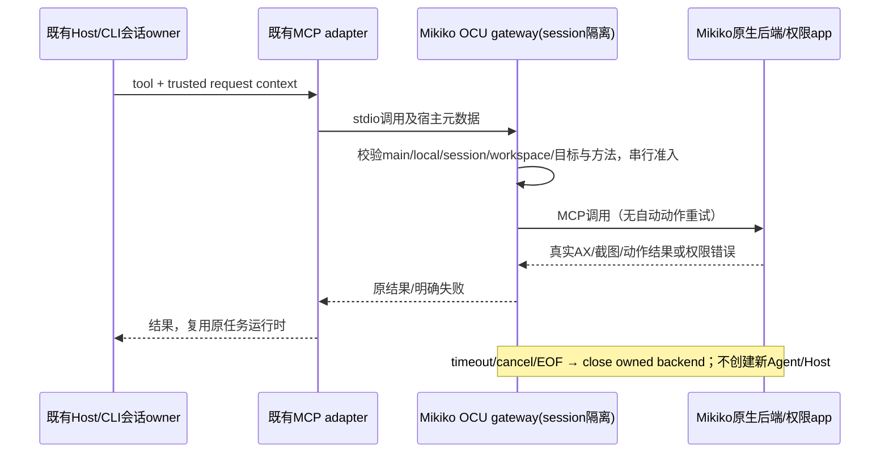

# Mikiko Open Computer Use 实验后端

用户授权设计并实践 iFurySt/open-computer-use 接入，实践前回滚锚点为 c41c6ba7。

## 产品规则

- 先提供独立、显式启用的本地 MCP 实验后端，不把它冒充原官方 producer；原占位包和内置 Computer Use 不可用判定保持真实。
- 首轮为 macOS 14+，上游固定 43eb4b53de7a15b3f99ec2c9922bedeb95602266。Windows/Linux 实验实现只做设计覆盖，不宣称本机验证通过。
- 产品入口、进程、app display name、bundle ID、配置/构建路径采用 Mikiko。持久配置默认 ~/.mikiko/computer-use；业务数据/配置根目录不变。
- 调用通过现有 MCP adapter。服务器配置 isolation=session；要求宿主注入的主会话、workspace 身份与 desktop-continuous 上下文。子代理、缺上下文和手机/远程请求明确拒绝，原手机远控链路不改变。
- 预览仅接受绝对本地 workspace_path；workspace_identity 若提供必须等于该路径，workspace_key 若提供必须一致。非路径身份（包括远程身份）不在预览范围，正式版本再复用 Host 的身份解析。已退役 turn 不得重新进入，即使其请求是观察。
- 预览默认仅允许显式配置的测试应用，发现服务不列出其他用户应用。每个 gateway 绑定一个 session/workspace，串行操作；不同身份不复用元素缓存。不宣称已有跨进程全局控制 lease，正式发布前必须接入 Host 控制 owner。
- 禁止通过模型参数打开 global pointer/keyboard fallback、sky 输入或虚拟显示器；动作超时/取消后销毁本次后端，拒绝后续动作，不重放有副作用的调用。
- 先观察再动作，沿用上游 PID/window/AX 元素 freshness 校验。拒绝所有未公开/未知工具；原生错误和图片如实透传，不伪造截图或成功。
- 动作准入必须来自本回合成功的 get_app_state；query 是只读检索，不能替代完整观察建立准入。AX 动作需本回合 AX，drag 需本回合截图，避免上游 endSession 未清完整 snapshot 导致沿用旧回合数据。
- 系统权限归重编译的 Mikiko .app；doctor 仅诊断，allGranted 不等于实际动作成功，也不能据 Codex/Terminal 或上游身份的授权推断 Mikiko 授权。
- 不修改 macOS TCC/认证策略，不安装上游 Locked Use/Guardian/root 服务。截图/AX 只通过工具返回，测试真实数据不提交仓库。
- 不安装全局 npm 包、不改 Codex/Claude/Gemini 配置。实验配置先生成到本地，最终接入复用 Mikiko 的 MCP 设置入口。

## 所有者与顺序

## 验收

- 原生固定版本可构建；MIT/依赖声明、构建 provenance 及品牌 ID 可复核。
- gateway 使用真实 SDK initialize/tools/list/call；缺 runtime、错误配置明确失败；拒绝边界时原生调用为零。
- 跨 session/workspace、子代理、remote/replayable、危险模式均拒绝；排队取消、原生错误、超时后失效、正常关闭均验证。
- 构建 Mikiko .app 并检查其自身权限；优先用受控测试窗口验证观察和 AX 输入读回。受系统授权阻塞时记录缺失项，交付已构建 app 和准确路径，不声称已接通权限。
- 根 typecheck/lint/architecture 与目标测试实际执行；现有官方占位契约回归不退化。
