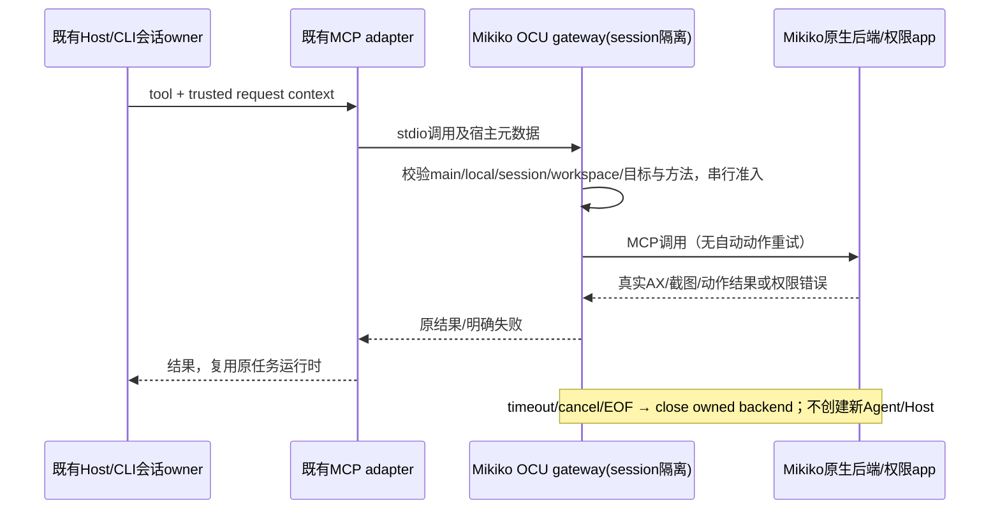

# Mikiko Open Computer Use 后端

用户授权设计并实践 iFurySt/open-computer-use 接入，实践前回滚锚点为 c41c6ba7。

## 产品规则

- 先提供独立、显式启用的本地 MCP 实验后端，不把它冒充原官方 producer；原占位包和内置 Computer Use 不可用判定保持真实。
- 首轮为 macOS 14+，上游固定 43eb4b53de7a15b3f99ec2c9922bedeb95602266。Windows/Linux 实验实现只做设计覆盖，不宣称本机验证通过。
- 产品入口、进程、app display name、bundle ID、配置/构建路径采用 Mikiko。持久配置默认 ~/.mikiko/computer-use；业务数据/配置根目录不变。
- 调用通过现有 MCP adapter。服务器配置 isolation=session；要求宿主注入的主会话、workspace 身份与 desktop-continuous 上下文。子代理、缺上下文和手机/远程请求明确拒绝，原手机远控链路不改变。
- 预览仅接受绝对本地 workspace_path；workspace_identity 若提供必须等于该路径，workspace_key 若提供必须一致。非路径身份（包括远程身份）不在预览范围，正式版本再复用 Host 的身份解析。已退役 turn 不得重新进入，即使其请求是观察。
- 预览默认仅允许显式配置的测试应用，发现服务不列出其他用户应用。每个 gateway 绑定一个 session/workspace，串行操作；不同身份不复用元素缓存。不宣称已有跨进程全局控制 lease，正式发布前必须接入 Host 控制 owner。
- 禁止通过模型参数打开 global pointer/keyboard fallback、sky 输入或虚拟显示器；动作超时/取消后销毁本次后端，拒绝后续动作，不重放有副作用的调用。
- 先观察再动作，沿用上游 PID/window/AX 元素 freshness 校验。拒绝所有未公开/未知工具；原生错误和图片如实透传，不伪造截图或成功。
- 动作准入必须来自本回合成功的 get_app_state；query 是只读检索，不能替代完整观察建立准入。AX 动作需本回合 AX，drag 需本回合截图，避免上游 endSession 未清完整 snapshot 导致沿用旧回合数据。
- 系统权限归重编译的 Mikiko .app；doctor 仅诊断，allGranted 不等于实际动作成功，也不能据 Codex/Terminal 或上游身份的授权推断 Mikiko 授权。
- 不修改 macOS TCC/认证策略，不安装上游 Locked Use/Guardian/root 服务。截图/AX 只通过工具返回，测试真实数据不提交仓库。
- 不安装全局 npm 包、不改 Codex/Claude/Gemini 配置。实验配置先生成到本地，最终接入复用 Mikiko 的 MCP 设置入口。

## 所有者与顺序

## 验收

- 原生固定版本可构建；MIT/依赖声明、构建 provenance 及品牌 ID 可复核。
- gateway 使用真实 SDK initialize/tools/list/call；缺 runtime、错误配置明确失败；拒绝边界时原生调用为零。
- 跨 session/workspace、子代理、remote/replayable、危险模式均拒绝；排队取消、原生错误、超时后失效、正常关闭均验证。
- 构建 Mikiko .app 并检查其自身权限；优先用受控测试窗口验证观察和 AX 输入读回。受系统授权阻塞时记录缺失项，交付已构建 app 和准确路径，不声称已接通权限。
- 根 typecheck/lint/architecture 与目标测试实际执行；现有官方占位契约回归不退化。

## v1.1.4 正式集成

2026-10-21 用户明确批准正式随包集成并完成真实测试后发布 v1.1.4。原独立预览规则保留，生产入口增加本机应用发现，并由原生 app-agent 统一独占控制租约。插件默认关闭，复用现有审批和可信上下文；不仿制官方 producer、不改变官方占位包。开发/正式权限身份分离，生产版仅 macOS14+。实现和验收顺序见 [正式集成计划](../../docs/plans/2026-10-21-mikiko-computer-use-production.md)。

### Host、插件与权限入口

- Main 根据当前分发资源提供 `MIKIKO_COMPUTER_USE_BINARY`、`MIKIKO_COMPUTER_USE_APP_PATH`、`MIKIKO_COMPUTER_USE_SERVER`。正式路径为 `resources/computer-use/Mikiko Computer Use.app` 与 `resources/computer-use/production-server.mjs`；开发路径独立解析自本仓库 production cache。正式包忽略外部同名路径覆盖，缺任何资源即不可用。
- `GetCuaOsSupport` 的产品能力来自此独立后端资源，支持态附加 `backend: mikiko-native`，macOS 地板14。原官方 producer 编译检测及占位包不改，不把它们视为新后端实现。
- `computer-use@zcode-plugins-official` ID保持，默认关闭。启用后只装配生产MCP server与新原生工具技能，不给共享NodeRepl注入旧broker凭据，不加载旧14方法SDK指南。未启用、缺资源及非本机主会话均不得触发控制。
- Host权限adapter复用 `ICuaPermissionService.getStatus/restartHelper`。仅本地desktop Host、mac14+、插件显式启用、资源有效时执行native命令。远程identity与相同路径不构成本地授权；查询不截屏或执行UI动作。
- doctor JSON必须包含 `platform: macos`、`appAgent: true`、本App `grantOwnerBundleId/appPath/buildIdentifier` 以及布尔权限字段；验证身份/path后才投影granted/denied。preflight不等于功能探针，`screenCaptureProbeOk`及`accessibilityProbeOk`不得凭granted置true。
- `restart-agent --json`由native验证本App身份及全局lease空闲后重启，返回 `{restarted:true,permissions:<doctor>}`；失败exit1，stdout `{restarted:false,error:{code:controller_busy|identity_mismatch|restart_failed}}`。Host仅按此结构识别busy，不分析stderr文案，不pkill、不结束其它会话，不用MCP stop冒充helper restart。
- 设置页经既有hook/service读取状态；用户点击授权才打开对应系统设置，并展示准确Mikiko app路径。focus只重查权限，不自动截屏或抢占控制。低于mac14、非mac、远程或缺包均清晰显示不可用。
- 可信回合完成/取消/关闭由CLI runtime通知生产gateway释放租约，不依赖模型调用stop；gateway与原生分别保留代际与互斥边界。

验收覆盖：off/remote/低OS/缺包零native调用，doctor身份错误与JSON错误不伪装granted，busy重启失败，现有开关与新技能/stdio server同源，权限页无旧SDK授权路径，MCP可信元数据及回合结束释放由原owner实际验证。

### 正式拖拽：真实鼠标（用户已批准）

- 生产 `drag` 固定使用 WindowServer/HID 路径，会移动真实鼠标并可能改变前台焦点；不得将无效 app_post 投递报告为成功。其他 global/sky/虚拟显示模式继续拒绝。
- gateway 仍要求本回合实际返回截图，原生 app-agent 独占租约保持到动作和清理结束。使用截图对应 PID/window、准确且未变的窗口 bounds，起终点必须位于该窗口；提高准确窗口后，逐步验证目标窗口未移动且路径下一点的 AX 命中仍属于准确目标窗口（不把 Dock/台前调度可穿透全屏窗口当作遮挡）。校验失败先于后续按下/移动，不自动重放动作。
- stdio proxy 在独立队列观察输入管道 EOF 并 shutdown 自己的原生连接（不等待同步 request 返回）；连接 EOF/取消由既有 LockedUseActionScope 在每一步检查。按下后任何失败都在最后已投递位置释放左键；清理释放不得被取消校验阻止。关闭连接直到同步清理完成才释放控制租约。
- 验收：受控 Cocoa NSView 真实 down/drag/up；取消后无后续拖动且恰好一次释放；变更 bounds、错误 PID/window、越界/遮挡在按下前拒绝；原有非 global 输入语义不变。
