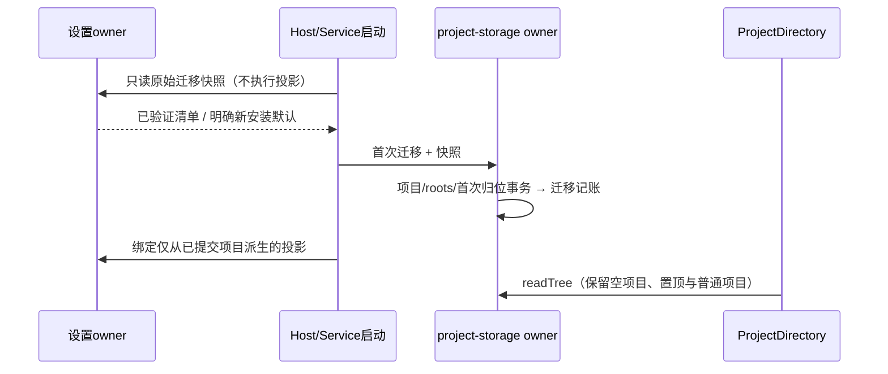

# 项目首次迁移的上下文与受控恢复

## 根因与前向规则

已确认源码存在未提供旧 settings 也可把 `0005_projects` 记为完成、产生空 projects 的初始化路径。真实 profile 同时存在已完成迁移、空项目表及同 profile 日志中的早期非空清单；历史具体写者未确定。此缺陷会让后续桌面即使读取到旧 workspace 清单，也不能重跑已记账迁移；目录投影继而把旧清单写成空。UI 如实显示空目录，不能从任务推断项目。

设置 owner 提供只读启动快照，固定同一实例路径、等待该实例已入队写入，直接校验已保存设置，不运行项目投影、不写配置。首次本机项目迁移必须先拿到这份已读取的快照；缺失或损坏则失败且 `0005` 不记账。合法文件缺席可由设置 owner 明确返回新安装默认值。已有 `0005/0001` 不为读取清单而递归访问设置，也不重跑迁移。远端按历史任务建项目的既有例外保持原合同。

## 本次受控恢复

恢复仅由显式命令触发，源为同一 profile 在清单被擦除前保存的可信设置副本，不从旧品牌目录或任务历史猜测。dry-run 不写正式数据。apply 必须同时匹配当前 app 库逻辑指纹、当前 setting 原始字节 SHA、源副本 SHA，并先产生受限备份；锁内复验，存在并发变化就拒绝。

仅接受本机项目目录，排除 conversation，保留原顺序及没有会话的项目。当前 projects（包括软删）、roots、remote entries 必须全空、任务项目归属全为 NULL；任一已有项目、源清单含远程条目或不兼容结构视为冲突。只新增 projects/roots，并为本地、无远程 identity、精确 root 匹配的 NULL 任务赋 project_id。其余未归类任务保持 NULL，cwd、identity、execution_directories、CLI镜像、时间、pin/archive、分组、定时/闲时与 CLI 库均不改。不修改已发布 migration id、SQL 或 checksum；再次 apply 必须因指纹或已有项目拒绝。

正式执行由父任务在关闭业务写者后进行；本任务先在0700副本验证逐表 hash、CLI事实不变及UI。真实目录、项目名、消息和源设置不进入Git或聊天，仅输出统计和hash。
