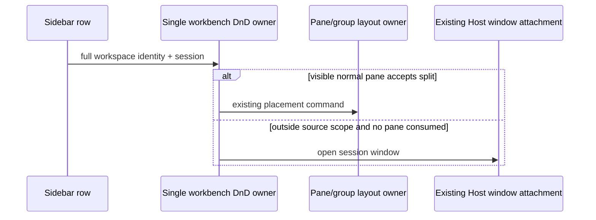

# 侧栏项目列表：行菜单（路径/复制/置顶）、右键菜单与项目置顶

> 2026-10-11 定稿。客户反馈：项目「更多」菜单缺少完整路径与复制路径；缺少项目置顶；
> 项目行只有「更多」按钮能打开菜单，期望右键也能打开。

## 项目行菜单（更多按钮 + 右键共用内容）

两个入口（行内 Ellipsis 下拉、行上任意位置右键）共用 `WorkspaceProjectRowMenuContent`
（多态 Item/Label/Separator，参照 TaskActionMenuContent 模式）。菜单项按序：

1. **远程同步子菜单**（仅已连接远程 workspace；现状不变，仅下拉菜单承载——其实现绑定
   DropdownMenuItem，v1 不做多态化）。
2. **完整路径项**：显示 workspace 完整路径（等宽字体、可换行）。本地 workspace 点击后在
   系统文件管理器打开该目录（mac=Finder / Windows=资源管理器 / WSL 远程走 UNC 映射），
   复用 `useTaskListItemContextActions`（loadTaskPaths=false）的判定与动作；远程
   （SSH/无法解析为 WSL 的远程/手机远控会话）打开语义不可用，该项退化为纯路径展示
   （Label，不可点击）；手机远控下遵循 spec §21.5 整体隐藏规则。
3. **复制项目路径**：`navigator.clipboard.writeText(workspacePath)`（远程项目路径同样可复制）。
4. **置顶项目 / 取消置顶**：切换本项目置顶态（见下节）。
5. **移除**（现状不变，含运行中确认与 Windows 保留名扫描）。

## 项目置顶

- **置顶键** = `buildTaskWorkspaceKey(workspacePath, workspaceIdentity)`（identity 回退
  path，与全局任务分组键一致）。
- **持久化**：localStorage（`zcode-pinned-projects`，键数组）。这是本设备 UI 偏好，与项目
  展开态（workspaceExpansionPreference）、分区排序同类；不进 tasks-index.sqlite（会话事实
  存储）也不进 AppSettings（项目布局不跨设备同步）。单一写入路径 =
  WorkspaceSidebar 的 toggle handler + 惰性清理 effect。
- **置顶后**：
  - 项目行从「项目」分区消失，进入「已置顶」分区（WorkspacePinnedTasksSection 新增
    pinnedProjectRows 插槽，渲染在分区标题下、平铺置顶会话之前）；
  - 项目行保留全部既有行为：展开/收起会话列表（复用 expandedWorkspacePaths，与项目分区
    同一状态，不另建）、新建会话、文件树、重连、移除、菜单；
  - 「已置顶」分区内的项目行不参与拖拽排序（sortable 上下文只在项目分区）；
  - 单独置顶的会话仍按现状平铺在已置顶分区，行为不变。
- **清理**：移除项目时同步清理其置顶键；置顶键指向不存在的项目时由 effect 惰性清理。
- **worktree 项目**（specs/desktop/worktrees.md D3）：置顶语义同普通项目，行键为 worktree
  自身 workspaceKey；root 项目行置顶不影响「worktree 会话并入 root 分组」的展示合并。

## 状态所有者

- `pinnedProjectKeys`：WorkspaceSidebar 组件 state + localStorage lib（读=read、写=toggle/
  清理两个入口）；置顶 toggle 通过 `onToggleProjectPinned(workspaceKey, pinned)` 稳定回调
  下发给 WorkspaceSidebarItem（保持行级 memo）。
- 菜单动作（打开目录/复制/置顶/移除）在 WorkspaceSidebarItem 内执行；平台能力只经
  IPlatformService（useTaskListItemContextActions 内部 usePlatform）。

## 验收

1. 本地项目菜单：路径项显示完整路径，点击在 Finder/资源管理器打开目录；
   「复制项目路径」写入剪贴板。
2. SSH 远程项目：路径项仅展示不可点击；复制路径可用；手机远控下打开项隐藏。
3. 置顶项目：行从项目分区移入已置顶分区，可展开/收起会话列表；重启后保持；
   取消置顶后回到项目分区原列表位置（跟随 tab 顺序）。
4. 右键项目行任意位置打开菜单，动作与更多菜单一致（不含远程同步子菜单）。
5. 移除已置顶项目后置冠键被清理；所有项目置顶时「项目」分区不再渲染空态文案
   （仍有项目存在，只是全部置顶）。

## Mikiko 上游 3.16.2 集成验收（2026-10-20）

采用新的 ProjectTree / project-sidebar 作为组织态唯一投影。保留工作树真实 workspaceIdentity/cwd、根项目聚合、路径菜单、置顶项目层级、归档和拖出开窗；投影不得变更运行时归属。独立窗口附着已有 Host，面板仍在各窗口本地渲染；未读按 task identity 去重，不引入第二份事实。手机远控继续自建服务，禁止装配 Relay V2；新增可见配置和路径使用 Mikiko。验收同时覆盖桌面 continuous 与手机 replayable 恢复，主/独立窗切换与关闭不改变共享会话运行时。

刷新恢复只有 workspace 选择桶时仍展示当前任务；窗口级 lastActiveTaskSelection 建立后按完整 workspace identity+taskId 投影，防止根项目与工作树旧桶双高亮。远端断连徽标同时覆盖普通/时间线行；手机禁用桌面 hover/focus 的合成状态切换。未读点统一现行 icon-blue 语义 token。

## 上游 3.16.2 的有意适配：分屏保留与完整视图

上游此版本下线会话菜单分屏和拖到对话区分屏，Mikiko 保留已有二开分屏/拖出窗口能力，分类为 adapted。继续使用单一 workbench placement/DnD owner；不得并存第二套布局状态。新增完整视图采用上游浮动焦点呈现：仅焦点 pane 显示，其他 pane 保持挂载但隐藏，隐藏 pane 不注册 drop target；浮动单会话视图不接纳分屏，退出后还原已有布局。桌面拖拽先由可见 pane 分屏消费，未命中且拖出所属范围才开独立会话窗。

