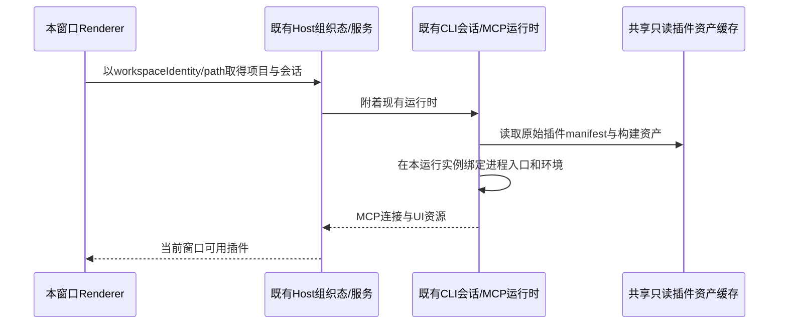

# v3.16.2 合入后的人工验收回归

2026-10-21，基线 custom_main 3358e20a。用户授权定位并修复8项问题；仅在确定需要时发布最新自建手机远控。正式数据读取只作结构/统计诊断，任何数据修复先用一致性副本验证；不按会话正文推断或重建项目，不覆盖用户主动移除的项目与设置。

| 编号 | 产品合同与待修复现象                                                          | 单元/集成验收                                                                   | 实际界面验收                                                                   |
| ---- | ----------------------------------------------------------------------------- | ------------------------------------------------------------------------------- | ------------------------------------------------------------------------------ |
| R1   | Host项目/roots组织态须保留，CLI列表不能决定项目存在性；升级后普通项目不应消失 | 含无会话/置顶/普通项目的真实旧库升级；幂等、失败与读取路径                      | 真实项目行、项目下会话与任务区                                                 |
| R2   | 占位Computer Use明确不可用，不误报启动中；真实producer按既有Helper权限合同    | producer/OS/权限区分，错误与打开设置边界                                        | 优先核查官方实现；官方私有producer与签名身份限制无法直接复用时，显示构建不可用 |
| R3   | 官方CodingPlan OAuth/订阅/重置/模型继续可用；普通产品配置仍自建               | 官方账号限定路径有必要设备/平台来源头，自建域不接收官方凭据；受控响应与失败路径 | 保留当前登录的只读权益与模型列表；不实际reset/claim或发送模型请求              |
| R4   | 顶部每种导航按钮唯一且可交互                                                  | DOM唯一、点击触发一次、拖拽命中正确                                             | 真实Dev toggle/back/forward                                                    |
| R5   | 自建手机链路连通后必须附着现有Host并渲染workspace                             | 初始化/断连恢复/continuous与replayable分界；不装配RelayV2                       | 网页真实连接与页面渲染，必要时部署自建远控                                     |
| R6   | 内置Office MCP缓存不绑定测试/旧进程入口；测试不读写个人运行数据               | 隔离测试进程数据根；冷/热/跨版本缓存与真实stdio初始化/UI资源读取                | PDF面板与MCP状态；image_search按用户新增的官方CodingPlan例外验收               |
| R7   | 语音整理模型选择使用会话同一模型菜单；保持单一设置写入与思考档规则            | 模型/档位选择、旧值兼容、一次持久化                                             | 同会话菜单样式和可用选项                                                       |
| R8   | 独立窗口使用自己的plugin UI context与既有Host服务，插件入口可见/可打开市场    | provider/handler组装，空态与可用态                                              | 新窗口插件列表、查看所有插件                                                   |

## 所有者和顺序

共享缓存不能成为多个进程启动参数的竞争写者。测试进程必须有显式临时数据根/配置/数据库；父进程和日常Dev profile不变。历史污染的缓存仅在备份后通过同一正式资产/运行绑定链修复，不删除插件用户数据或修改个人会话。

插件沙箱页的对外窗口标题使用 Mikiko 品牌；内部已发布协议命名保持兼容。

### R6：每个运行实例的官方 stdio MCP 绑定

`resolveZCodePlugins` 在 discovery 完成后，将 PluginLoadOutcome 交给既有 official-plugin-runtime 绑定。只处理 metadata 中 marketplace、完整 id 和启用的 mcpServerNames 同时匹配的官方 namespaced stdio 条目；HTTP/SSE、第三方、用户显式服务器与未启用插件不变。

运行命令由 `createBundledMcpRuntimeConfig` 按当前 process.execPath / 当前入口 / 当前 execArgv 生成。发现旧参数包含 `__zcode-plugin-host` 时，只采用其后的真实 server path 与参数；原始未包装参数原样作为 server 参数保留。不得从共享 manifest 继承旧 process 入口或 Node test flags。cwd、env、auth、timeout、protocol、isolation 等业务配置继续保留，Node 模式强制为 ELECTRON_RUN_AS_NODE=1。

绑定仅创建本次 outcome 的新 map/变更配置，不改变 discovery 输入对象或落盘 manifest。旧 runtimeManifest 持久化可留作兼容，但新的消费者只信任本进程绑定结果。验证覆盖旧归档入口、raw args、跨进程换代、非官方/HTTP/用户配置不变、输入不变，以及 PDF/演示/表格真实 stdio initialize 和 UI resource 读取。

### R6：Image Search 后端新授权

用户追加授权：Image Search 暂用官方 CodingPlan MCP，仅当前智谱（BigModel/Z.ai）登录身份可用。这是图片搜索服务的明确新增例外，不能将其他普通产品服务转回官方。默认后端为 official-coding-plan，HTTP URL 通过既有官方 account resolver 解析，独立于 Mikiko 产品 origin；配对品牌、功能入口和未来自建服务继续使用 Mikiko。

保留显式 ImageSearchBackendPort/custom 配置工厂入口。custom 分支不保留 zcode_official auth/provenance，不实现未选定的供应商，也不新增云部署。普通第三方及用户显式 MCP 配置仍由原通道管理。

官方 Image Search 整条连接必须逐请求取得有效官方身份头；未登录、账号不可用、缺少 auth port 或空身份头时在本地明确拒绝，不能匿名调用付费搜索。initialize/tools/list 同样要求登录，避免把日志用的请求体解析当作授权边界而漏掉非字符串 tools/call。其他 MCP 保留原有协议与匿名语义。目的地仍由 shared 专用 CodingPlan MCP 信任工厂双端校验，官方凭据不能发往自建产品域。鉴权/工具调用验收只用合成凭据与 loopback，不做真实图片搜索消耗。

## 验收记录要求

先保存失败证据与需求到测试映射，再修复；根仓typecheck/lint及当前架构门禁必须实际执行。单元、模块集成与真实UI各自记录命令、结果、覆盖率来源及未覆盖项，不用数量代替真实链路。真实账号仅允许必要只读探测，账号重置、额度领取和模型消费用loopback验证。

### R5：真实连接验证的票据边界

`bind` 会消费配对票据并轮换 sessionToken，是状态变更操作。生产页连接期间不得用额外 bind 探针验证可达性，否则会使页面持有的 token 失效。重新取票须等待真实 sid 换代，关闭旧测试页后只允许一个页面完成绑定；HTTP 429 要按服务端限频窗口等待，不能将另一次手动 200 当作页面同次请求结果。先记录页面自身 fetch/WS close 事件，再判断页面初始化及 P2P/中继恢复，观察器不得额外发送鉴权请求。
