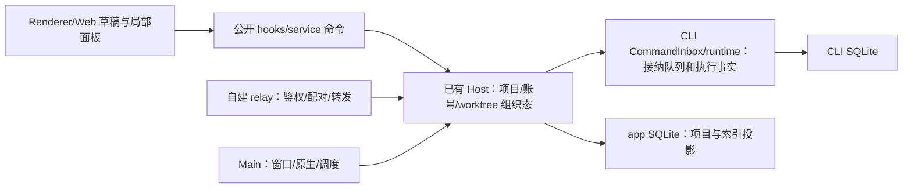

# main v3.16.2 合入 Mikiko 的实现合同

状态：2026-10-20 用户已授权实施。本文优先于此前方案中的拟定取舍；先提交可回滚锚点，再隔离集成和实际功能测试。

## 已确认决定

1. 手机远控保持当前自建 relay、Mikiko ID、设备认领/直连、扫码与 P2P 能力。上游 Relay V2 不采用、不装配，不以它替换自建协议；其专属模块列入明确排除台账。通用任务/恢复修复仍需适配并回归。
2. 更新/远端资源下载、bug 上报、需求反馈、分享、客户端功能配置等产品云端接口全部使用自有品牌与自建服务。只有官方 CodingPlan 账号体系及它完成账号业务必需的供应商接口继续保持官方合同。普通产品服务不能借此例外回流官方端点。

生产模式下，任意自建产品域（包括 `MIKIKO_BASE_URL` 自定义部署）均不改变官方 CodingPlan OAuth、套餐计费/领取及官方 MCP 套餐额度的来源，不能向产品域转发官方账号凭据。由共享 account resolver 唯一决定该来源；非生产显式测试 origin、loopback 回放与账户工厂的明确 baseUrl 注入保留测试合同。公共功能配置仍自建，套餐静态配置使用已有专用只读代理，不能把普通产品 client/configs 当账号配置。3. 新功能的产品侧环境变量、配置名、文件名、目录路径、进程名、可见文案和安装身份统一 Mikiko。包 scope、TypeScript 内部符号、不可见协议判别器与第三方品牌不做机械替换；可对外配置/运行的名字不属于内部符号豁免。

## 路径和远端兼容

- 本地业务数据继续使用现有 Mikiko 路径解析 owner；新增 SQL 默认目录分类必须识别 `.mikiko`。
- 新 Source Server 默认安装/日志/备份/服务名/CLI 产品名采用 Mikiko。旧已部署 ZCode 路径只允许存在于明确的 legacy 探测/迁移适配中，不能作为新版默认或展示名。迁移不能丢历史身份、会话和凭据；兼容行为有单独测试。
- 签名互验的 CUA placeholder/第三方协议例外不借此次集成恢复内部实现；不改变其 fail-closed 事实。
- 发布版本保持二开版本线；上游来源另记 SHA。Server manifest、发行包和客户端兼容门槛必须一致。

## 唯一所有者

桌面/独立窗口使用 desktop-continuous，手机使用 web-remote-replayable；复用已有 Host/运行时，不另建手机 Agent。保留 owner/lease、stale-run 防护和 `workspaceIdentity?.trim() || workspacePath`。

## 必须保留的二开行为

工作树创建/配置继承/真实执行 cwd/根项目显示聚合，项目路径菜单和置顶层级，历史归档和导入；独立会话窗共享 Host、面板本地渲染、关闭销毁；语音/麦克风、会话统计、ChatGPT/Sub2API/MikikoCC、密钥路由和 token 轮换；皮肤/壁纸/桌宠/CDP/文件打开规则；自建云端/更新/反馈/分享及签名公证恢复发布。

采用上游新 project/sidebar/storage owner 时将以上行为迁至新入口，不保留重复权威树。普通项目删除不能误调用工作树删除。任务聚合展示不改变 identity/cwd。未读按单一索引事实投影，多窗口不得重复累计。

## 验收

- 锚点提交和标签可解析；完整本地/远端 custom 和上游 tip 为最终集成祖先。
- Relay V2 未装配，自建扫码/账号直连及 continuous/replayable 恢复通过。
- 新产品云端服务不请求官方产品端点；CodingPlan 账号例外独立测试。
- 新产品文件/配置/变量/目录/进程品牌扫描无未分类残留，legacy 例外有明确可执行合同。
- 真实 SQLite 迁移/重复执行/失败恢复保留身份、cwd、正文与组织态；测试不用个人正式数据库。
- 按 integration-cases 的已确认场景执行单元、集成、E2E；必须运行 typecheck/lint/架构检查，真实记录失败和环境限制。

## 手机 E2E fixture 合同

此节的 HMAC fixture 只覆盖遗留 transport 的通用恢复适配。当前生产侧栏入口是 `RemoteControlDialog → remoteControl/service → relay-server` 的自建票据链，不能用旧 dialog/旧 HMAC fixture 冒充当前产品手机配对/P2P/账号认领已验证。当前数据面由真实 relay-server WS/票据/RPC Node E2E 验证，桌面入口由 Electron 验证；手机真机及 Mikiko ID 认领另列未执行边界。

上游移动项目/未读/会话恢复用例继续验证同一 Host 与 replayable 语义，但 fixture 必须采用
自建 HMAC `device_register_init → auth_init/challenge/response → data` 协议，禁止通过
Relay V2 `/api/v1/remote/token` 或官方账号设备表冒充自建链已验证。账号相关外部 HTTP
仍隔离到 loopback。Web 开发 fixture 使用操作系统分配的独立端口，不抢占开发者5173；
其实际 origin 通过 Mikiko 环境变量与用例传递。启动失败/正常结束均关闭本次拥有的
Web 子进程和 relay，恢复本次环境，不关闭其他会话的进程。
