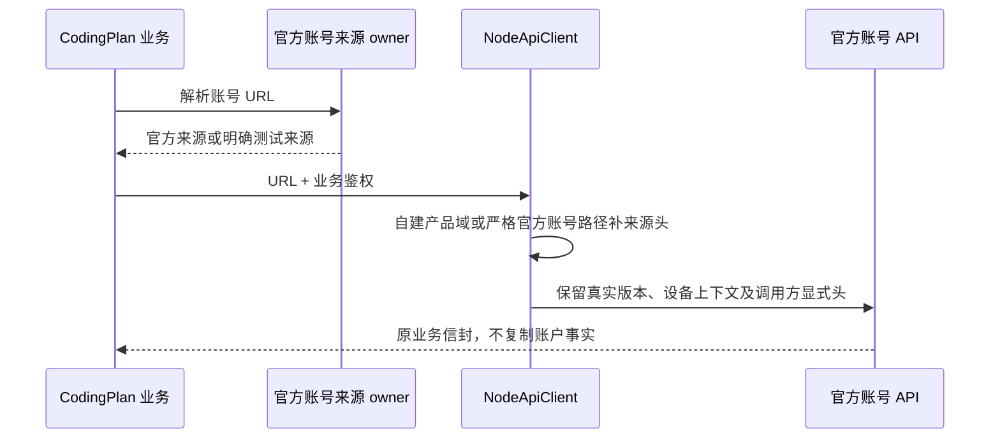

# CodingPlan 官方账号来源与请求上下文

## 产品规则与所有者

官方 CodingPlan OAuth、套餐权益、额度及订阅重置继续遵守官方账号接口合同。自建产品配置、升级、反馈、分享和手机 relay 不属于此例外，继续使用 Mikiko 自建来源。

account endpoint resolver 独占官方账号来源选择；NodeApiClient 独占 HTTP 出口来源头注入。生产自建产品 origin 不得改写账号来源，也不得使账号请求丢失已有设备/平台/版本/语言来源头。app_version 保持实际 Mikiko 发行版本，不伪装上游版本。

## 已确认故障

2026-10-21 对同一官方 balance 只读接口进行 A/B：实际 app_version=1.1.3，仅 Authorization 时 HTTP 400 / code 3001 parameter error；补既有 source headers 后 HTTP 200 / code 0。根因是产品域隔离后，出口只按自建 product origin 注入来源头，漏掉官方账号域；不是版本号不兼容。

当前线上自建 CodingPlan 静态代理尚未部署，专用路径返回 404。Desktop/Host 直接通过官方账号 resolver 请求官方 `/api/v1/client/configs`，只消费既有 CodingPlan 套餐/模型字段。普通自建 `/api/v1/client/configs` 的 owner 和调用不变；桌面强更仍由自建 updater 负责。

订阅服务保留的 `getForceUpdateConfig` RPC 兼容入口也只读取既有自建升级服务 `/api/v1/client/configs`，不从套餐缓存消费官方 forceUpdate。该方法没有当前生产 UI 消费方，但其公开合同必须与实际桌面 gate 一致。

## 接口边界与顺序

官方域只放行 OAuth、CodingPlan、zcode-plan、MCP quota 与账号 client/configs 路径补头；官方普通产品路径及其他第三方域不自动获得设备身份。测试用 loopback、合成凭据和临时数据根；真实账号只读核验不输出令牌、账户资料，不执行 reset/claim 或模型调用。

## 验收

- 自建 product origin 与官方账号 origin 共存时，balance 收到来源头并保留原 URL/query；调用方显式值优先。
- 非账号官方路径和任意第三方请求不注入设备头。
- CodingPlan 配置走官方 `/api/v1/client/configs`，显式测试来源可注入；产品配置不回流官方。
- 现有 OAuth、quota、订阅 reset 定向回归保留，重置只在 loopback/mock 执行。

## 2026-10-21：当前 profile 的测试 scope 精确恢复

重构建后余额链已成功，但当前 BigModel 连接仍指向仓库合成夹具 `productId=p / organizationId=o / projectId=j`。该范围首次写入同一 `.mikiko` profile 的时间为 2026-10-20 23:52:46.939（Host），污染前最后有效记录 21:27:31.535 为 `individual-coding-plan`；更早多条记录一致。只读 ProviderSettings 确认个人套餐 available/entitled、团队范围 not-entitled；真实 customerInfo 只有一个非团队项目。不得把此测试范围当作合法团队身份恢复或推断真实团队。

用户授权精确修复此测试污染。操作前备份当前完整 setting.json 和来源证据到同 profile 的私有 backup；仅当当前选择仍精确匹配合成夹具、原选择有同 profile 历史证据时，通过唯一 SettingService.update 的 expectedAccountSettings CAS 写入个人选择，保留其他域、连接、设置和所有凭据。连接版本仅由原服务单调递增；CAS 不匹配即停止，不覆盖并发用户修改。

提交后复用原设置通知和 ProviderSettings 刷新通道，重新读权益与官方 MCP 初始化。只恢复事实，不清空账号/凭据/插件缓存，不进行 reset/claim 或真实搜图/模型消费；若原运行实例持有旧 MCP 会话，仅重新初始化该连接，不扩展清理范围。
