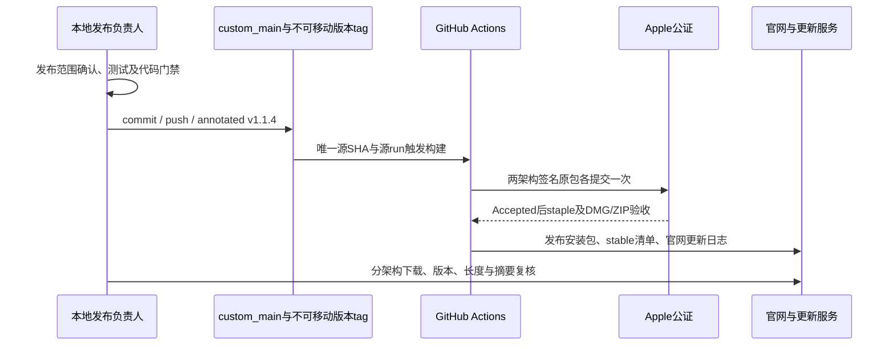

# Mikiko v1.1.4 发布验收

## 发布范围与门禁

用户授权在功能测试无问题后整理提交、推送 `custom_main`、创建并推送 `v1.1.4`，持续跟进打包与 Mac 公证，直到官网可下载、App 可更新。发布前保留本地回滚锚点 `c41c6ba7`。

用户于 2026-10-21 明确确认：v1.1.4 尚未打包，因此将 Computer Use 正式随包集成与真实测试纳入 v1.1.4，不另发 v1.1.5。正式实现复用现有MCP及权限入口，自身两项系统权限已由用户手动授予并原生核验；正式集成及真实验收完成前不得创建发布 tag，不把环境阻塞记为通过。

## 状态所有者及顺序

CI 是安装包/公证原始输入的唯一所有者；本地状态文件 `.cache/mikiko-release/v1.1.4-status.json` 只记录事实，不覆盖 source run 身份。相同版本有活动 run 时不得重复触发。Apple 等待超时后复用原包和 submission，按 `docs/desktop/release-recovery.md` 恢复，不移动 tag、不重新打包或盲目补交。

更新 Worker 继续由现有 `deploy-remote-control.yml` 的唯一 `update-service` job 部署，不另建并行部署者。该 job 部署前必须执行隔离的真实本地 R2 范围回归，部署后用公开 stable 清单引用的实际安装包验证 32 字节 Range；不能依据未变更的 healthz 版本字段判断修复已上线。

## 验收场景

- 实际执行根类型、Lint、架构与单测；对功能回归和环境限制分别记录。测试失败先定位修复，不能以 affected 选择器跳过全量来宣称全仓测试通过。
- 官网 Intel 与 Apple Silicon 下载分别指向 x64 与 arm64；更新包断点续传的 Content-Range、Content-Length 与实际 body 一致。
- Mac 双架构公证均 Accepted，App/DMG staple、ZIP payload 验签成功；proof 的版本、SHA、源 run 与最终文件 hash 一致。
- GitHub Release 公开、非草稿，完整平台安装包存在；官网下载接口与更新日志均为 1.1.4。
- 五平台 stable manifest 均为 1.1.4，下载 URL、大小和摘要匹配最终产物。最终安装包的“检查更新”和只读官方账号功能单独验收，不以旧 Dev 结果替代。
- 工作流完成与实际服务成功分别验证。官网日志发布仅告警、缺少更新发布凭据等情况不能当作整个任务完成。

持续跟进已创建为本对话的 heartbeat。状态无变化保持安静；成功后记录 run、公证 ID、下载地址并暂停跟进。
