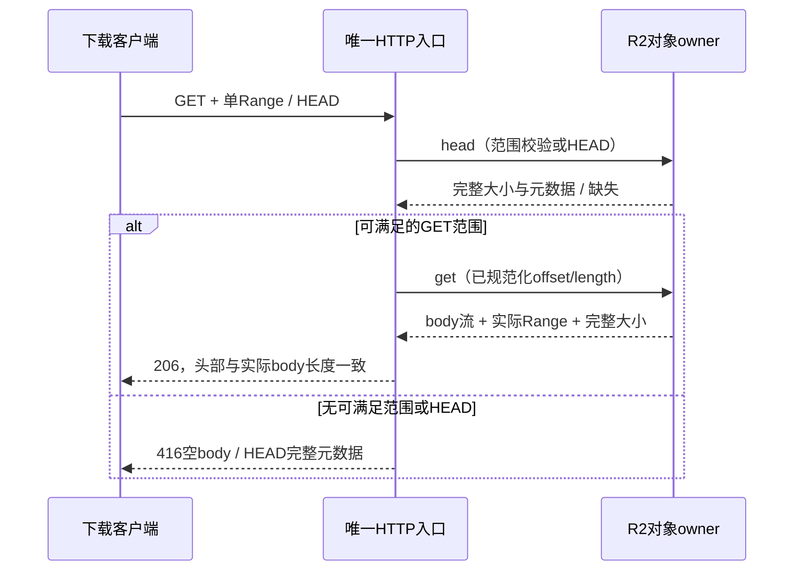

# 自建升级服务（Mikiko Update Service）

> 关联：`specs/update/update-check.md`（客户端接线与屏蔽开关）。
> 版本基线：1.0.0 起（脱离 ZCode 官方 3.x 版本序列，避免升级冲突）。

## 架构（全 Cloudflare）

```
App(electron-updater + manifestUpdateProvider)
  ├─ 清单: GET https://agent-update.mikiko.ai/api/v1/releases/electron/manifest?platform=&channel=&device_mid=
  ├─ 强更: GET https://agent-update.mikiko.ai/api/v1/client/configs
  └─ 下载: https://agent-dl.mikiko.ai/files/{version}/{asset}（Range/206、immutable 缓存）
              ↑ Cloudflare Worker(packages/update-service) ← R2(mikiko-releases) + KV(UPDATE_CONFIG)
发布: GitHub Actions(release-desktop.yml → publish-update-feed job)
        scripts/publish-update-feed.mjs → PUT /admin/*（X-Publish-Token）
        小文件单次 PUT；>90MB 自动 multipart（init/part/complete）
```

## 端点契约

| 端点                                 | 方法                            | 说明                                                                                                                                                                                                                                                                                         |
| ------------------------------------ | ------------------------------- | -------------------------------------------------------------------------------------------------------------------------------------------------------------------------------------------------------------------------------------------------------------------------------------------- | ----------------------------------- |
| `/api/v1/releases/electron/manifest` | GET                             | platform∈{darwin-aarch64,darwin-x86_64,windows-x86_64,linux-x86_64}，channel∈{1:stable,3:preview}；返回 R2 `channels/{channel}/{latest*.yml}`（electron-updater UpdateInfo，URL 已重写为 agent-dl 绝对地址）；无版本 404                                                                     |
| `/api/v1/client/configs`             | GET                             | KV `client-configs`；默认 `{forceUpdate:{enabled:false,minimumVersion:"0.0.0"}}`（KV 异常 fail-open）                                                                                                                                                                                        |
| `/files/{key}`（agent-dl）           | GET/HEAD                        | R2 下载代理，单 Range 206，`immutable` 缓存                                                                                                                                                                                                                                                  |
| `/admin/files/{key}`                 | PUT                             | 发布安装包/blockmap（token 鉴权）                                                                                                                                                                                                                                                            |
| `/admin/channel/{channel}/{file}`    | PUT                             | 发布通道清单                                                                                                                                                                                                                                                                                 |
| `/admin/configs`                     | PUT                             | 覆写强更/灰度配置                                                                                                                                                                                                                                                                            |
| `/admin/prune`                       | POST                            | 旧版本清理（2026-10-09 v1.0.7 撞 R2 10GB 配额后补的长效机制）：body `{"keep":3}`，`files/` 前缀按语义版本降序保留最新 keep 个版本目录（1–10），更旧版本整目录批量删除；返回保留/清理版本与释放字节数。`channels/` 清单是当前指针不占空间，不参与清理；新版本刚上传必然属于保留集，不会被误删 |
| `/admin/multipart/{init              | complete}`+`/{uploadId}/{part}` | POST/PUT                                                                                                                                                                                                                                                                                     | 大文件分片（每片≤80MB，除末片≥5MB） |
| `/healthz`                           | GET                             | `{ok,version}`                                                                                                                                                                                                                                                                               |

## 已知坑（2026-09-24 实测）

1. **wrangler CLI（OAuth）的 `r2 object put`/`kv key put` 不落真实存储**（CLI 与 Worker 绑定两套视图）——一切写入必须经 `/admin/*` 端点或 Workers 绑定。
2. `uploadPart(partNumber, value)` 参数顺序（types 定义），etag 用 `R2UploadedPart.etag`。
3. wrangler.toml 顶层键（routes 等）必须放在 `[[...]]` 表段之前，否则被吞进上个表。
4. workers.dev 域名在国内被污染（error 1042/DNS 污染），必须走自定义域名。
5. Workers 免费版单请求体 ≤100MB → 安装包（144-184MB）必须 multipart。

## 客户端接线

- `packages/shared/src/zcodeEndpoint.ts`：`MIKIKO_UPDATE_ENDPOINT_ORIGIN`/`MIKIKO_UPDATE_DOWNLOAD_ORIGIN`。
- manifest provider 默认 endpointOrigin → 自建；forceUpdateGuard 同（与账号后端 zcode.z.ai 解耦）。
- electron-builder generic publish 占位 → `https://agent-dl.mikiko.ai/feed`。
- `ZCODE_UPDATES_ENABLED = true`（已恢复）；生产 flavor 生效。

## CI secrets（需手动配置）

| Secret                 | 用途                                                                                        |
| ---------------------- | ------------------------------------------------------------------------------------------- |
| `UPDATE_PUBLISH_TOKEN` | 发布 feed（值见 `~/.mikiko/update-publish-token.txt`，与 Worker secret PUBLISH_TOKEN 相同） |
| `CLOUDFLARE_API_TOKEN` | Pages 手机页 + update Worker 部署（需 Workers Scripts Write + Pages Write）                 |
| `RELAY_DEPLOY_KEY`     | VPS 中继 SSH 私钥（`~/.ssh/id_ed25519_termius`）                                            |

未配置时对应 job 以 exit 78 跳过并提示，互不阻塞。

## 发布流程

1. 打 tag `v1.x.y` → release-desktop.yml 构建 4 平台 + Release 发布 + publish-update-feed job 上传 R2。
2. 上传完成后 publish-update-feed.mjs 自动调用 `/admin/prune` 清理旧版本：默认保留最近 3 版（`--keep-versions N` 可调）；prune 失败（如 Worker 未更新到含该端点的版本）只告警不阻塞发布。
3. 强更/灰度：`curl -X PUT .../admin/configs -H "X-Publish-Token: ..." -d '{...}'`。
4. 回滚：重发旧版 manifest（yml）即可——因此保留 ≥2 个历史版本的安装包文件。

## Source Server 自建资源缓存（2026-10-20 集成）

新版Desktop descriptor与CLI catalog从同一已校验四平台SourceServer集合发布。`mikiko/server/catalog.json`及版本目录的`source-server-release.json`是可更新索引，下载Worker必须返回`no-cache, must-revalidate`；不能沿用安装包一年的immutable缓存。SHA寻址的归档/组件继续长缓存。上传者只在对象上传并验证后发布两个索引；失败不得发布指向缺失对象的目录。

## 下载 Range 一致性（2026-10-21 发布前修复）

R2 的 `object.size` 是完整对象大小，不能作为本次分片长度；返回的 Range 元数据没有 `total` 字段。下载仍由本 Worker 单一 HTTP 入口拥有，不增加缓存副本或客户端兜底。响应直接流式转发 R2 body，不把安装包读入 Worker 内存。

- GET 的单字节区间支持闭区间 `bytes=start-end`、开放末端 `bytes=start-`、suffix `bytes=-length`。超出对象末端的 end 截断到末尾，suffix 大于对象时返回整个对象的 206。
- 206 的 `Content-Range` 必须是本次实际 offset/end 与完整对象大小，`Content-Length` 必须等于实际返回字节数。32 字节分片不可标成完整安装包大小；保留 ETag、Content-Type、Accept-Ranges 及原有 immutable/可变索引缓存策略。
- 单区间语法合法但无法满足（start 超出对象、end 小于 start、suffix 为 0、空对象上的任何 Range）返回 416、`Content-Range: bytes */<完整大小>`、空 body 与 `Cache-Control: no-store`，不向 R2 传入负长度或越界 offset，也不把错误响应当作不可变安装包缓存。
- 原先不支持的多 Range、未知单位、无效语法或不能安全表示的数字继续忽略 Range，返回完整 200；不新增 multipart/byteranges。
- HEAD 忽略 Range，返回完整对象的 200 元数据和空 body；通过 R2 head 读取元数据，不打开下载流。缺失对象继续 404，路径校验与方法限制不变。



验收使用 Wrangler 本地真实 Worker 与隔离 R2 绑定，经已有 admin 上传入口写测试对象。必须覆盖闭区间、开放、suffix、尾部截断、416、HEAD、缺失对象，以及完整 200、缓存与方法限制。测试不得连接正式 R2/KV 或部署。该修复只有部署到服务 `agent-dl` 的 update Worker 后才会改变 App 更新下载行为；发布新安装包或更新 manifest 本身不能修复已在线的 Range 响应。

### 部署后的 Range 探针

`manifest.path` 是相对于当前版本 `files/<version>/` 的安装包名，不是下载域根路径。部署探针必须使用该版本前缀解析相对path，或使用files中的绝对URL；不能把错误根路径的404认定为Range能力失败。实际公网验收要求206、32字节body/Content-Length和对应Content-Range。
